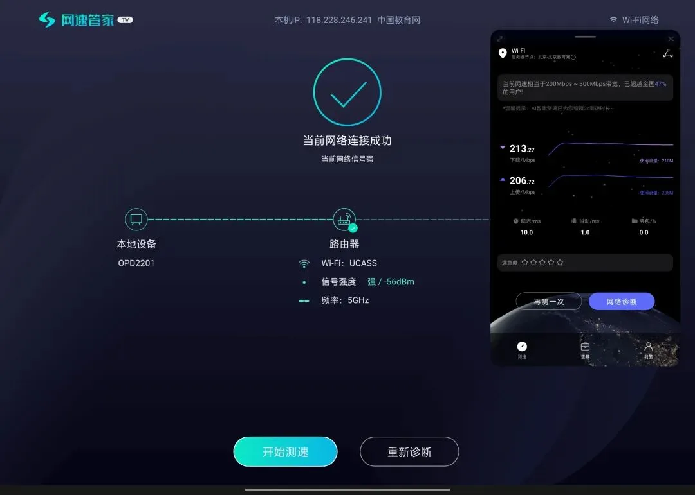

请相关部门及时关注并跟进问题。

## 1 奖补问题

## “想问问专硕新生奖学金真的被取消了吗？”

## “想问问专硕奖学金是真的取消了吗？”

“请问新生奖学金到底发给谁了呀？法硕没收到 学校能不能给一个评奖文件 招生简章上明明白白写了有“梁慧星新生奖学金” 现在又说不知道不确定…无语死了”

“我想请问一下这个学期本科生有收到每个月的补贴吗?，怎么感觉好久都没发过的样子啊”

（见《

【读者投稿】食堂宿舍校园网，部门总是有的忙

》1.1）

## 2 校园网

> “投稿：今天评价望京网络中心那条狠狠点了！望京的宿舍、食堂部门解决问题又快又好，唯独这个网络中心是真稳啊……有问题是真不解决啊！现在已经彻底wifi关了，每月还要为流量多花一笔钱，难以想象这是大学校园！”

## “望京校区网络真的很烂，管理人员尸位素餐，不作为吗?”

“那个说校园网卡的同学，我在我宿舍还有一二号楼中间用我新买的魅族测速都差不多二百多，而且刷视频都还好没怎么缓冲过，不知道您是因为什么会那么卡?”

## 3 食堂

“我要回复那个一餐厅八号清单窗口的那个评论，你不吃清淡不代表别人不吃，而且清单窗口的菜每天几乎都可以卖完，自私的人永远只想到自己。”

（见《

【读者投稿】食堂宿舍校园网，部门总是有的忙

》2.3）

## 4 宿舍

“12号晚上查了13号的天气特意早起把衣服晾在三号楼保安亭靠路的第一排，中午在图书馆没回，晚饭后去收，发现原位置空了，找了发现衣服整体被挪到里面的第二排，整体挤在一起还是湿的，以前也遇到过把衣服推到一边的，这次更过分。

所以请学校增加晾晒衣物的地方，二三号楼阴面晾衣杆利用率不高，而向阳面一直很紧张，阴面晾衣杆利用率不高还不如挪到阳面。”

## 5 后勤处

## “噗，笑死了，解决点问题就搁这感恩了………这不是理所应当？

后勤处表现是不错，值得表扬，但大可不必到“感恩”的份上。当然了，愿意感恩的同学大可以感恩，不感恩也不是刻薄。

就我私心来说，更希望积极亦或随心；知感恩而不滥感恩，更不用感恩作为道德律令要求他人；内心柔软或坚毅的人做我的校友。（其实我校友爱咋滴咋滴）

ps：社科大的基础设施本身就差的要命，问题一大堆，目前食堂饭点没多少饭问题还是没解决。

课程拼的像开烧烤店的，能有一个正常大学的样子，我就感恩了～”

“投稿，回应昨天第七条。读完这位校友以及他想要回应的文章，好像看不出对他所批评内容的有效反驳。首先某些校友请不要对“服务者”抱有偏见。服务者和被服务者的正常关系应该是平等地提供服务和享有服务的，还希望这位校友可以好好接受一下人文教育的熏陶。

再者人家似乎只是想说既需要掌声也不能全是掌声，没有去对其他人的感谢评评头论足的，真正想去评头论足别人的貌似是你……至于所谓对“不配合”的理解，就更让人摸不着头脑了。原文貌似是赞同沟通投诉、进行监督的这种“不配合”的吧。

讲真，非常好奇认为一所大学做了一点正常行政工作就需要大书特书的人真的是校友吗？于我一点私心而言，我更愿意能听得见不同声音的、有人文关怀的、真正是校友而非害怕校友进行监督只希望被表扬的人来当我的校友。”

（见《

【读者投稿】食堂宿舍校园网，部门总是有的忙

》7.1）
