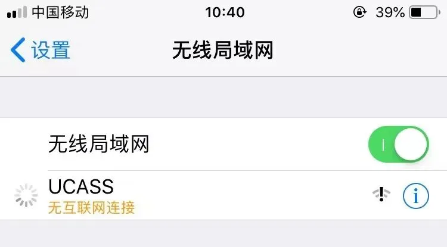
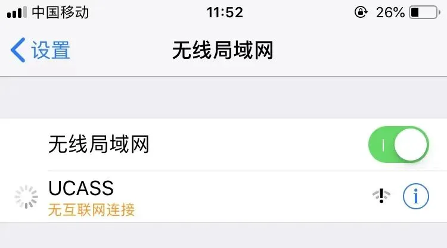
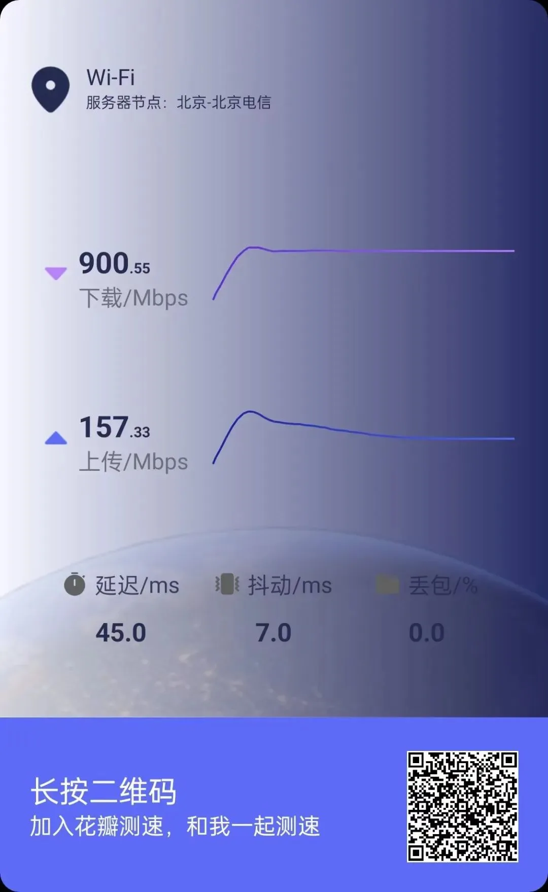

请相关部门及时关注并跟进问题。

## 1 接诉即办平台

> “学校这两天接诉即办上的回复越来越敷衍了，给食堂提的建议，回复说是要考虑到所有人的诉求了，如果考虑到所有人的诉求的是会出现的这种状况，去一趟都觉得没有什么值得吃的，做一个同学们想喜欢吃什么的调研又不是很难，这就是根本不负责任的态度，人家别的高校都开始搞各种美食节了，不要求你们完全看齐吧，提意见也不能这么敷衍”

## 2 校园网

> “那个新买的魅族网速不卡的同学，你也说是新买的了，新设备当然不怎么卡啊，你新买个诺基亚也不卡啊。关键是每个同学都要每个月换一个新设备才能配得上咱们望京高贵的网速吗？最近网速争议很大，建议个案就不要投稿了，真的很没有代表性。能不能搞个问卷调查一下望京网速的群众满意度啊？可以统计一下同学们觉得网速慢的时间段以及打不开的软件，也好后期方便网络中心进行改进。同时网络中心的工作人员如果觉得自己网速不需要改进，请出示一下各个时段自己的测速数据，并说明测速设备及方法，相信如果有了确切的数据，同学们也不会冤枉好人的。”

> “望京校园网的问题，其实不是网速快慢的事情。大家作为用户，需要的就是用户体验，而不仅仅是网速快。望京校园网从速度来讲可能确实符合正常水平，但是用户体验完全不及格。不仅经常断连卡死，甚至有些网页需要刷新多遍才能显示，经常微信消息刷不出来。这不是网速快慢的问题，而是每月25元钱，确根本无法提供正常的网络服务的问题。这些事情其实网络中心作为专业部门，应该很清楚才对，而不是将话题引入到比拼网速快慢上来。”

## “社论君你好，我于望京校区含泪投稿，反馈内容如图，谢谢！”

## “今天突然发现网络改变好大呀

（见《

【读者投稿】校园问题仍待解决

》第2条）

## 3 奖学金

> “你好，我想请问一下政管院的研究生奖学金多久开始评选啊？现在都十一月中旬了，是不是要拖到十一月底才开始评选？想问问友友们往年一般是多久开始评选的以及钱一般是多久能打到卡上？感觉按今年这个节奏一套流程跑完，是不是明年开春才可能钱到手？小生近来财政状况实为窘迫，不胜感激！”

## 4 食堂

“之前在一食堂吃早餐，喝到了羊杂汤，觉得味道很不错～冬天的早晨能喝到羊杂汤也是一种幸福，希望羊杂汤能常驻一食堂早餐。”

## “你好，曝光一下一食堂的餐具卫生问题”

5

图书馆

“望京图书馆最近几天不同时段每天跟地震了似的，窗户桌子地板一直在抖动，能不能有点素质考虑下学生。连续几天又发生了这种事情呵呵”

## 6 摆渡车

> “投稿: 晚上10点半坐摆渡车到地铁站，到了以后已经10:36，地铁工作人员说10:35末班车就走了。……刚好没有赶上 学校的地铁摆渡车这一趟可以不要完全按照整点发车吗，10:20或者10:21，10:22等，只要再早一分钟，学生都能赶上末班车求求了，虽然我不天天坐末班车，但是到了地铁站后发现没车了真的很难受。”
