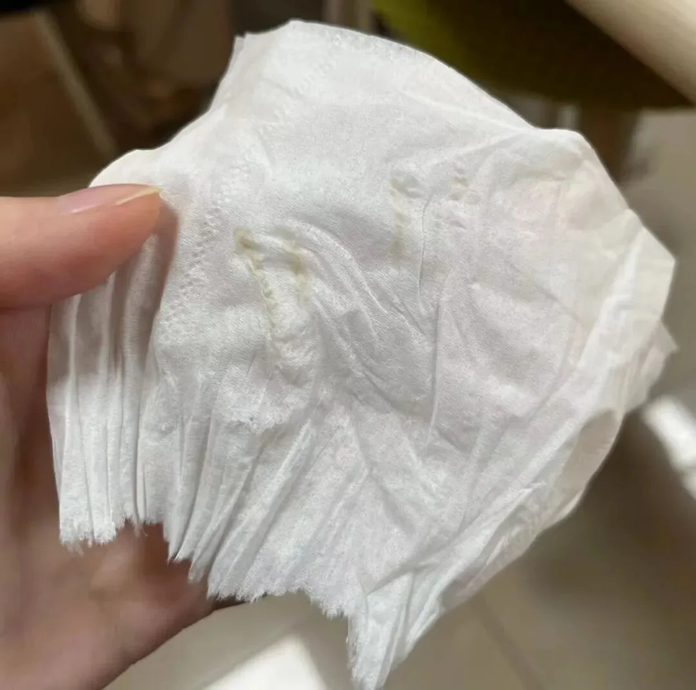

请相关部门及时关注并跟进问题。

## 1 答辩

> “请问社科大是否存在人文之光？政府管理学院是否枉顾学生生死，只考虑某位行政人员老师利益？ 我是政府管理学院MPA的一名学生，今年非全政府管理学院MPA二次开题答辩没有通过延期就有13个，全日制都不知道有多少。我想询问一下其他校友望京校区其他情况专硕二次答辩的具体通过情况，是不是只有政府管理学院只能依靠卡开题答辩的打压 ，让学生延期毕业才能提高论文质量，达成让相关工作人员达成绩效kpi的情况？平时没有采取任何措施提高论文质量，最后依靠这种粗暴的卡学生的方式减轻相应工作人员负担，增加学生负担，让学生承受不应该承受的重量，学生的时间，金钱，工作机会难道不比某一老师kpi重要？导师都认可我，依靠开题答辩老师30分钟就能否定我为之所付出的一切努力？学校的人文关怀去哪了？最后再次提问，是不是一切都是为了学院某位老师行政人员的kpi? 时间：11月14、15号附近 地点：望京校区 事件：开题答辩大批卡学生延毕包括非全和全日制， 为了学院某位老师行政人员的kpi目标。”

## 2 食堂

## “坐标一食堂二楼，筷子上有水只是想简单的擦干一下，看了一眼纸发现………”

“看到有同学反应一食堂勺子，真的，我老早就想说了，不要求你码的很整齐，但求稍微码一下，那么乱我都怀疑是不是倒进水里随便一捞风干就相当于洗完了。 同学们拿的时候还得找勺柄，而拿的同时就会碰触到相近范围的勺头，一点都不卫生。 想问问教工食堂的勺子是不是也这么整的。

就这还好意思夸上天，连基本的工作都没做好。”

（见《[【读者投稿】仍然是校园网问题](https://mp.weixin.qq.com/s?__biz=Mzg2MjcwNzQ1Mw==&mid=2247486798&idx=1&sn=3da47e2184de0a79d0d82ef56a1c8a9b&scene=21#wechat_redirect)》4.2）

## 3 社论与鸹貔墙等

> “这个人文之光社论和墙，这两个问题平台不应该存在。有问题可以去接诉即办平台找相关部门反映。那里面能够把各个部门的工作量化，而且是内部的。这两个平台在某种程度上来说是公开的，在某种程度上，很多过激的不真实的言论没法管控。现在接诉即办平台上线来，后勤处是事情最多的，也是最忙的，也是最被吐槽的。真的很让人心寒。反而是那些不露面不作为的部门，没有任何事情。假期里面这些平台没有发消息，学校风平浪静的。现在每天都有各种鸡毛蒜皮的问题，很容易让人把问题无限放大。而且旧问题解决之后，还会有数不尽的新问题，即使清华北大等学校，或者自己家，小区等等，都有数不尽的问题。这样容易让人形成惯性思维，就是看到什么都想挑问题。也只有在学校才会这样毫无保留的宠着学生。而且在学校除了学习，其他的都是小事情。不应该被无限放大。”

## 4 校园安全

> “安全提示 最近学校门口，天街，大学城等地经常遇到一些阿姨，奶奶，她们会用帮忙，问问题等方法逮着你一顿唠，然后最后话题都指向你或者你同学应该去兼职或者干活，本人被逮到三四次，其中一次还是在东门门口，并不清楚这些有组织的女性是要干啥，但感觉很怪，大家小心”

## 5 宿舍噪音

> “一号楼二楼东侧，是在口哪位领导的口口吗？能不能考虑一下这是学生宿舍，你在这又是钻又是锯的，声音大到把人耳朵都震聋了，大中午一点半开始搞，有没有公德心啊，学校是在做什么，专门给学生添堵吗？能不能用你们睿智的大脑思考一下，把木材割开的程序可以去楼外面搞吗？啥玩意都跟个二百五似的，这就是社科大的作风吗？”

(注:本稿中有些言辞过激，故以“口”代替，请读者朋友们自行脑补当事人的愤怒)

## 6 摆渡车

> “第6条，理解同学的心情，但若换个角度想，原定10:20发车的班车可以等到10:21或10:22，那么10:23或10:24到站的同学如何是好？如已有明确发布的时刻表，则最好的策略就是照办。当然，建议师傅临开车前下车看一看有没有学生飞奔来赶车，这个场景下车子应该多等一会。”

（见《[【读者投稿】仍然是校园网问题](https://mp.weixin.qq.com/s?__biz=Mzg2MjcwNzQ1Mw==&mid=2247486798&idx=1&sn=3da47e2184de0a79d0d82ef56a1c8a9b&scene=21#wechat_redirect)》第6条）

## 7 望京小卖铺

> “望京校区这个校园超市是什么黑势力吗？买了两块七毛钱的辣条追出来问我有没有付款，看我的付款记录，我的天哪，谁会偷你两块钱的东西？这么不尊重人？趁早倒闭，阿姨态度也特别不好，跟那个尖叫鸡一样冲我嗷嗷喊，至于吗？”
