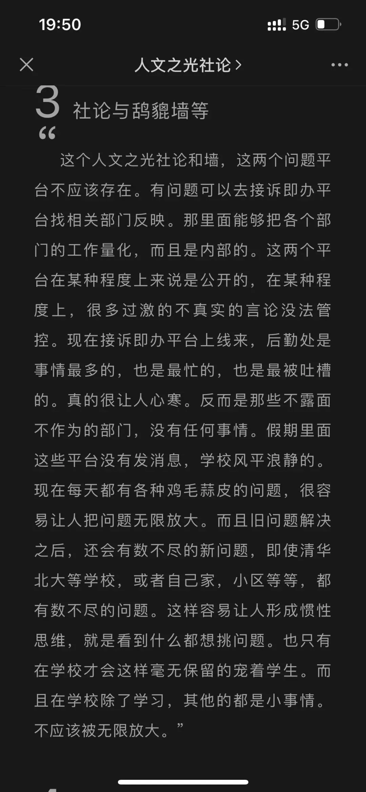
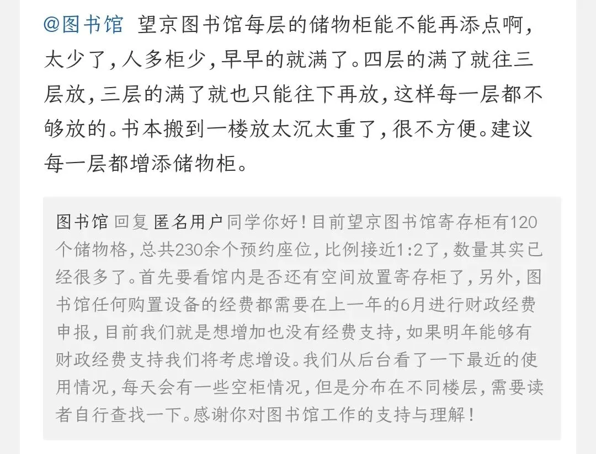

请相关部门及时关注并跟进问题。

## 1 奖助学金优化方案

“趁学校还没有公布今年的学业奖学金评定公告，请求学校考虑优化我校研究生奖助体系： 从全国高校的普遍情况看，基本的研究生奖助体系包括奖学金、助学金和“三助”津贴。学校在积极建设“双一流”，那我们的奖助体系不妨与在京双一流高校做个简单的对比： （1）奖学金 以博士生学业奖学金为例。我校现行奖助体系下，博士学业奖学金分别是15000、12000、8000。基本可以这么讲，我校现行学业奖学金标准是在京高校里最低的。也许有人会反驳称，某985高校的奖学金只有几千块钱。但是，该校的助学金却是3W+。 （2）助学金 我校现行助学金标准是博士生15000/年，即国家规定的最低标准。实际上，在很多高校，除了国家助学金之外，学校会另外提供一部分学校助学金，共同构成学校的助学金体系。目前，北京市的最低生活保障标准为每人每月1395元

(见：

https://www.beijing.gov.cn/fuwu/bmfw/sy/jrts/202306/t20230614\_3133223.html），按这个标准计算，每年最低生活保障标准为16740元。

（3）“三助”津贴 我校确实有“三助”管理规定相关文件，但实际上对标准并没有具体说明，尤其是助研津贴这一部分。在我校的硕博生群体中，有很多同学承担了很多科研任务，但却并没有拿到哪怕一分钱的助研津贴。反观其他高校，都出台了具体的助研津贴明文规定，如每人每月最低标准。在这一点上，绝大部分高校对导师都是有硬性约束的。 我校的奖助体系确实到了该改一改的时候了。我们要建双一流，应该是全方位的双一流，研究生的培养是我校的重点工作之一，建立完备的奖助体系本应是最基础的环节之一。我想，学校早日进入双一流行列，是每一位社科大学子内心的期盼。”

## 2 望京超市

> “投稿：望京超市阿姨态度已经可以了，只是每次碰巧阿姨忘记要核实付款，才会显得有点着急。不要要求这么高，你随便在超市群里截个图看看阿姨怎么回复大家诉求的，以及日常阿姨态度如何，不要吹毛求疵，这种小事你跟朋友吐槽一下下或者你直接跟阿姨说“你别急，我会正常付款”也比来这说这些强。一点小事还是别上纲上线了吧。”

> “望京的超市我也想说。 1.管理不当：不止一次看到超市打开后门，在超市只有1-2位员工的情况下边卖给学生东西开个门往外卖； 2.挂羊头卖狗肉：大概是11月初还是10月底，望京超市进去后就会看到其他品牌的商标产品和胸针，试问在社科大的地牌还看不上社科大的文创了？ 3.价格不合理：望京超市的价格平均要比外面正常价格贵1-3块； 4.选品差：依据上述内容，在价格本来就贵的基础上，选品能力也差，长时间都是那几样东西，并且很多商品零食我不知道超市店员有没有吃过，难吃的辣条 落灰的山姆零食拆了包装高价卖 无良商家的过度包装，超市有没有为同学们做一道防线？ 5.服务差：除了之前同学说的追出来要钱，之前还有隔了2-3天回去依然走到你身边跟你说，那天你在什么时候买了什么东西多少钱没有付，没有付钱我想并不是同学们故意的，但是没必要像监控一样盯着吧 6.产品保质期：山姆的零食请问拆封了超市怎么看保质期？冰箱里放了好几个月的抹茶蛋糕快过期了都不敢买 望京超市真的应该好好改善一下”

（见《[【读者投稿】答辩结果有疑问，公共平台惹争议](https://mp.weixin.qq.com/s?__biz=Mzg2MjcwNzQ1Mw==&mid=2247486803&idx=1&sn=a002a401269eaff829b4992157ed33cb&scene=21#wechat_redirect)》第7条)

## 3 宿舍

> “社论君你好，这学期良乡校区7号楼5层总有人晚上烧艾草，整个五楼都是燃烧植物的味道，搞得同学们睡不好觉，再者，在宿舍里搞这么大火，是真的不怕消防事故发生吗？希望这位同学不用再在楼里烧了。我这学期已经向宿舍反映三次了，那个人也不只烧了三次了，真的难以再忍受下去了。”

## 4 社论与鸹貔等

“对于在社论上抨击社论和校园墙的言论提出理智的疑问： 1、如果没有人文之光社论，这位朋友的言论是如何发在人文之光社论上为人所知？ 2、校园墙的功能只有反映问题这一个职能吗？恐怕这位“明智的同学”大抵是没见过校园墙的。所以，请问是否真正见过呢？ 3、校园问题是这些平台发消息造成的话中之意怕是不妥。难道没有这些平台，校园便没有鸡毛蒜皮的小事吗？请问所说的清华大学是否有这些“鸡毛蒜皮的小事”？ 4、这位同学在开头句便说：“人文之光社论和墙，这两个平台不应该存在。有问题可以去接诉即办平台找相关部门反映。“可在后文又讲:” 现在接诉即办平台上线来，后勤处是事情最多的，也是最忙的，也是最被吐槽的。真的很让人心寒。“这是否是存在内在的不合逻辑和显而易见的混乱矛盾？为何有了问题要去找有了问题就找而让人心寒的部门呢？心寒是否要更心寒？ 5、假期里风平浪静、没有鸡毛蒜皮的原因真的是平台无发文吗？这似乎是站不住脚的吧。假期校内人数较少，自然事务较少。这便如小岛国与14亿人口的大国，哪方的“鸡毛蒜皮的小事”更多？ 6、既言墙不该存在，又何故推出清华大学来作为挡箭牌呢?清华难道没有校园墙吗？ 7、我们都知道“做人为先”、“先为人，后为学”，彼社论又言“在学校除了学习，其他的都是 小事情“，这似乎并不符合我们的道德和教育准则，又何故发此言论？ （所有除名言，其余引用皆来自11.16日社论原文）

客观中立发文，万望勿喷，希望我们都能学点逻辑与思维，保持理性”

> “那个说不需要社论和鸹貔的是学生吗？ 有问题不发出来就叫风平浪静？这种投稿怕不是口口有病。 接诉平台有平台的功用，社论和鸹貔也各有功用，这种试图堵住别人嘴，并认为没人说话就是风平浪静的不是口口就是口口。 如果这位同学觉得社科大学习环境还不错，那我告诉你，就连现在图书馆的开闭馆时间也是同学们battle得到的成果。而不是风平浪静得到的。自习室也是大家争取才保住的。接诉平台根本起不到这些功用 这位同学大可以取关社论，删掉鸹貔，想把反应问题的平台关停，真是有做一方土皇帝的官僚秉性。a呸！”

(注:本稿中有些言辞过激，故以“口”代替，请读者朋友们自行脑补当事人的愤怒)

## “投稿，针对这一篇社论的一点个人意见

自我阉割了的可怜人，即便面对着不完全的自由，仍要祛懦卑猥地从“除了学习，都是小事”这面发臭的裹尸布里伸出一张嘴来，喋喋着冬烘遗老都要掩鼻洗耳的破烂话。不合理的言论被公开不是言论要被禁止公开的理由。”

> “很好奇为什么前几天刚有人讨论了一下后勤处的事情、接诉即办平台的事情，有些人脸上就挂不住了，开始以一种居高临下的态度对着社论和鸹貔大加鞭笞。我只想说，如果您真的是既不来自社科大，也从不属于社科大，更对社科大毫无归属感、罔社科大现状与未来而无动于衷的那某些人，还是建议您趁早从哪里来的就滚回哪里去呢，不要再祸害这个全力建设都不一定能赶上它应得未来的小院了。您这样不负责任的行为，对得起任何一个想要办好社科大的朋友的心吗？”

（见《[【读者投稿】答辩结果有疑问，公共平台惹争议](https://mp.weixin.qq.com/s?__biz=Mzg2MjcwNzQ1Mw==&mid=2247486803&idx=1&sn=a002a401269eaff829b4992157ed33cb&scene=21#wechat_redirect)》第3条)

## 5 校园网

> “投稿：望京校区校园网，学校整这个测速的用途何在？测一下速表示自己网速行？网速行不行看打开网页速度啊，2023年11月17日早10点电脑打开一个政府网站至少需要30秒以上才能打开。不知道这么一个被学生诟病的网络中心，到底能不能安下心来坐在办公室尽好自己这份职责。望京校区网络中心，请拿出真真切切的解决措施来解决学生的网络问题，并不是所有同学有着最先进的设备，并不是所有的同学有着足够的金钱去开额外的流量，网络中心请不要再搞这种测速的小心思来告诉同学你们工作职责下的网络没有问题。不妨如之前同学建议那样，做一个同问卷调查，肯定有着足够的样本容量来反映你们的网络有问题，学生去年封校也没反映网络问题这么激烈，今年为什么反馈了呢，是因为真的网速烂到没底了。”

## 6 食堂

> “这是我第一次投稿。 因为真的忍不了啊！ 学校一食堂的饭做不好吃也就算了。现在是让人吃冷饭了。连温度都保持不了。之前也就罢了，现在大冷的天，你这样让我怎么办啊？难道我只能去二食堂吃面粉了吗？真的是难受死个人。每次来这吃一肚子冷饭”

## 7 图书馆

> “望京校区图书馆，地方不大，一直被同学们吐槽的问题都不少，而能不能重视、理解并帮助解决学生诉求是图书馆管理水平的重要体现。 关于座位预约机制，众所周知，使用预约系统的人确实很少，一是有空位可以坐，二是预约系统有问题，不合理。没有人会呆在图书馆一整天不出去，出门刷卡但不选择暂离会自动释放座位，选择暂离也只有一小时时间（图书馆工作人员说的），因此对于有需要外出比如外出上厕所（因为图书馆厕所又臭又排队）、吃饭、处理其他事项出去的同学十分不方便，因为要不停的暂离，否则每一次回来都要重新预约。这到底是便捷还是枷锁？到底是方便同学学习还是浪费时间在无用的地方？ 对于该问题，图书馆方意思是我们系统就是这样规定的，没办法。 我相信对于预约系统不合理不是没有同学反馈过，但是图书馆方估计只是笑笑，当做过眼云烟。因为他们很自信系统是有用的，好用的。他们会说找找你自己的原因（李佳琦口吻），你每次出去点暂离不就行了。是的，晚饭中饭出去回来就是四次，所以至少在系统上操作四次，试问图书馆老师您真的觉得方便吗？学习一下北京其他高校先进的预约机制和系统，以及提高管理水平很难吗？ 学生有诉求，应该重视且马上及时地研究解决办法，不是上来就说 我们系统就是这样的。（下面附图一张图书馆关于其他问题在接诉即办的回复，同样的态度：我们已经做的很好了，没有办法改，不是很想改，会争取但不是现在。既然这样的话6月份后的工资也别发了，没经费哦😜）”

