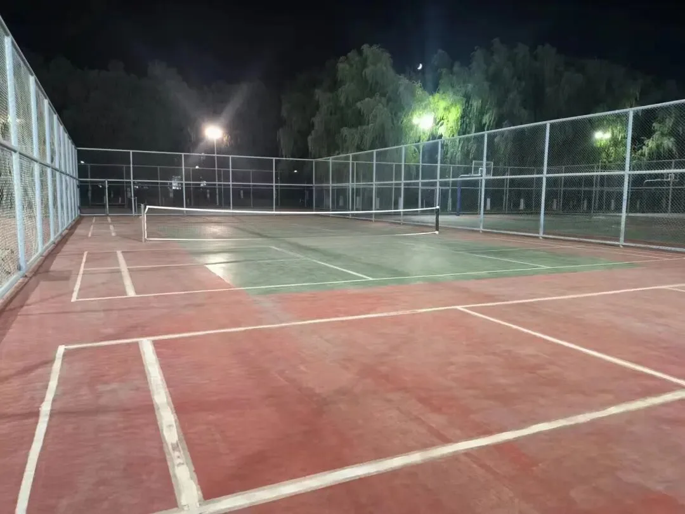
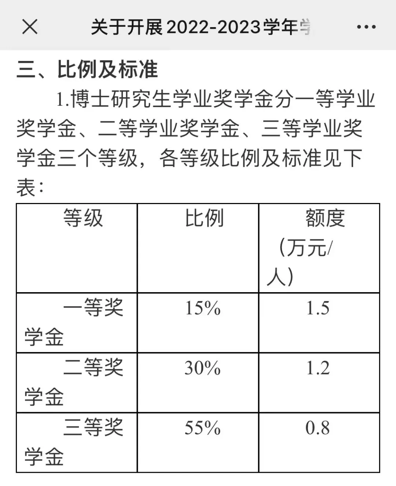
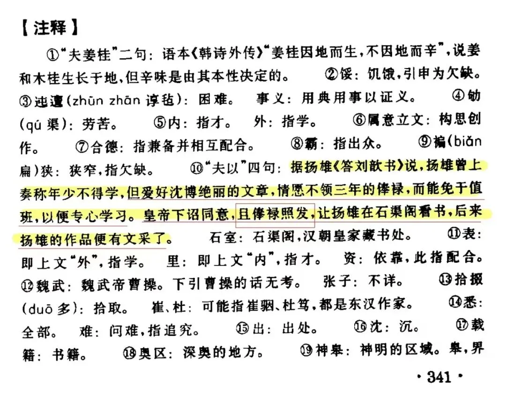
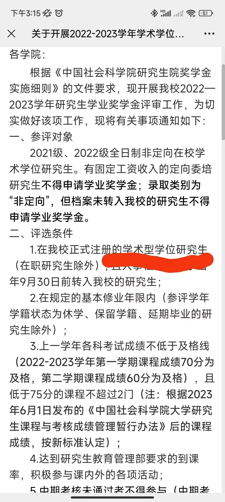
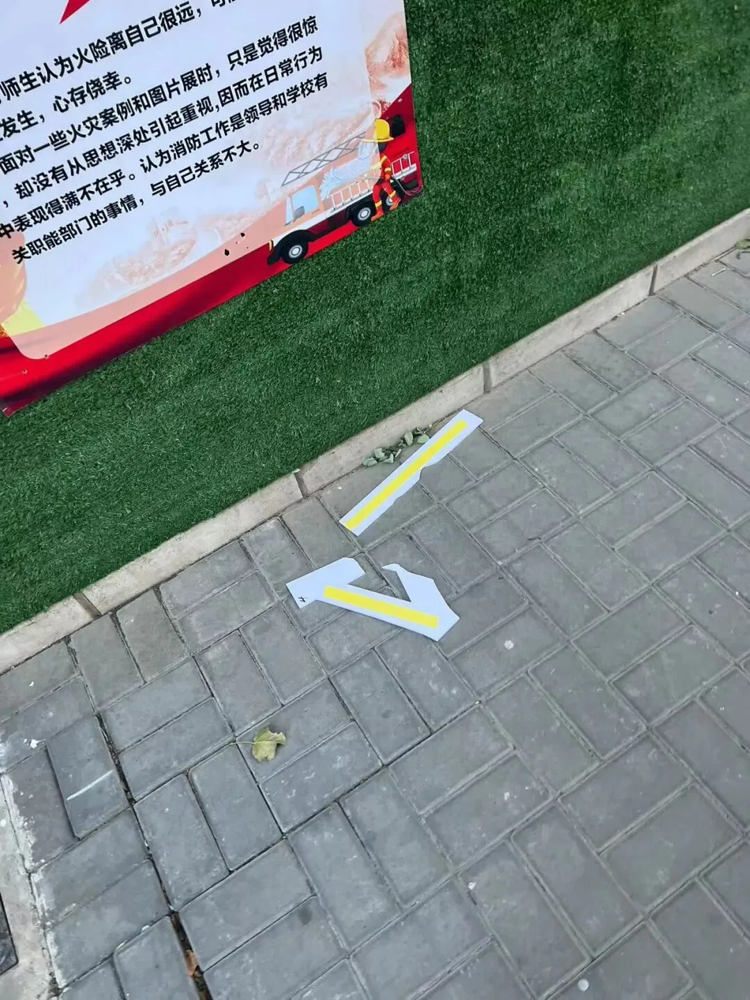

请相关部门及时关注并跟进问题。

## 1 运动场地

## “无法用语言描述学校的某些管理层。一言以蔽之，就是口，口的属性要用棍子来交流。

一个室外羽毛球场，风雨中立了十多年，从研究生院时代就立在这里。网子破了没人管，发个人文之光想更新一下瞬间被拿走改成网球场。这个室外羽毛球场对你们有任何威胁吗？会影响你们任何利益吗？或者就是纯粹为了恶心人是吧？所以，称呼某些管理层领导为口，我认为是非常贴切的。”

(注:本稿中有些言辞过激，故以“口”代替。请读者朋友们自行脑补当事人的愤怒)

## 2 奖助学金

“投稿，22级的专硕新生奖学金去哪了？现在一分钱都没见到，几万块的学费收的倒是很积极”

## “不全覆盖学费 ，只能说学校一堆领导脑子是口”

(注:本稿中有些言辞过激，故以“口”代替。请读者朋友们自行脑补当事人的愤怒)

> “补助问题： 扬雄曾经请求停俸三年，好让自己安心读书。汉武帝听罢，不但没有停发俸禄，而且鼓励他专心看书，此后扬雄的文章就变得更有文采了。遍观世界各国，愿意给教育投资的国家、学校一定能做大做强。 与其他高校不同的是，绝大部分社科学子在“享受”北京的高物价同时，需要返所上课，承担高昂的交通费。一周返所上几次课，就会形成一笔巨大的开销。 我们可以缩衣节食，可以省吃俭用，但没有积蓄、年近逾立的我们不想在1250元之外花父母太多的钱。 我们背后依托的是中国社会科学院，呼吁与北大、清华待遇持平的要求并不过分。哪怕先涨50元、100元，一点点微弱的进步也会让学生们深切感到学校为我们的付出。如果学校愿意为我们争取，我们也会为学校摇旗呐喊。求求学校付出一点实际行动，让我们看到学校也在为学生的补助作出努力，相信学生也会在各大平台积极响应。社科大的诸君，团结起来！”

> “学校对于专硕的奖学金事项到底有研究过吗，首先新生奖学金即便达不到全覆盖，对成绩靠前的优秀同学进行激励也应该在考虑范围内吧，目前学校完全没有相关文件在处理这个问题，到底有还是没有，有的话是哪部分同学能有完全不清楚。其次是最近发的学业奖学金评选，资格限定仿佛也是学硕才有资格评定，专硕同学连学业奖学金也没有办法争取了吗？（如果是本人理解错误也欢迎指正）如今学校内专硕占比越来越大，希望学校能妥善考虑相关事宜。”

## 3 失物招领

“建议咱学校找一个专门的部门负责整理失物招领信息，比如北理工之前是安排了志愿者负责整理的。丢了很喜欢的东西找不到真的很无助”

## 4 图书馆

## “图书馆文明公约（良乡校区）

平等的讨厌每一个在图书馆座位上吃东西的人，轻轻的撕开包装假装自己很文明不打扰到别人，假装控制声音但是发出来的咀嚼食物或是吧唧嘴的声音，都做到这一步了还装什么素质！！！希望都能自觉一点，如果真的尊重别人，就去走廊的沙发上吃。坐标3楼的图书馆阅览室，像是普遍现象，总是有人在吃东西，有吃水果的，有吃零食的。请遵守图书馆文明公约，不要在阅览室吃东西！”

> “望京图书馆能不能给系统加一个挂机或者锁屏功能啊，出去吃个饭都要担心电脑被别人动。今天图书馆机房，中午出去吃了个饭回来就发现电脑被人动了（没关机，而且微信wps啥的都最小化了），动的人不仅退了我的微信登了他的，还用了浏览器，我回来就发现微信wps都被退出了。望京校区怎么会有这种人啊！”

## 5 消防宣传栏

> “这个消防的宣传栏，做的也太差了，刚安装好就掉了，学校的钱这么好骗吗？还是哪个老师的特殊关系，这么多行政老师，难道就没看见，拜托你们对得起自己工资，不要 混日子，也请学校领导重视。”

## 6 望京超市

“望京超市我也想说，你要是那个自助机不好用，你干脆就撤掉自助机，直接走人工通道可以吗？省得学生付完钱你们检查半天，学生检查半天……

我每次去那个超市我都感觉我不是去购物的，我是去做贼的……每次都得反反复复检查几遍有没有被扣款，哪怕离开店铺也要再次核对一下是不是付款成功了。因为一不留神就会被挂在超市群里……那个机器真的很鸡肋，真的不是几块钱我们不想付，每次扫半天搞半天。 所以自从疫情放开，我再也没去过那个超市。 还有说阿姨态度的，那个超市我去年都想向市监局举报他。去年疫情期间翻几倍价格卖烤红薯，我忍了，但是你称重称出来多少钱就应该收我多少钱啊！每次都四不舍，五一定入，每次都要多收几毛钱……虽然钱不多，但是这是违法的啊！！你要是纠正那个阿姨，她就会特别生气说哎呀行了行了，几毛钱，那你按照实际的付款吧，我们这都不挣钱……真的绝了，现在微信支付，小数点是多少付多少很难吗？ 最后那个山姆分装和水果切，请问，你们有售卖鲜切水果和分装甜品的资质吗？知不知道这个需要资质？你们去年那个果切，卖的比我点外卖还贵！ 疫情期间没办法，除了你家没别人。现在疫情结束了，大家当然会用脚投票！你家很多东西别说比普通小卖店了，比便利蜂都贵！”

> “对望京超市阿姨有意见的同学，大概是没有经历过疫情封校的日子。这个超市对我们来说简直是来之不易。阿姨们一直都是笑脸相迎。你说的付款问题我也有遇到过，网络不稳定的时候确实会付款失败，我都会主动回去再付款。阿姨们有多紧张就知道背后有多心酸了，肯定是自己补过很多次钱。不是怕你故意不付款，而是担心网络问题付款失败，这性质差很多好吗！山姆爱好者表示分装简直太爱了，大包装根本吃不了，保质期之前看到过有贴纸标注。建议反馈问题前自己先沟通核实一下，不要只是来宣泄个人情绪。要是真有意见，超市有意见簿，大家可以去留言。反正我许愿都成功了！”

“望京超市是社科人文公司开的，关系很硬，所以服务差，价格高，就对上号了，胳膊拗不过大腿，咱们不去就是了，她如果不相信同学，建议把自助收款机撤了，改成人工收款。”

（见《[【读者投稿】答辩结果有疑问，公共平台惹争议](https://mp.weixin.qq.com/s?__biz=Mzg2MjcwNzQ1Mw==&mid=2247486803&idx=1&sn=a002a401269eaff829b4992157ed33cb&scene=21#wechat_redirect)》第7条）
