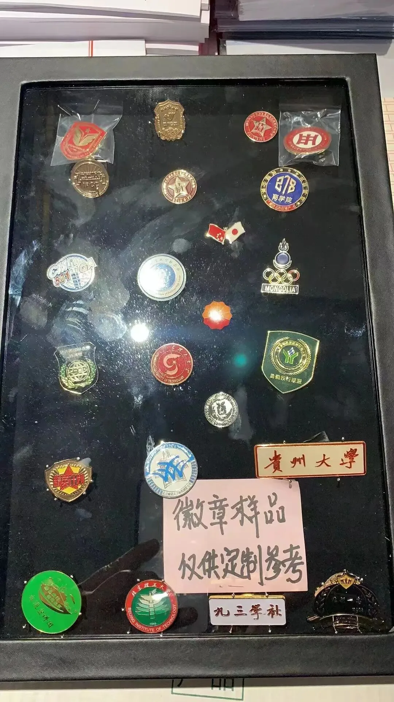
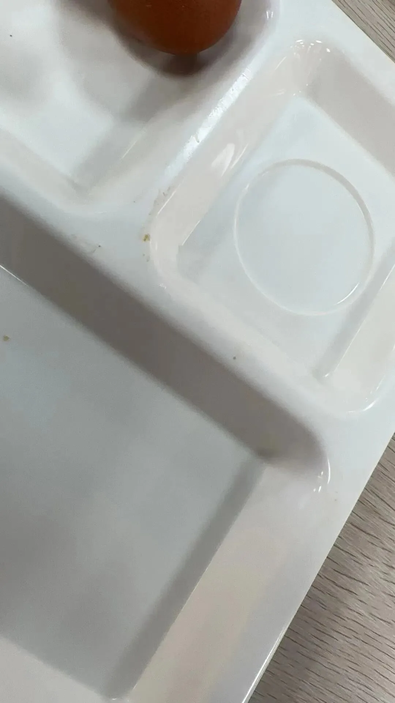

请相关部门及时关注并跟进问题。

## 1 运动场地

> “回复运动场地一，那块场地本来就是网球还是排球的，好像是21年还是22年疫情时候拿了一些之前馆里淘汰的羽毛球架子摆上的，地上的线也是那个时候画的。可不是建校一开始就是羽毛球场地。 你愤怒归愤怒，别虚空造历史，我这脑海里还以为是自己多出了不存在的记忆。 （撤掉那些架子也有可能是买不来新的吧，原先摆出来的就是旧的，还是希望理性一些）”

（见《[【读者投稿】奖助学金差评如潮，望京超市褒贬不一](https://mp.weixin.qq.com/s?__biz=Mzg2MjcwNzQ1Mw==&mid=2247486859&idx=1&sn=1115bb6caf4d1b114cda170ddbe1a71b&scene=21#wechat_redirect)》第一条）

## 2 奖助学金

> “强烈要求专硕也发新生奖学金+学业奖学金。 国奖都专硕和学硕一视同仁，为什么学校内的奖学金不一视同仁？ 是社科大看不上国家那一套吗？（如果是的话，那本人表示：不理解，不认同，不支持）”

> “完全不理解为什么课题只要立项通知书或者证明书就能加分，太荒谬了。第一：课题没结项就代表课题还没有达到结项标准和时间，也就有结项失败的风险。第二：没有结项的课题今年我拿着立项通知书加个分，明年我再拿个结账书再加一次分，这不就重复加分了？？只有明确规定结项，才能避免课题重复加分。第三：奖学金材料截止时间是2023年8月31截止，那我2023年8月30号申请成功的课题，是不是也能加分？？？这不搞笑吗？？第四：我拿着一堆立项申请书是不是可以吊打发论文的同学了 第五：既然立项就能加分，那我说我有顶刊在写，能给我加分吗？”

> “想问学校，当初科研系统课题申报只是摆设吗？说好了每学年限制报两个课题呢？每个学院有不同所，所和所对于课题加不加学生名字的看法差异很大，有的所课题都会加学生名字，有的所就不加，把这些不同所的同学放在一起评奖学金，本来就很不公平了，学生也是实实在在参与了课题过程，真论数量，不比加了名字的同学的课题少。但到了评奖学金的时候，因为没有加名字，所以一个课题加分都没有，只能眼巴巴看着学院里其他所的同学人手好几个课题加分。而且，如果靠一堆课题参与就能加分，那永远超过发论文的同学，这样真的很不公平。强烈建议学校限制课题加分数量，当初说了一学年限制两个，用于奖学金评选，现在又不认了。出尔反尔是怎样？”

> “除了发表北核南核加分，其他期刊就不加分？参与项目也不加分？参加学术会议并做论文汇报也不加分？ 但是做和学术没有一分钱关系的活动却可以实打实的加分？ 我就不信这比以上“垃圾”学术活动含金量还高。 社科大能不能参考一下其他高校的奖学金评定，参会、报告、普刊（除认定不得加分的刊）这些很多高校都有一定加分，当然，有分数限制。 纯文科专业（文史哲）核心哪那么好发，就算普刊也不好发啊，普刊不如核心没毛病，但不如办活动就真是离谱。 还有知网查询结果，发过刊的都知道，知网电子版有时候比纸质出的慢啊（每个刊出的速度不同），赶不上就当没发？ 以及各班标准不透明，说是民主评议，其实是班委评议，什么加分什么不加分，群众根本不知道。 你社科大各学院情况不一，无法有一个校级的统一标准，那各学院总能有统一标准吧，省得变来变去，上学期说这个能加分，下学期说这个又不能加分了。 其他学校各学院都有个统一标准，就你skd不行？搁这人治＞法治。 学工处通知里还说有异议可以举报，我tm就想问问，这举报就跟实名举报一样，谁敢？”

## 3 望京超市

“望京超市关于11月17日学生评论的反馈 望京超市反馈一下: （对11月17日评论的反馈，因网络原因当天未发出） 我们真的非常在意同学的反馈，看到您的评论后我们针对问题一一复盘查找问题，作为服务行业我们的员工绝对是本着能为学生服务好的初心开展工作的，有时候也可能是当局者迷没有发现自身存在的问题，感谢您的指出让我们更加清醒。 您指出的问题我们都会研究马上整改，其中也确实是有一些门店工作的疏忽让您对一些情况产生了误解，我们也借这个机会和平台解释一下：

1.偶尔开临街的门只是用于方便收取供应商配送的货物，没有主动对外销售的做法，学校早已通知过不要对外销售。也确实偶有路过的行人敲门或者在送货过程中恰巧想买瓶水，这种情况一周也没有一两次。 2.您说的胸针和徽章以及还有一些本子套装是我们摆在门店的样品，主要目的是方便学生和老师订做商品的时候能够看到实物的质量颜色之类，避免只能看图片选最终质量和想要的不一致，不用于对外销售，绝对没有半点不尊重的意思，是我们工作思路简单了，给您造成误解，我们会收到屋内。现在学校订做的样品只有几款，后期在定制品增加以后会不断更换。 3.价格方面，我们店员会去周边超市调研，对比对面便利蜂和711平均价格肯定比他们低，对比全家爱超市肯定有贵的也有便宜的，但是平均价格应该不会高出他们，超市销售一直保持了比较低的利润率，在部分需求高的单品如水和可乐上长期保持了比较低的价格。各个超市的经营策略不同会对不同的品设置不同的利润水平，就跟同样的产品pdd价格会比京东便宜一些，这里面有信任成本经营策略配套服务等等，但是我们超市目的绝非完全为了盈利，受限于采购渠道和部分产品没有批量优势，部分产品价格高于其他超市绝非有意为之。为了方便您监督，我们承诺马上开启价格反馈渠道，对于您觉得定价不合理的地方我们即查即改。 4.超市会补充新品，受限于门店展示位置较小，陈列的目的还是以尽量全覆盖和针对大众需求为主考虑。门店的小程序商店预计于本月底会上线，借助于平台我们争取加大更新频率，平衡同学之间的需求差异。同时也邀请您做个小参谋，有好吃的零食欢迎在群里推荐一下哦，只要群里有同学反馈的我们都会及时响应满足需求。 5.超市使用的是自助收银机，确实偶有同学忘记支付我们店员会提醒同学重新支付的情况，可能提醒的方式和语气不够温柔和委婉，我们会进一步培训店员。设备因为老化确实反应有点慢，结账有卡顿的问题我们已经察觉到了，采购的新收银设备近期就会到店，同时我们已经在自助收银机的多处张贴了请支付完后再离开的标语，希望能减少此情况发生。再次抱歉给您带来不便。 6.冰柜的抹茶蛋糕是一个空盒子，用意也是告知同学可以帮忙预定这款蛋糕的意思，让您误解了，我们再贴上标签。保质期的检查我们有店员专门负责，每天都会查，或许您可能注意到部分货架上边上贴着的便利贴，写满了日期和提醒，就是自我提醒哪些商品会过期。山姆的商品每次我们只采购一盒，销售完之后才会继续采购。您反馈这个信息后我们也检查了门店保质期管理和登记的信息，您可以随时到门店沟通查阅是否有登记记录。

确实是一直想要做的更好，给同学们一个满意的购物空间，店内的陈列货品也在不断地丰富，但是看到您的评论发现我们做的还是很不够，也有很多是我们没考虑周全的地方，也有很多可能让同学误解的地方。无论如何，请您相信我们绝对是渴望提升自身水平，愿意为您服务，绝没有想把你们当韭菜割的想法，希望能得到你们的谅解和更多的反馈，我们一定会尽力做的更好，给你们添麻烦了，可爱的同学们。

最后，温馨提醒下门店有长设的意见簿，店内员工也常在门店，这些渠道也可以接收您的及时反馈，意见簿我们经常会看，也有在及时处理。如果我们的服务让您不满意了，请及时直接的鞭挞我们，让我们难受和整改，不要憋在心里让自己难受。”

“关于这个望京超市山姆瑞士卷分装价格 大家去下载山姆app自己搜索一下计算单价，就会发现学校有多黑心”

## 4 宿舍隔音

> “投稿：笑死，望京宿舍大张旗鼓给凳子装的静音条根本不静音说到这个凳子问题也很讨厌，楼下住了一群很敏感又很事儿的人导致在宿舍还要蹑手蹑脚（针对本层普遍情况并非个人）”

## 5 食堂

## “希望食堂可以把餐盘刷干净点谢谢”

## 6 校园网

> “投稿：我包月的校网网速烂到我打开百度都得二十几秒。这样吧，尊敬的各位校领导以及学校网络部门负责人，您们说要加多少钱，我给，给我把网速整好可以吗？我给钱，你们开价就行。”
