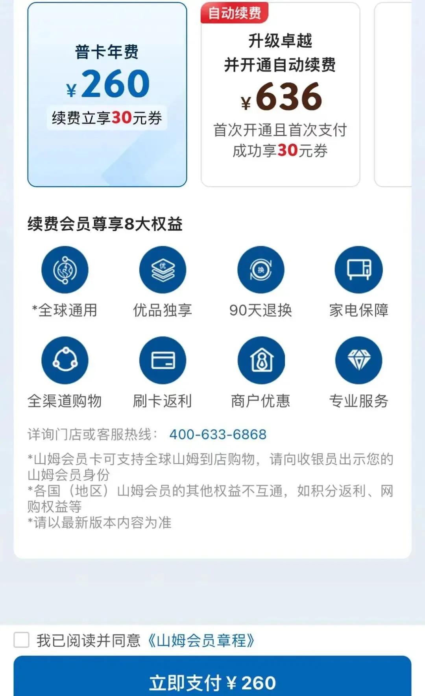

请相关部门及时关注并跟进问题。

## 1 奖助学金

## “奖助学金:

老师好，感谢您的回复！

针对您的回答我作两点回复:

1.如果以立项时间来计算课题加分，则会出现很多同学赶在本评奖年度末（以本年度为例，23年8月末）扎堆申请课题中间加入项目，那么试问仅仅1个余月怎么能够参与实际课题？

2.工作量的判定是件极其困难的事情，论文课题均无法“预测或感知”一位参与者将要工作多少，唯一的判定标准就是论文作者排序或课题结项！只有课题结项才能判定参与者的实际工作量。像论文一样，不可能写出论文大纲便能判定这位作者有实际水平，只有发表才能判定这位作者的学术贡献。如果仅按照立项来算，由于没有结项的压力，相反更会出现很多人扎堆加入项目但不承担相应工作的现象！

3.因为材料过多，老师很难会记得上一年度某位同学是否用某项材料进行了评定。以往解决的办法很简单，就是用年份来衡定。以课题为例，按照结项时间计算则代表一个课题只有一次可供使用的可能，自然就避免了这个问题。

4.课题具有特殊性，产生的问题会很多，为保证学术严谨只能通过最大公约数。以我院为例，很多同学参与了国社科课题，并确实承担了大量工作。但因为课题周期很长（通常为5年），很多情况下结项或立项时间均超过了这些同学的在读时间。（例如20年立项，25年结项，该同学于21年加入项目，并承担了4年实际工作），这种情况又如何解决？若仅按照立项算是否对于这些承担工作年限更长的同学不太公平？

5.希望老师能够正示上述问题，以往我院按照结项算很多同学虽然没办法进行课题评奖，但毕竟是“结果导向”，很多同学是服气的。但要按立项算，很多同学就会感觉“为什么不必产出最终成果就可以加分”的疑问，以我在学院的经验来看，按照过去课题及论文评定方式评定并无同学有争议

敬请老师正式上述问题，做出回复，在今年评定中就予以解决，莫要拖到明年！建议去掉“之一”即可！”

## “请问贵校参加学术会议，做论文汇报的那种，都算不上学术活动是吗？不配加分？”

“学业奖学金的评审本以为经历了前面那么大的争议会有所调整，但是经济这边的学院仍然坚持原封不动发补充意见，把AMI扩展和北核C扩等同，我不懂到底是什么力量让他们这么装死。

高等奖学金都落入到发AMI扩展这种普刊的人手里，不是逆向激励是什么？真是太让人心寒了！专心做科研一年到头来不如拿课题混普刊。学生科研意义何在？

学院不听学生意见，完全图省事，真是寒了人心呀！很难对这个学校抱有任何感情了。”

“请问今年助学贷是学校扣完把剩下的钱再打回来吗？ 现在贷款已经发了但是学校全都划走了。去年是把钱打给学生学生再自行缴费，今年怎么还没有通知呢?”

“想问一下为什么普刊应该多算分？很多普刊只要给钱或有关系就能发，不是众所周知的事吗？”

## 2 本科学工系统

## “投稿：

学生工作处能不能更新下本科学工系统！为了它下载了360浏览器，开了ie兼容模式也根本打不开这个网页！

打电话问网络中心，说这系统是学工处的，不归他们管，打电话问学工处办公室，说系统比较旧，解决方式竟然是让我换台电脑？可换了电脑都打不开这网页！

ie都没了，更新下你们的系统会怎样啊？领了工资，不做事吗？？？校园网能搞几次升级测试，学工处系统就不能改？”

> “(注:此稿非本次稿件而为排版漏误，请略)关于这个校外快递驿站的问题，建校内驿站的时候就已经有过争议，我给不知道的同学讲一下。 校内驿站最初是由顺丰公司出钱建立和管理的，按照校外快递驿站人员的说法，他们被学校“摆了一道”，已经租好了店面用于快递驿站但是学校又弄了校内驿站，而且在校内驿站放件要额外按件收费并且学校存在不让他们进校的行为。学校驳斥了相关言论，并且说任何快递进校门放在校内驿站或者快递柜都没有阻挠和所谓的“许可证”要求（当时是疫情期间）。学校也有透露校外驿站最后答应放在校内，但是不放在校内驿站，他们也不管，丢了也不负责。学校拒绝了，双方就僵在这里变成了现在这样。 至于沟通问题，学校也和校外驿站沟通过。据说校外驿站态度十分强硬，就是不进校门，并且学校也说冠以“社科大”之名不符合实际，要他们整改，也没整改。”

## 3 食堂

## “一食堂二楼中午的粥可以出个小份的嘛，中午的粥分量太大了，女孩子真的喝不完……”

“最近望京食堂炒菜太咸了，连着两天都是这样。麻辣烫也没有一开始好吃，全是素菜，菌菇类很多几乎没有真肉。希望可以改进一下～”

4

望京超市

> “关于昨天说望京超市山姆瑞士卷黑心的那条 如果你只看得到app上的价格，而对一年260的会员费视而不见；如果你只对比调价后的瑞士卷价格，而对超市对大分量蛋糕点心的分装成本视而不见；如果你只知道满99、299免运费，而对山姆默认的包装费视而不见；那你大概是可以说超市黑心。 作为消费者，没人不想降价。但我支持用科学全面的统计，考量一个商品的价值，向超市提出自己的意见，而不是粗暴地下结论。否则，最后只会让超市停止售卖山姆的产品，两败俱伤罢了。”

（见《[【读者投稿】望京超市进行回应 奖助学金疑问依旧](https://mp.weixin.qq.com/s?__biz=Mzg2MjcwNzQ1Mw==&mid=2247486864&idx=1&sn=db8205d6778dd1d4574d5f390079cff4&chksm=ce028602f9750f14d08b3be389db484685f2983b8398de22bd1f327222766270508043a015a6&scene=21#wechat_redirect)》第3.2）
