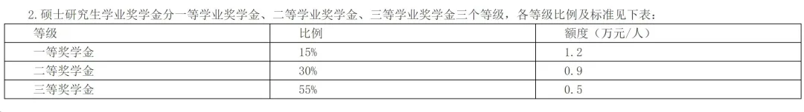
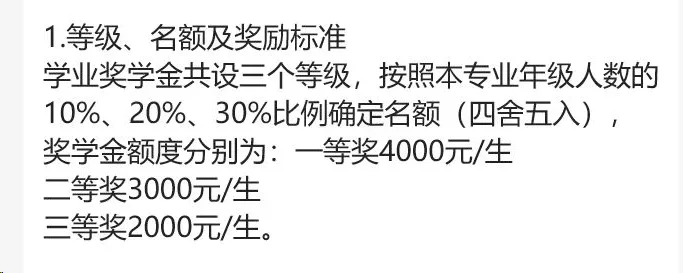
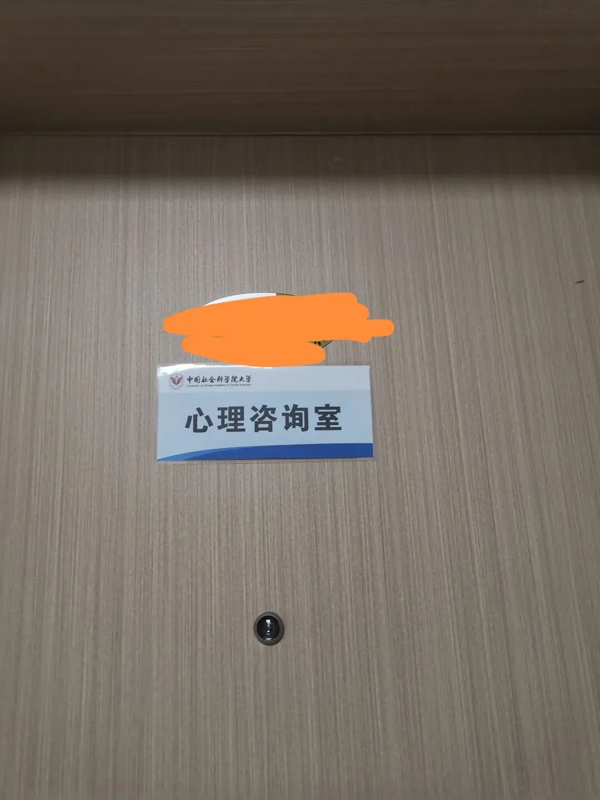
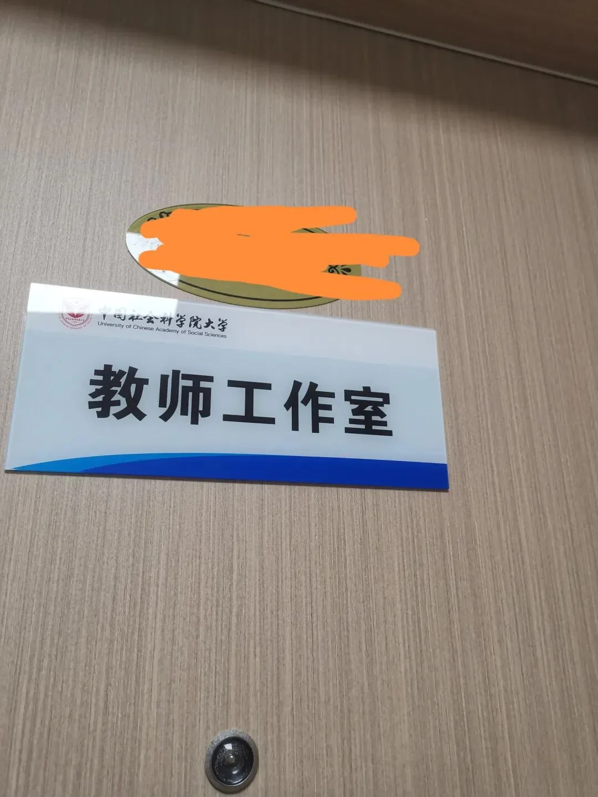

请相关部门及时关注并跟进问题。

## 1 信息化

> “强烈建议学校改进更新学工系统！！！！！填写学年鉴定和奖学金需要种种软件、网络条件，可是很多同学在好不容易达到这些要求后依然无法正常填写。学工系统这样牵涉学生奖学金、学年鉴定等多种重要事项的网站，居然操作如此不便，令人咋舌。系统页面古早，好似本世纪初的网站。去年就有同学提出改进建议，但至今未见回应。试问，在中国式现代化的进程中，我们古早的学工系统究竟还想抱残守缺到几时？”

“表扬网络部！一直以来对校园系统的升级和维护让人能看到确实在脚踏实地工作，也确实为同学们提供便利，每次打电话从来没占线过！谢谢网络部的老师们！”

## 2 奖助学金

“按照应用经济学院的标准，国奖和学业奖学金可以更名为AMI期刊奖学金了。AMI核心很多都只是普刊，算C类！AMI扩展基本都是水刊，居然算D类！”

“投稿，专硕学业奖学金，打发要饭的呢，连学费零头都没有，就这么点还不能全覆盖，专硕两年每人可是快10w的学费，另外，新生奖学金呢”

## 3 望京超市

“投稿：给今天支持超市的言论狠狠点赞，这个学校对我来说最好的几点之一就是超市卖山姆分装而且不贵，向全校说卖的贵的同学大吼：嫌贵你别买！

## “还有说两败俱伤的😅，差不多得了，可以不用买山姆来分装哈😅”

（见《

【读者投稿】老旧的系统 与被困在其中的人

》第4条)

4

自习室

“

投稿：7-8号楼每层都有的这些个空置房间，关了一学期，这学期继续关，为什么不能开放给大家当自习室？

每次学生要求开放，不知道哪个部门就各种推辞，说什么有安排，安排就是关着呗，我们又不瞎。宁可把学生关在地下自习室自习也不开放空置房间？”

## 5 开水房

“投稿：望京校区开水房接的水是有味道吗，还是我的壶有问题，我三个地方都试了一下，感觉都有味道”

## 6 食堂

## “良乡校区一食堂二楼，今晚的这个菜真的不错，煮的也到位，味道也好。鼓励一下。”

“

再说食堂打包问题！能不能明确规定不能一人打包多份饭菜啊？也希望人文之光发个投票，看看多少人反对一人打包多人饭菜的。这不就是等于插队吗？我今天中午发现了一位同学就是，一个人打包了两个人的饭菜，这位同学起码一个人占用了5分钟的时间，隔壁队伍已经完成了三人（一人打包，两人堂食）。我还发声制止了，但是当事人不当回事儿，其他同学也沉默，看来只能强行规定才行了。”
