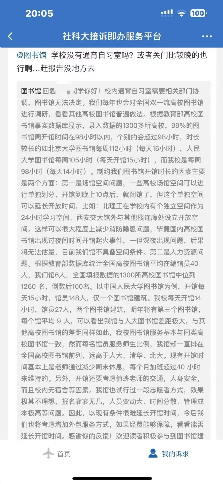

请相关部门及时关注并跟进问题。

## 1 食堂

## “希望望京食堂早餐可以多上几次疙瘩汤…真的好馋疙瘩汤”

> “【关于食堂打包】可以限制一人不能打包多份，要打包第二份可以重新排队，但是为什么要单独开一个打包窗口啊，窗口就那么几个，每天几个人打包也不固定，这不是浪费资源吗?”

## “一食堂二楼给的肉菜分量越来越少了吧！”

## “投稿，求求增强良乡一食堂的供暖吧，太冷了，吃着饭裤子都透了，还不敢抖腿。”

## 2 图书馆

## “标题可以取为：图书馆回复为什么社科大没有通宵自习室。”

> “社论君你好，很奇怪为什么望京校区的图书馆允许读者带食物进馆。撕包装袋的声音和咀嚼音很吵不说，食物碎屑也不利于保存书籍呀。图书馆什么时候可以禁止在馆内进食呢？学校这么小，想吃东西的话走几步就是食堂和寝室，饿不晕的。谢谢社论君！”

## “求问，更新信息系统后用微信图书馆选座怎么打不开？一片空白？试了一天好无语。”

## 3 奖学金

> “对奖学金成绩有点质疑，据说有同学的二外一学期没去上，说是“硕士时修过所以博士免修”，最后老师给分很高，接近满分。 相比之下，很多同学努力学习二外，却因为零点几分之差，与二等奖失之交臂。 ”

## 4 信息化

## “投稿（关于信息化建设，密码设置问题）：

学工处你没活儿可以咬打火机。密码用得好好的，怎么就不让用了？不让用自己的姓名和身份证信息就算了，用自己家人的也不行？就必须按你理解的“安全”就安全了吗？有的端口没有钥匙串功能不能记住密码，知道学生输密码有多麻烦吗？赶紧改回去，别这么多事！”

## 5 宿舍

> “告诉各位同学一个热知识，如果延毕（万一…祝诸君都能顺利毕业），大家可千万不要学我们做老实人，按学校要求乖乖搬到四号楼去住四人间。大家就不搬，问就是不在学校，反正就是不来，来了也没人知道。后勤不作为，不痛不痒地问几次也就不了了之了。然后就可以继续住着二人间，甚至是一人间了目测完全有效，诸君都可效仿”
