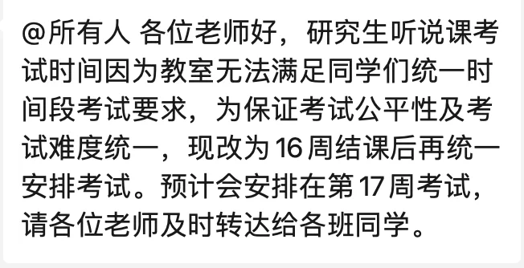

请相关部门及时关注并跟进问题。

## 1 联合培养

> “建议学校多跟社科院院部反映一下研究生的出国学习交流机制，能不能与更多名校合作，既方便应届学生进一步申请国外的研究生项目，或者方便学生能够申请海外联合培养的项目？对标中科院、北京的985，本校研究生的国际水准真的太低了。”

## 2 硕博考试

## “《关于博士英语听力考试时间安排不合理的问题》

博士英语听说12周结课，今年因为没有教室被改到了17周考试，实在不合理。博士很多都不住校，或者有课题会议需要出差，并不是一直留在学校。这样被一直拖到17周才能走或者离校后还要再回来实在是不合理。教室的问题其实并不难解决，11周结课后会有教室空出来，无非是多分几个考场，同时播放听力材料而已。

不知道教务处这样安排考试是不是为了监考轻松，可以省几个监考老师？希望能多站在学生的角度考虑一下吧！”

## 3 短周结课论文

## “本科论文提交时间问题：

上学期这个引起轩然大波的事情这学期看来又卷土重来了。到了第十一周，又是突然接到通知要求”寒假前除成绩“？请问这样做的必要性在哪里？

教务处的各位老师如果做过一点点学问的话就不会不明白一个道理，一篇文章、高质量的结课论文是需要反复打磨、反复修改的，否则糊弄一篇交上去的意义何在？你教务处只顾着11周通知，可问题是人均3-5篇的论文难道让大家一周一篇吗？还不算这个里面要进行期末复习。可能教务处制定政策的人有三头六臂七十二个灵巧大脑——那倒是可以申请国家专利！可惜我们并不是有这些老师一样的”天赋“。那面对”愚钝“的人总该有点”笨“的办法。

现在统一的口径是为了明年的所谓本科合格评估，固然它很重要——与领导的荣誉密切相关。可问题是，本科生也是人，是鲜活的个体，不能沦为所谓“本科合格评估”的螺丝钉和耗材！上学期教务处”胡萝卜加大棒“式的政策真的起到了提高教学质量、提升论文水平的作用吗？

正如一边选课一边考试十分让人费解一样，一边复习一边花着大量的精力写论文也让人十分费解，难道教务处老师一天有72小时？建议什么时候发明了给社科大同学推广一下，也救民于水火之中，挽救一下大家紧张的时间、紧绷的大脑，这也是功德无量的事情——比你们去雍和宫上香好使。

结课时间、提交论文的时间只要不是太过分，理应由学生和老师之间进行商量，最好的办法就是下学期开学前统一提交成绩。这很难做到吗？你不能因为推行”新政“，搞”新官上任三把火“就可以不顾教学规律。有”聪明“的人可能会说了，”你们为什么一定要等结课以后才写论文呢？“对于这种询问，我其实很好奇，那听课的必要性在哪里——如果一门课没听完、甚至听了一两节之后大家就可以写论文了，那么这门课有什么必要开设？大家从中学到了什么东西？还是说上一门课就是烙烧饼，把已经知道的”知识“来来回回的加热——您也不怕表皮糊了里面还夹生呢？

还是那句话，不能一方面”接诉即办“，一方面”实际不办“。一个结课论文提交时间为什么还需要反反复复的被讨论，难道教务处各位老师没有反思自己的政策是否合适吗？表面上听取了大家的意见，实际上丝毫不办，这恐怕既不符合”本科合格评估“的宗旨，也于创办”双一流大学“无益。

还是希望教务处和教秘慎重考虑，建议将结课论文提交时间延长到考试周结束以后，这样大家可以很从容地开始写论文，才有可能写出有价值的文章了。您不要忽视每一次论文，或许可以改变一个同学的一生。”

## 4 食堂

> “对于“单设打包窗口造成资源浪费的回应”：首先，单设窗口将极大缓解高峰排队的压力；第二，如果打包的人真的不多，那打包者应该高兴才是，继而大家都高兴；第三，上条提出的“只打包一份，第二份再排”很难判断是几份，每人饭量不同。”

## “虽然说大学校园是象牙塔，但是大家不能理想主义到如此天真……如此烂漫的地步吧……

让打两份饭的同学重新排队……你的小脑袋瓜是怎么想的呢？嗯？ 帮同学打饭也不是人人都帮打，也不是天天都帮打。谁没个头疼脑热需要舍友帮忙带饭的时候呢？这种情况一个月在食堂也遇不到几回吧？这几回还都让你碰到了？这几回你也不能忍一下吗？你没有头疼脑热起不了床 需要舍友带饭的时候吗？ 阿姨打饭那么快，可能一分钟都不需要，这一分钟你就等不了？？ 在外面，你去星巴克买咖啡，买的时候帮朋友带一杯。 你于是点单只点一杯，点完一杯后大喊：我是个有素质的人！我不能占用后面人的时间，我一次排队只能点我一杯，我帮朋友带必须重新排队！后面的顾客您先请！我重新再排队！！……现场的人估计以为哪家精神卫生中心的后墙塌了跑出来患者了呢…… 此外，如果前面的人点两道菜，我点三道菜，那我是不是需要点完两道菜后告诉阿姨先结账，我再重新排队点第三道菜呢？？？ 我们不要每天活的那么事事计较，那么钻牛角尖可以吗？ 前有让食堂帮忙抽虾线的，后有让打两份饭的人重新排队的……这要是让别的学校的人看到这些贴子，估计都会怀疑社科院学生精神健康状况吧……”

（见《[【读者投稿】新系统引发不适 旧标准令人令人](https://mp.weixin.qq.com/s?__biz=Mzg2MjcwNzQ1Mw==&mid=2247486895&idx=1&sn=b27cd45487b8fd5ef8bec89215ceaa9c&chksm=ce02863df9750f2b48397310fe93554aedb311cc2023aef4bb2257dcb00e9a4de7859e88503d&scene=21#wechat_redirect)》第1条)

## 5 图书馆自习

> “问题2 研教一直是24h开放 本教也是不锁门的 随便找个教室都能通宵 没必要去图书馆找24h自习室吧 再说了也不是所有学校的24h自习室都设置在图书馆里的，建议以后问这种类似问题的人先问问身边的同学，不然显得您很没常识也很不了解学校🙂”

（见《[【读者投稿】新系统引发不适 旧标准令人令人](https://mp.weixin.qq.com/s?__biz=Mzg2MjcwNzQ1Mw==&mid=2247486895&idx=1&sn=b27cd45487b8fd5ef8bec89215ceaa9c&chksm=ce02863df9750f2b48397310fe93554aedb311cc2023aef4bb2257dcb00e9a4de7859e88503d&scene=21#wechat_redirect)》第2条）
