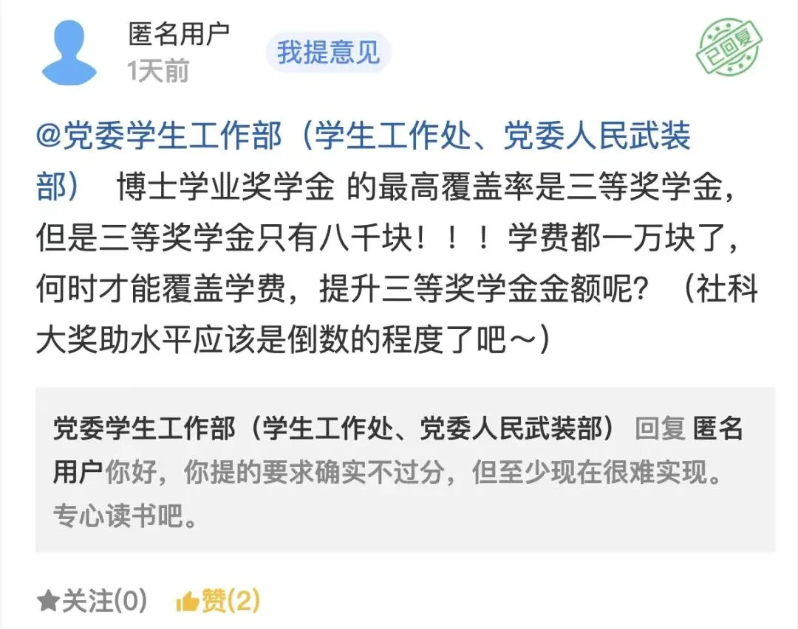
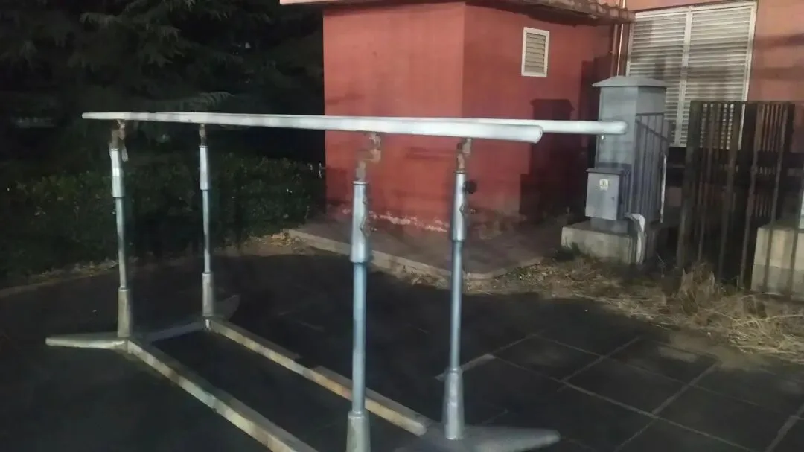
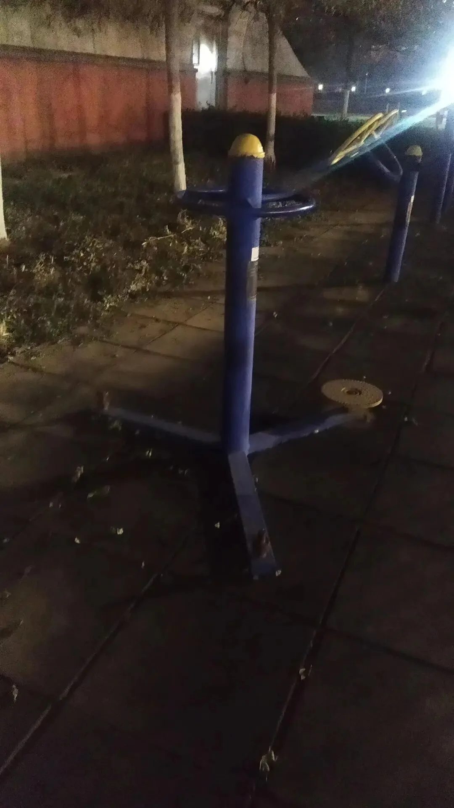
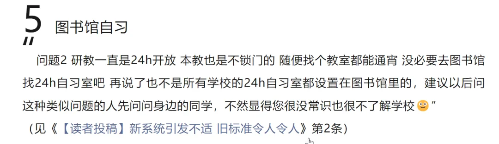
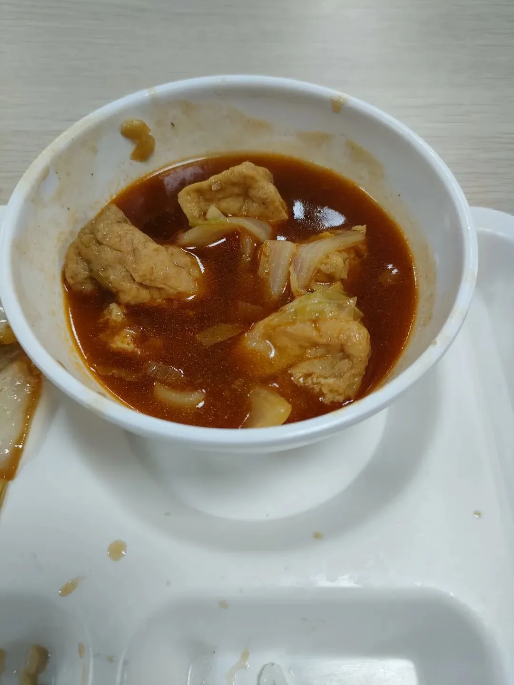

请相关部门及时关注并跟进问题。

## 1 奖学金问题

> “看了看接诉平台 党委学工部就只会让学生专心读书？那我想问问人家省级非985 211院校都能保证博士最低档的奖学金冲抵学费 社科大做为殿堂级高校就不能满足冲抵学费的最低档奖学金么？ 党委及学工部是不是要反思一下自己工作有没有做足，有没有充分做到为学生服务？”

## 2 安全隐患

“一共两个双杠，一个晃得厉害，另一个已经上下分开了，虽说学校都是几乎都是文科生，但体育锻炼多少也重视一下，最起码运动设施定期检修一下吧！

还有这个，从我来学校就少两个站盘，也从来没人管过，再过两天这一块就没什么能用的设施了。”

## “投稿：

最近气膜体育馆消防隐患和宿舍楼卫生间中水发黄带臭的问题真的很让人揪心。气膜体育馆年久失修设备老化先不说，尤其要吐槽这个新建一年多的宿舍楼，真是问题不断。隔音极差和空气质量问题就不谈了，没想到连卫生用水也这么多问题，发黄带臭的中水真是让人一看就犯恶心有生病的隐忧......而且这甚至不是新宿舍楼第一次发生这种疑似管道老化的问题，之前楼道里还发过大水。这可是刚建成不到两年的新楼啊，真的很担心学校建设的工程质量问题。现在学校还在建新教学楼，希望这栋楼不会有这样那样的工程质量问题了。”

## 3 博士考试

> “想说一下上条同学说的博士英语听力考试时间安排不合理问题（仅代表个人观点）。请问一下这位同学有没有考虑过，如果在没结课（16周前）安排考试，除了教室的问题，还有可能别的学院的同学要上课呢？之前安排的考试时间，就和我们上课时间冲突了呀。有人可能说那可以安排在周末了？那周末也有返所上课的是吧，所以比较合理的还是安排在结课后，教室也有了，大家时间也有。”

（见《[【读者投稿】教务问题多点开花](https://mp.weixin.qq.com/s?__biz=Mzg2MjcwNzQ1Mw==&mid=2247486901&idx=1&sn=0bad64e35932206b992369d36a5df99d&chksm=ce028627f9750f315a6f7583888e218f4a540873da565b7ae7338829462241d6345f34bcffc5&scene=21#wechat_redirect)》第2条)

## 4 短周结课

> “对一方面“接诉即办”，一方面“实际不办”。教务处本学期连关于成绩提交的通知都没有发，不知那位同学何来的洋洋洒洒的长篇大论。上学期发的通知，要求论文结课的开学前统一提交成绩，这学期也依然会是这样！莫名其妙的被扣了一堆帽子。这期推送就一个莫名其妙的涉及教务处的,哪里来的多点开花？”

（见《

【读者投稿】教务问题多点开花

》第3条)

## 5 图书馆

## “回应一下这条:

非常感谢这位同学的回复。原投稿的目的是希望大家了解一下目前图书馆的运营状况，主要目的不是“吐槽”图书馆无法24小时开放，如果原投稿中图书馆的回复提到的消息也称之为“常识”的话，那无话可说。“问问身边的同学”，如果身边的同学也都是新生呢？大可不必用自己的“常识”界定“公共的常识”。”

（见《[【读者投稿】教务问题多点开花](https://mp.weixin.qq.com/s?__biz=Mzg2MjcwNzQ1Mw==&mid=2247486901&idx=1&sn=0bad64e35932206b992369d36a5df99d&chksm=ce028627f9750f315a6f7583888e218f4a540873da565b7ae7338829462241d6345f34bcffc5&scene=21#wechat_redirect)》第5条)

## 6 食堂

> “不得不吐槽一食堂现在越来越离谱了。今天五点半左右去二楼买饭，想必来的并不算晚，”牛肉烧豆泡”里面已经没有牛肉了。食堂师傅只是说“可能少肉”，但这也不是半点肉找不到还按原价卖的理由吧。食堂最近菜品质量真是逐渐下滑，开始糊弄学生了。”

“投稿：今天投稿第四条的同学你是我的嘴替！每日来人文之光看同校神经病们对一点破事儿唧唧歪歪已经成了本号锁定观众的重要渠道”

（见《

【读者投稿】教务问题多点开花

》第4条)
