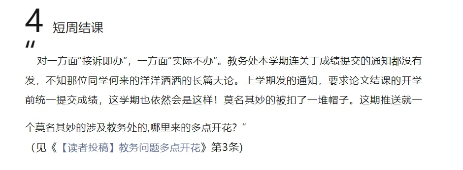
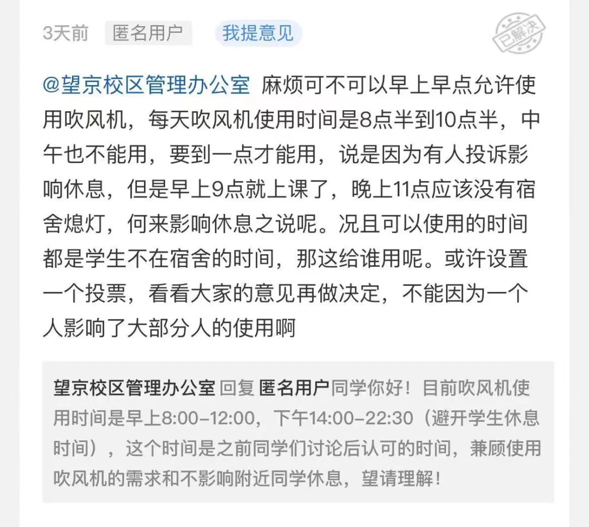

请相关部门及时关注并跟进问题。

## 1 短周结课

> “回复这一条：不知道这位同学是哪个学院的，至少我们学院各门课授课老师接到教秘的通知说是寒假前论文结课的课需要提交成绩，所以到了结课的时候大家才知道原来16周就要交论文。建议教务处给各个学院一个明确的说明。如果是教务处的政策问题，请教务处慎重考虑。如果是教秘会错了意，也请相关部门明确权责。”

（见《[【读者投稿】夜是如此安静](https://mp.weixin.qq.com/s?__biz=Mzg2MjcwNzQ1Mw==&mid=2247486912&idx=1&sn=b91accdd7aea097bde0584029a9dcb01&chksm=ce028652f9750f4446dabc44650e997c2b3bf2bfec0df09cb5974cec47de984c7db278d4f3c6&scene=21#wechat_redirect)》第4条)

## 2 奖学金

> “有很多学校国奖获得者是不能再参与学业奖学金评定的，学校不如参考下，这样三等奖学金是不是就可以提高了，按照学校说辞“没钱”，那学校就得精打细算。三等覆盖学费并不是什么过分的要求。”

> “关于奖学金评选，有四问：首先，为什么要有班主任综合评定这一栏？设置的目的何在？是为了让研究生们都去和班主任搞好关系？其次，来这儿一年多了，班主任怕是连很多人是谁都不知道，对大家到底了解什么呢？如何做到公正无私不偏不倚地给除班委外的普通学生打分？再次，班委已经得到加分就不说了，为什么原本学术成绩社会活动方面都没有什么竞争力的班委同学，在得到班主任评分后直接把其他同学挤下去了？这公平吗？而且据计算，能导致这种差距，只能是班主任给班委打满分，给其他同学打0分才能造成这种差距，这公平吗？最后，贵校既然觉得班主任打分没有问题，为什么不能保证整个过程公开透明呢？建议把给各位同学的班主任评分放出来，让大家一目了然，心服口服，而不是搞一些形式化的成立评选小组或者“有异议联系学院或者校长信箱”。”

（见《[【读者投稿】夜是如此安静](https://mp.weixin.qq.com/s?__biz=Mzg2MjcwNzQ1Mw==&mid=2247486912&idx=1&sn=b91accdd7aea097bde0584029a9dcb01&chksm=ce028652f9750f4446dabc44650e997c2b3bf2bfec0df09cb5974cec47de984c7db278d4f3c6&scene=21#wechat_redirect)》第1条)

## 3 学工系统

“学工系统只能用360浏览器进入真的很让人无语=\_=众所周知，360是“流氓软件”，但是学工管理系统只能从360进入，给学生带来不小困扰”

## 4 望京吹风机

> “吐槽一下望京的吹风机使用时间，早上八点才可以用，中午12-14点都不能用，但是各位老师可知道冬天早上用水比较集中，都集中在早上8点洗头，很快热水就没有了，压根用不上吹风机了，中午12点50下课1点30就上课了，完美避开可以使用的时间。以前可能确实是经过讨论决定的使用时间，但是那也是以前的同学决定的，现在的同学的需求为什么不听听呢。投诉即办平台上反应也只是官话往上一摆，干脆改为投诉即回好了，回的很快，但就是不会帮你解决。”

## 5 食堂

“个人感觉食堂有新来的师傅要培训一下再上岗吧。一楼打饭师傅是连隔壁放的菜也不能给看看吗？一楼打菜量应该比二楼多点吧，好像个别师傅也不太清楚。
