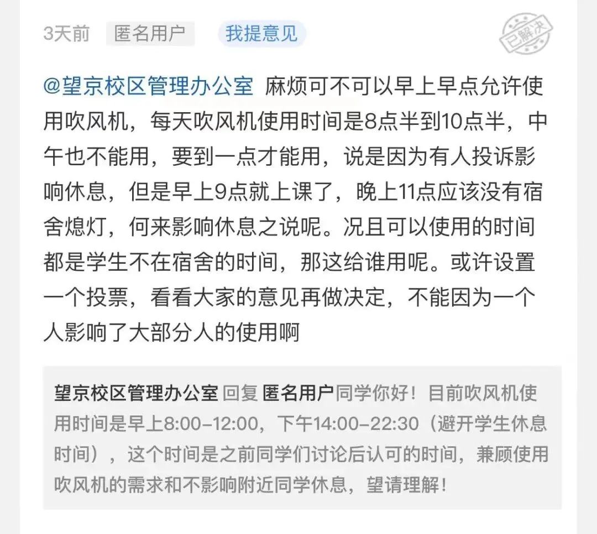

请相关部门及时关注并跟进问题。

## 1 校园网

> “校园网崩得不行。图书馆内学习，一天要登录好几次，以前电脑合上再打开不用重新登录，现在需要。而且手机iPad断网很多次。在图书馆门外站着Wi-Fi就连不上了。这玩意儿到底找谁投诉管用？消费者投诉热线管用吗？学校收钱不办事吗？”

## 2 奖学金

“社论君你好，想问问校奖学金评定规则需要公示吗，我们班奖学金的规则没有公示，我去问一些班干部，班干部也说不清楚（本科生）。”

> “回2023.11.27的2.2奖学金班主任评分这一项。班主任为了省事不得罪学生，班主任评分这一栏给所有的学生打的分都是一样的。当然，如果某些学院真的有特别不公道的行为，当我没说。”

（见《[【读者投稿】奖学金问题讨论再起](https://mp.weixin.qq.com/s?__biz=Mzg2MjcwNzQ1Mw==&mid=2247486924&idx=1&sn=a451de7ee587509e74ee52e749a4036d&chksm=ce02865ef9750f488137c4767025547c059ce946132c2fd045abe3160f52fe9a8165e76a2d51&scene=21#wechat_redirect)》第2条)

## 3 宿舍

“这上面写的“十一点应该没有寝室熄灯”我真服了 你不睡别人要睡啊 能不能别这么自我啊”

> “那位吐槽望京吹风机的同学，想问一下你是想要增加十二点到十四点的的使用时间吗？那你是真的一点都不管住在卫生间附近同学的死活啊。午休时间本来就短，还要听着吹风机的噪音，再加上你洗头的流水声，简直是地狱绘图。麻烦提建议的时候稍微考虑一下别人吧，休息时间没有噪音这个解释理由难道不够合理吗？这有什么好值得再来投稿的？”

> “作为一个曾经住在吹风机旁边宿舍的人有话要说：吹吹吹，你爱吹你住吹风机边上好不啦，感受一下天天一大早伴着吹风机起床中午吵得不能午休，晚上十一二点不能安静看书或者睡觉的生活。我不太了解望京，但良乡的旧宿舍，安静的时候一个吹风机响，上下三层楼边边宿舍的人都能听见。为了你一个人的早出晚归，牺牲边上六七间宿舍的休息，真是有够自私的🙄)”

（见《

【读者投稿】奖学金问题讨论再起

》第4条)

## 4 食堂

“（望京食堂）虽然我知道笋丝炒肉放生姜具有迷惑性 容易把生姜当成笋丝 但是这也好过不放生姜 一股肉腥味啊…能不能自己吃吃看是不是…放点姜去去腥吧求求了🥺”

## “良乡一食堂的尖椒炒油饼太好吃了！！！赞👍”

## 5 教务问题

“关于教务处新发的《本科生选课及课程成绩录入的提示》我有一点理性发言：虽然现在“原则上”可以下学期第一周完成论文类成绩录入工作，但在实际操作中普遍要求在教学周内上交论文。

请贵校教务处等机构老师改正一下自己对于教学科研的错误逻辑。人文社会科学不是月考，不是做题，不是衡水模式；一篇论文的写成需要长时间的投入和努力。强制在学期结束之前要成绩对于教务工作毫无好处。我知道你们要交差。原则上将成绩提交期间划定在下个学期的第一周，实际还要折磨大家教学周內提交真是可笑。暂且不论校内老师，社科院的老师很多平时工作繁忙 ，强行让他们在教学周內提交成绩非常不妥。而对于学生来说，教学周最后一段时间要准备考试，复习，甚至还有四六级等等。推迟几周有何不妥？若不能正面回复，每次发通知也不能解释，能不能将你们看成皇帝老子，而不是共治者？”
