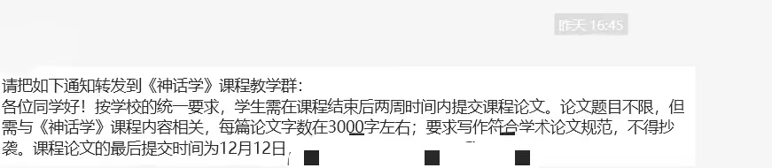
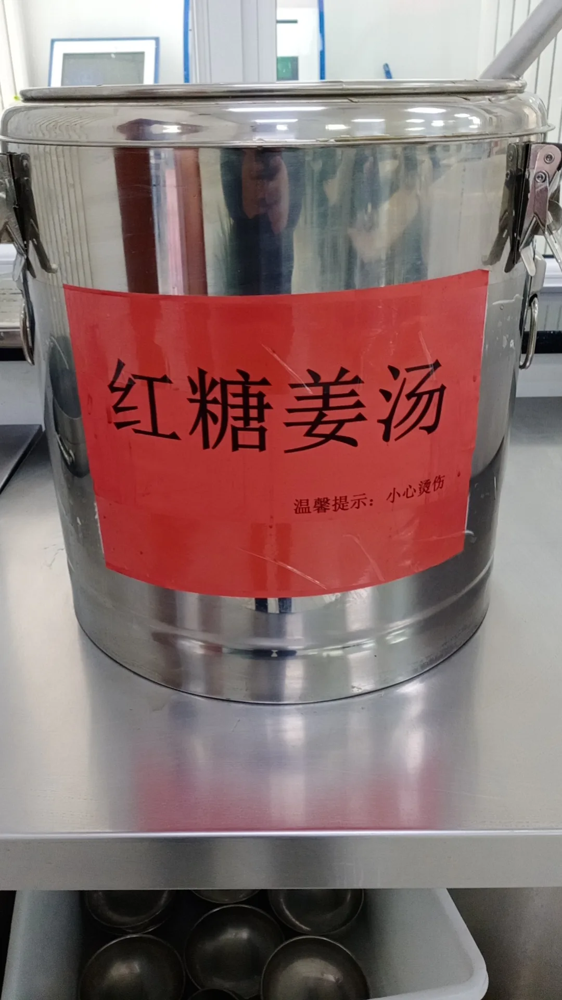

请相关部门及时关注并跟进问题。

## 1 短周结课论文

> “对于第五条理性发言的回复：教务处要求论文结课的成绩原则上是下学期第一周，意思是让各学院知晓成绩提交的时间，统筹好时间安排，从教务处的角度没有发过通知要求在教学周内提交，何谈“强制”，更何谈向谁交差。各学院有自己的做法，各位授课老师也有自己的提交论文时间要求，教务处如何强制要求？你所谓的实际上的折磨，并不是教务处想看到的。在看到这条推送前，我们给各学院发了通知如下：“按照上述要求，请各学院通知本学期所有任课教师：论文类结课课程（短周和长周），建议在开学前1-2周提交论文，以便于给本科生充分的时间写论文，提高论文质量。”

你也可以问问所属学院是否收到了通知。

不知道这算不算正面回复，你说我们不能强制要求，难道我们发通知就要强制要求学院或者老师？

以上。”

## “赞同昨天第五条投稿：

请教务处和有些学院不要原则上一套、实际做一套。昨天下午16：11教务处说原则上论文类成绩录入工作原则上应于下一个学期第一周完成。结果呢，如图某学院某门课程在16：45公然要求12月12日提交论文。查觉不妥之后，仅过了一小时就改为12月21日，但这样的安排明显不符合文件精神与大家的期待。两次出台的政策要求本质上还是寒假前交论文政策的延续，只不过假意拖拉而已。大家希望教务处和学院做的是，把论文提交时间推迟到期末考试周以后。请这个学院的教秘和教务老师自行考虑，一篇好的结课作业是否有必要用一个比较宽松和连续的时间来写——除非你划水或者抄袭。又想马儿跑又不给马儿吃草的想法关键是压力没给到这些管理人员头上？所以我们也很好奇，到底是教务处的通知有问题还是这个教学部门的有关人员假传圣旨、欺上瞒下、巧言令色？如果是前者，请教务出台更为具体的政策。如果是后者，也请稍微考虑一下学生的感受。

所谓人文社会科学的学习和研究，迟早得败坏在这些不通事理、不体下情之人的身上。如果是这样的敷衍塞责，那就不要谈什么教学质量、学生发展、立德树人，因为这样毫无逻辑的糟糕政策，本身就是对学科、学生的践踏——只不过成了在其位者洋洋得意的一个注脚罢了。

从这个事情也不难看出，社科大很多问题并非政策问题，而是执行政策的人随意更改、拉东扯西。这就造成了不必要的冲突和摩擦，让本来可以解决的问题因为这种不专业的行为而扩大化，真是特别好玩、特别无语。”

（见《[【读者投稿】原则上的原则 与实际中的实际](https://mp.weixin.qq.com/s?__biz=Mzg2MjcwNzQ1Mw==&mid=2247486937&idx=1&sn=b51a9cd6a34f5ee55fddb5a6da49995c&chksm=ce02864bf9750f5da41d5bb300ad71c4e23fb3f825b8adfcd12cd636158c162f4fb5986ca1f5&scene=21#wechat_redirect)》第5条)

## 2 食堂

“投稿：夸夸望京食堂今天（28号）的菜！！鸡翅和猪耳都好好吃，希望能多多多多多出现在菜单里”

## “望京食堂

最近天气变化大，病毒肆掠，周围好多人都生病感冒了，食堂这几天每天都额外准备了红糖姜汤，好贴心，点个赞！”

“吐槽良乡一食堂，这不是新换了个电子屏吗，结果根本不亮，我是11点多过去的。还有，学生会公众号发的菜单根本不准，我要水煮里脊根本没有。”

3

流感防护

> “投稿：坐标望京校区，最近图书馆内的咳嗽声喷嚏声此起彼伏。咨询了医务室老师，最近校园内流感和阳性症状频繁且混杂。可以请在图书馆内频繁咳嗽打喷嚏的同学戴好口罩吗？生病了还坚持来图书馆是您的自由，但连最基本的防护措施都不做，任由其他同学被传染是不是太缺乏公德心了？”
