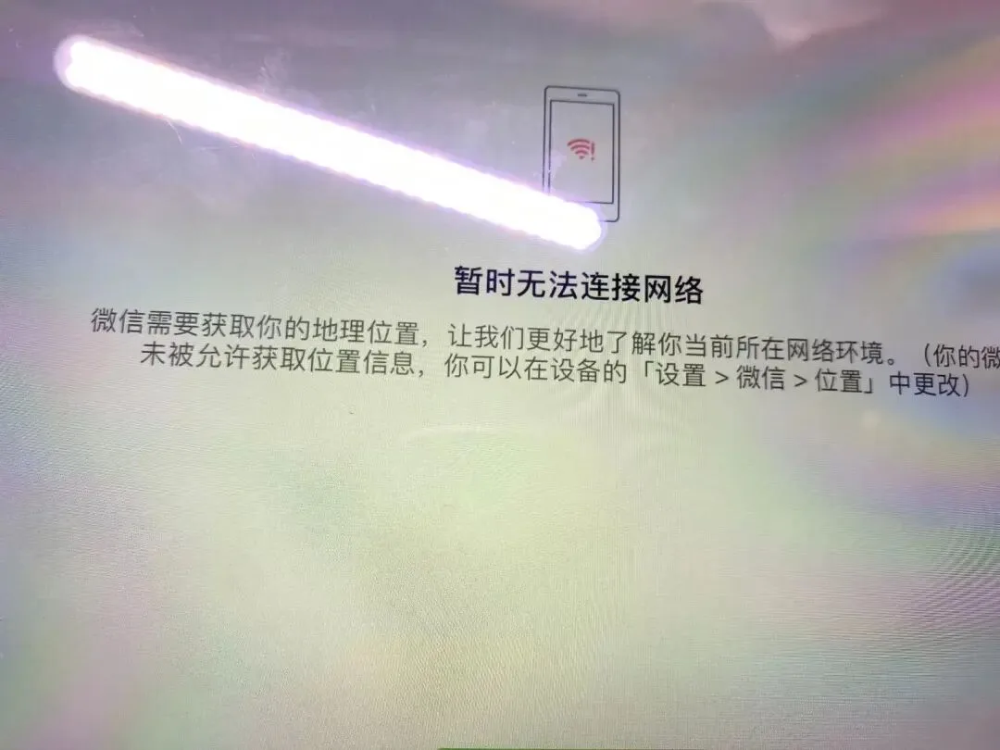

请相关部门及时关注并跟进问题。

## 1 校园网

“网络：学校的破网究竟能不能行呀，一动不动，只花钱不流动，就一个网络问题都不能给学生解决一下，连学校网站都进不去！！ 有毒有毒”

## 2 食堂

“回复食堂最后一条：其实温馨提示是一种委婉的说法。实际菜品会因为各种因素影响，发生变动，所以菜单只能参考。”

（见《

【读者投稿】结课论文讨论热烈

》2.3)

## 3 流感防护

> “最近流感严重，大多数课都结课了。最近的一到两周没有结课的，能不能线上呀。一个教室都是戴着口罩上课，冬天也不能开窗，真的是透不过气呀。教务能不能发个通知，酌情线上上课呀”

## “《关于灵活调整线上授课的建议》

近期流感高发，班里有很多同学在咳嗽，还有同学贴着退烧贴来上课。

全班同学都戴着口罩上课、汇报，一节课下来缺氧、胸闷恶心。是否可以请老师根据各班实际情况，考虑灵活调整授课方式（个别情况可以线上），这样对同学们的身体健康也有好处。”
