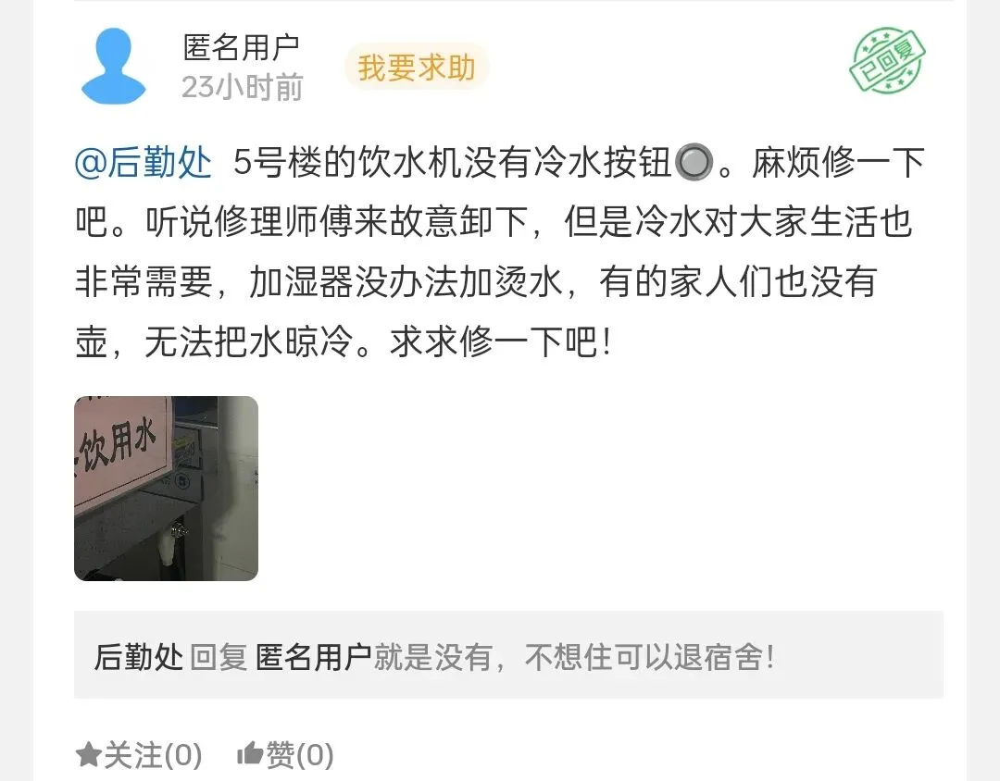
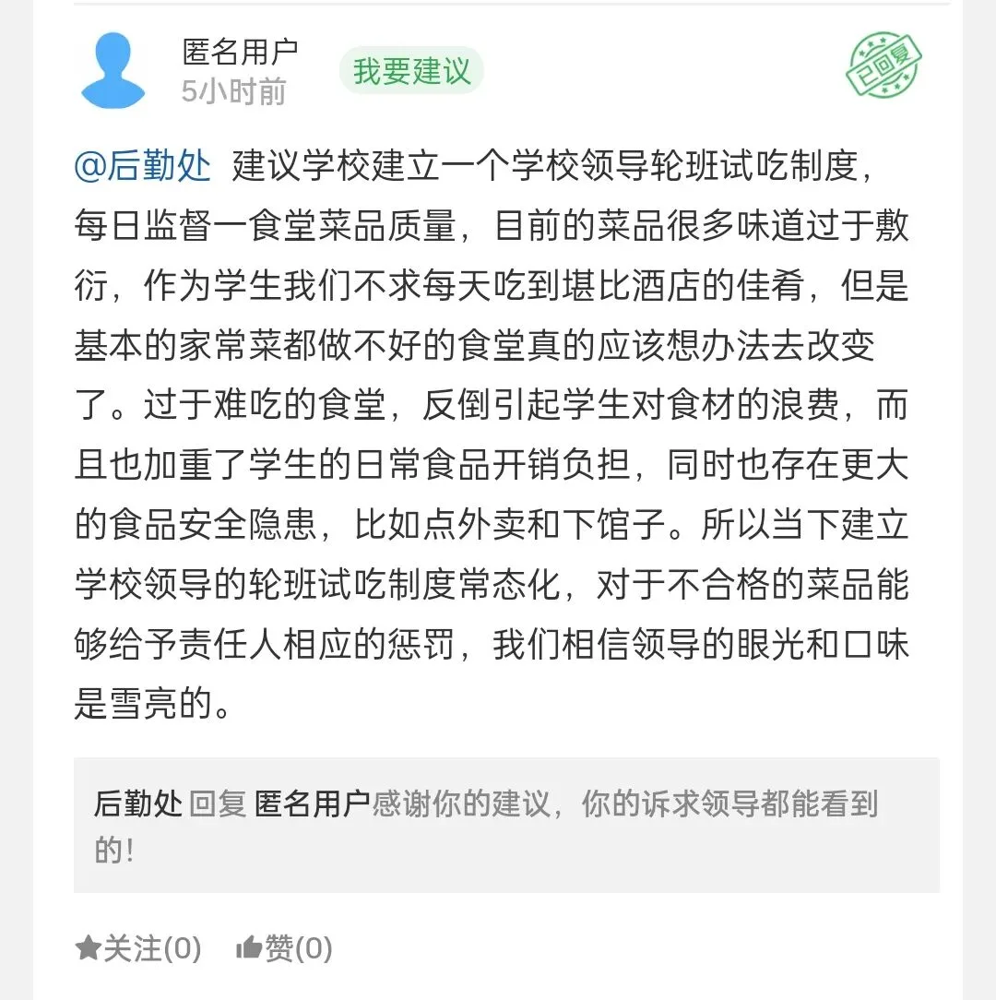
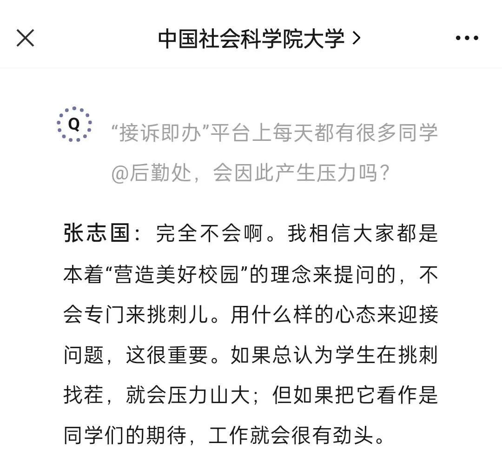

请相关部门及时关注并跟进问题。

## 1 接办平台

## “

（注：今日有许多朋友反映接办平台相关问题，为方便排版，现将有关平台附图合并置于前，内容将在下面分条列出。）”

## “今天无聊，翻了一次接诉即办。请大家明鉴，这就是学校的态度吗？

校园驿站不是在一楼吗？”

> “今天接诉即半平台真是让人大开眼界，当然也希望相关行政人员能开开眼，起码要有基本的常识，而非整天想当然做高高在上的回复。在一楼的校园驿站都“楼层太高”的话，想必某些人是居住在下水道里的吧，还是说程式化套路化回复用的太过顺手了？那么明显的水果腐败都要硬说看不出来，一时竟分不清这到底是办事认真的严谨还是故意装傻的懒政；如果面对问题只有“就是没有”的耍横，那么希望这种无赖还是自己退出社科大吧，请。”

> “原来接诉即办平台是可以这样回复的吗？一直以来都对接诉即办平台和后勤处观感很好，没想到今天接诉即办平台上会有这样的回复，真的很令人失望，大家面对问题都只能得到一个连校园驿站究竟在哪里都不知道的部门作出“就是没有”的生硬答复！亏得后勤处还敢说领导们都会看这些诉求，不知看到这些诉求的校领导又会作何感想呢？还是说这其实是校领导默许的回复？”

“依稀记得前些日子学校对后勤处的宣传，那么我想请大家看看，这就是一所高校对师生们期待的看法。”

> “今天接诉即办平台上说诉求们校领导都在看。但是看见了之后呢？我想这个问题今天后勤处已经做出了回答；然后就可以没有下文，只是看见了。否则也不会有后勤处“就是没有”的霸气回应了吧。”

## 2 教室通风

## “投稿：

教学楼一到天气冷的时候就通风很差，门窗紧闭，教学楼大门还要搞个又厚又重的帘子，在教室里很不舒服。不管是不是流感高发期，都希望教学楼不要搞得这么闷热。空调温度别开那么高，走廊的窗开一开，既让人更舒适又更节能。”

## 3 教室清洁

## “140办完活动能把东西收拾了吗？门上贴的东西和板子全扔给保洁阿姨收拾？

以及希望下次活动开始后可以把门关上（开始前为了迎接大家我不说啥），不用一直敞着吧，毕竟对面就是自习室，还有很多人在楼上学习。”

## 4 食堂

“望京食堂可以精进一下打蛋技术吗，吃一个煎饼能吐三次蛋壳，还不止我一个人这样，室友也如是反应，看看打蛋视频吧，食堂大师傅。”

## 5 宿舍

> “希望宿舍对噪音管理加强，7号楼14楼12月2日一点十分开始从东边寝室传出枪响，估计又是哪位大爷在打游戏。你不睡，别人还要睡呢。麻烦这位大爷反省一下，能不能考虑下别人的感受，宿舍不是只有你一个人，好吗？”
