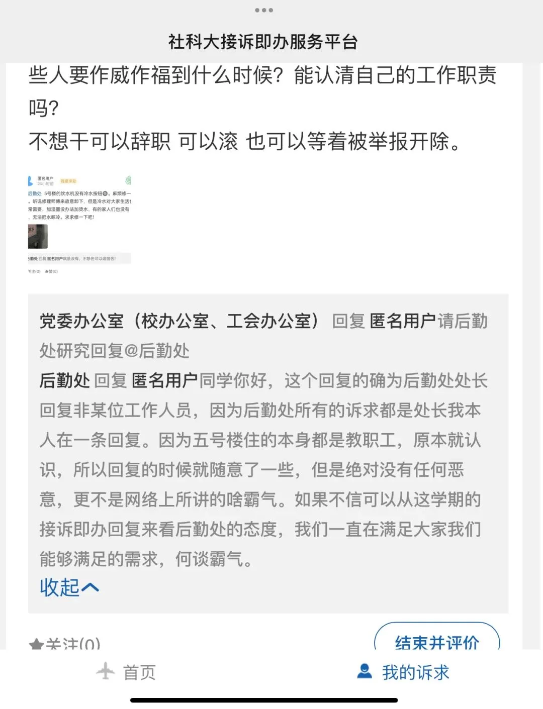

请相关部门及时关注并跟进问题。

## 1 图书馆

> “请求图书馆一楼女厕所恢复暖气。听说以前图书馆一楼女厕所是有暖气的，后来因为什么水管原因而取消了。目前的女厕所无暖气，和机房/大厅形成明显温差，一热一冷容易感冒，并且对女生生理健康的角度考虑也是喜热不喜冷，现在上厕所总是凉飕飕的，有时候厕所为了通风除味还开着窗，北京冬天的风有多冷，这种环境对女生的身体健康影响可想而知。所以希望图书馆一楼女厕所能有暖气，让我们的学习生活更加温暖”

## 2 教学大纲团队授课

## “投稿：

教务处-教学大纲团队授课课程分工问题

教学大纲是对一门课程进行系统化设计的结果，是一门课程的教学实施方案。那么团队授课课程的分工当然也是教学实施方案的一部分。按照咱们学校教学大纲的规范要求，团队授课请在周次教师栏标明授课教师姓名。查其他高校对课程教学大纲的要求，也提到应体现教学团队授课内容计划及分工。咱们学校的团队授课是一个特色，这一点就应该更引人注意。除了像一些学院开设平行班/教研室授课不便于分工之外，大部分课程应该标示具体分工或者每个老师的课时。但我们注意到很多学院的课并没有做到，几乎每一个学院都有一两门课及其以上存在这个情况。

查一下这些课，发现并非是没想好分工，很多课已经运行了很久了。这样一来，重新更新信息、再次上传实际上就是举手之劳，在很短的时间内就应该协调完成的。同时，顺带的效果是提醒授课教师根据课程情况、学术发展情况，及时更新教学大纲，才使它显得不过时和更有参考价值。

据不完全统计，目前各学院（除有特殊情况的学院）专业课里面有至少83门课没有具体分工，数量还是比较惊人。除此以外，通识选修课还有十来门也存在这个问题。请教务处协助各个学院完成补充更新工作并非难事、也不需要花很长时间才能办妥。希望能够尽快完成这个大规模更新工作。

上个学期辛辛苦苦搞了建设，希望能够尽善尽美，在最大程度上发挥它的作用，而不是成为摆设，这才不辜负当年撰写大纲的初心。”

## 3 接诉即办平台

> “针对昨天曝光的接诉即办上面关于五号楼冷水的回复，特意去接诉即办问了一圈，这是后勤处的回复，因为五号楼住的是教职工，志国老师跟他们也比较熟识，所以回复的时候就有些开玩笑，导致同学们误会了。此外再澄清一个小问题，关于校园驿站“楼层太高”的表述，昨天也问了志国老师，他的本意是指楼层单层的挑高，不是指校园驿站所处的楼层的层数比较高，这里又让同学们误会了。”

## “投稿，接诉即办的现象：

这个平台看着信息非常多、处理的也挺快，但是涉及重要问题的意见就处理的比较慢。

值得观察的是，比如课程的设置与建设、教学大纲的上传等等这些问题上面的意见并不多。但实际上反映出的是，通过这个平台能解决多少问题，能多快解决这些问题恐怕更值得思考。根本上说，鹅腿这种事情好办，教学这些核心诉求不好办。但恰恰是这个平台需要更发力的地方所在。比如一个很简单的事情是，某些课的课程大纲连授课教师都没有，但是授课内容却填的满满当当，那请问这个教学计划有什么效力？今年五月份集体交了课程大纲，但到12月份有些教学大纲仍然是没有授课教师，可见这些东西就是走了过场，部分的存在糊弄事的情况。这点也请教务处和一些教学部门考虑。

再者就是课程大纲的细节问题为什么会被大家放到接诉即办上来回说，实际上是大家很重视这个来之不易建设的大纲平台。像是好多课授课分工不明确的问题（除了特殊情况）是一直摆着的，但就一直没人管，也反映出当时填写的时候标准不统一的问题。这些都是涉及教学这一核心诉求的，才是更需要快速解决的。”

“那个“就是没有，不想住可以退宿舍”的，如果没有什么前因后果，就是如图所示，那么强烈建议学校对后勤处责任人进行调查。什么人都能坐在办公室当老爷了吗？”

“好家伙！学生是不是得管后勤部叫爹啊，这就是社科大的“接诉即办，办就办好”？打脸不？建议社科大公号把这也登上，别没干几天正常的行政事物，就给夸上天了，这狐狸尾巴一下就露出来了。之前偶然看到学工部的一个回应也是这个感觉（回复学生提升三等奖学金金额那个），但没有这次后勤部那么生硬。

这也侧面反映了社科大的官僚形式主义，一副高高在上的嘴脸，永远都是管理者与被管理者的二元对立。

想想之前还有要求社论和鸹貔都给禁掉的，大概率是某些部门人员投的稿，但凡把应付学生的精力用在正事上，也不至于评不上双一流。社科大还会好吗？”

> “接办平台的回复真的绝了。一是希望可以让回复的话不止显示部门，最好可以显示哪位工作人员回复的，这样大家投诉的时候也能认准要投诉哪位大爷。二是希望学校在年底给各位行政人员评奖评优的时候考虑到学生的意愿，如果他们的利益和学生群体的满意度不能挂钩的话，那出台再多东西也没什么用。（当然这也是我天真了，skd从来不是学生的skd，是行政人员们的呢）”

“昨日接办平台上的回复以及后续光速删帖的事情令人愕然，很难想象这是一所高校行政应有的水平。

后勤处能在连楼层都搞不清的情况下就妄加回复，还连带着蛮横无理的态度。令人齿冷之余，不难分析出社科大行政的普遍状况究竟是什么样子。

先看回复态度，又戏谑又蛮横，似乎非常随意，没有半点认真的感觉；再看回复内容，某些行政部门既缺乏调研又常识不足，连水果腐坏与否、校园驿站在哪里都不清楚；处理问题的方法就更不用说了，对争议诉求一删了之，同时减少接诉平台的公开内容以平息议论，简单而粗暴。

从这样的接诉平台之上，社科大某些行政人员只能给自己勾勒出这样的形象：

1.对教职工及学生诉求建议非常不当回事，面对问题回复随意而不专业；

2.对自己本职工作内容与生活基本常识缺乏理解，欠缺作为行政人员的基本素质，沟通都困难；

3.自以为是，认为自己就是学校的主子，教职工及学生只是供随意打发的奴隶，想怎么样就怎么样；

4.不负责任，害怕公开及监督，所有的事情都倾向于暗中阴损地解决，包括反映问题的诉求本身。

这样无能、猥琐而毫无服务意识的行政着实让人无语，但仔细深究，更大的问题则隐藏其后。

后勤处昨天已公然回复“所有的诉求领导们都会看见”，这意味着平台上所有部门的所有回复都必然有其分管的校领导进行背书，受到其领导的支持。那么我们就可以说，正是在某些不负责任的校领导的放任之下，才会出现某些不负责任的行政人员。

昨天的滑稽闹剧应该有一幕收场，而如果说必须有部门为此负责的话，那么这个部门首先就得是分管后勤的校领导，我们希望其能主动的从幕后走向台前，承担起自己应有的责任。”
