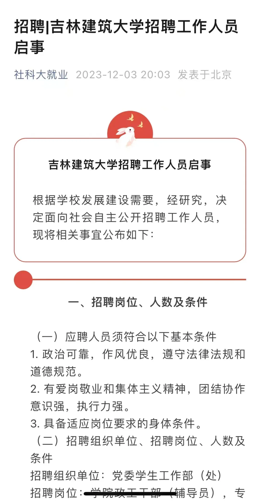
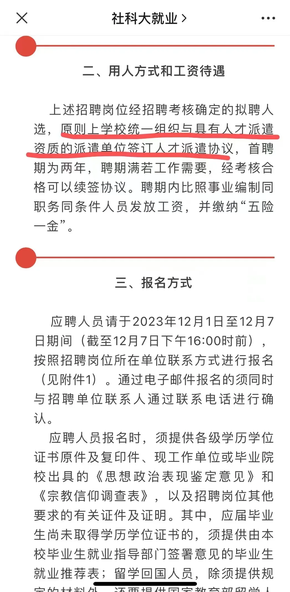
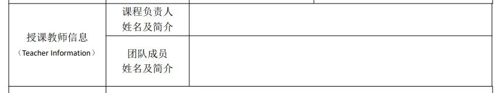

请相关部门及时关注并跟进问题。

## 1 就业问题

“请就业办发推文时能否看看用人单位的用人方式，这种劳务派遣模式就意味着第三方的派遣单位是用人单位，这个吉林建筑大学根本不是用人单位，而是用工单位，你们作为就业办至少注意一下保障我们就业生的利益吧，不是什么职位都在学校媒体上推荐，就这职位还放推文首条，不知道审核是怎么通过的。他这里还说明了续签协议，续签的也是劳务派遣协议，吉林建筑大学哪来的底气跑社科大来发这个招聘公告？

帮忙补个提示：

【提示】请正在找工作的同学注意招聘单位与你签约的方式，是直接签定劳动合同的方式，还是通过劳务派遣的方式。这两方式区别很大，特别是在对你的权益保障方面有很大不同，实务中，劳动派遣方式对劳动者权利保障较差、法律争议较多，直接用工单位（即未与你签订劳动合同，但你直接提供劳务给它的）承担责任极少。”

## 2 教学大纲团队授课

## “赞同昨天第二条

大纲岂止这一个团队授课没写分工问题，更大的问题是：某些课程在没有授课教师的情况下就编写了教学内容。恕我实在不能理解，一门课都没有授课教师，那这个教学内容是怎么来的？浏览一下还没有授课教师是十余门大纲，我很震惊的发现这些课并非是“马工程”规定的课程——也就是说没有固定的、必须完成的授课内容。那就奇怪了，这些凭空而来的授课计划哪来的呢？

看看这些课程基本上都是2022年修订培养方案的时候已经制定好的，到今天已经一年半了！如此长的时间内，一门课找不到授课教师，那倒要问问这是在糊弄谁？有一个最基本的常识是，除了规定的课程，一门专业课的授课内容当是授课教师深思熟虑之后仔细设计的，体现的是老师的学养与愿望。但目前这些个“空头大纲”（约有14个）显然只是为了应付学校的要求而草草拟定的，根本就没有效力！

编写这些大纲的人是一回事，教务处上传的时候不经审核就草草通过也是另一回事。社科大很多问题不在于没做，而是在于做的太慢和做的太粗糙。我们观察的结果是，这些没有授课教师但却提前填写了内容的课程大纲已经提交了半年有余。半年间无人问津，甚至到了开课前夕依然保持原封不动——更不要说昨天推送中指出的团队授课分工不明和仍然有未交大纲的情况。

我们想说的是，如果这些课程以后还要开，那就得请教务要求学院找到对应的授课教师，认真填写内容。如果这些课确实无人愿意讲授，那也请从页面上撤下。挂到那既显得尴尬、也暴露出一些部门不作为的现实，让这个本不该发生的问题拖延甚久。

我们好奇的问题是：难道请教务处解决这些问题就那么难吗？教务处不能只规范学生的行为，也麻烦规范一下老师/学院的行为。大纲这些细节看起来是小事，可是却能一叶知秋。也请教务处先落实这些没有授课教师的大纲，请教务处落实那些没有授课分工的大纲。不要让来之不易的成果与良好形象付之东流。

补充：有些课程大纲掩耳盗铃，干脆把这一栏给删了，请教务处自己核查。”

（见《[【读者投稿】都是误会](https://mp.weixin.qq.com/s?__biz=Mzg2MjcwNzQ1Mw==&mid=2247487002&idx=1&sn=17194e461b6373dfd8fc0a5fb1c3d884&chksm=ce028588f9750c9eaa09d653c7098ab344c1d4454dc8dc43c6dca8ae44ca0938a2bb78df0d89&scene=21#wechat_redirect)》第2条）

## 3 宿舍

> “投稿：就没有人觉得望京3号楼宿舍里的暖气不够热吗？想反映一下，望京宿舍冷的问题，在宿舍不开空调坐一会儿要穿羽绒服，夜里睡觉大半夜会被冻醒，暖气片是热的，暖气没有坏，但就是不够热，能不能请后勤处烧暖气的师傅多加点碳，让孩子们在宿舍里暖和一点，谢谢”

## “投稿

想问下学校在3号楼西侧各楼层楼梯间的吹风机处都装上门的必要性在哪里？吹风机间在楼外侧，和宿舍不相邻，噪音应该不会很影响对侧的宿舍（没注意到同学投诉，如果有的话欢迎讨论）；而且最近观察同学吹头时候其实也不会特意关门；更何况西侧楼道仅供6层同学使用，本来人也不多，绝不会挤到为了吹头发只能下到低层。鉴于此，实在不理解学校此举的意义，希望给个解释。即便经费多的没处花了也不至于这么浪费，何况还有更多更需要财力投入的地方。”

## 4 寒假宣讲宣传

“其他学校已开始寒假回高中母校宣讲的志愿活动，宣传和支持力度也不小。社科大招生方面名气很欠缺，所以建议学校好好考虑和筹备此活动”

“今天看到那个去中学宣讲的消息。突然很感慨。我该怎么跟我母校的同学说呢？我要说一降再降的分数线吗？我要说还没有我们高中好吃的饭吗？我要说嘈杂的施工环境吗？我要说跟我们高中一般大的校园吗？我要说你想象中的大学它大部分都没有吗？我要说让人无语的基础设施和一大堆的内部问题吗？我要说不太能感受触摸的到的学术大家吗？我该怎么说呢。我原本以为skd只有关于985211的争议，没想到竟然还有有如此之多的内部问题和争议。这不禁让我想起了一句话---不要陪一个人长大。（也不要陪一个学校成长）

当然我还是感谢skd的，不如说是skd收留了我，让我一个来自农村的孩子有机会来北京，来我们国家最好的城市！！！我想我是幸运的，就算不来skd，我也不会有比这更好的出路。我会接触认识到这么多超级厉害的学长学姐。我也不太需要着急上课赶路，因为比我高中从校门口的出租房到教室的距离都近。我想命运自有安排，但我还是不知道该怎么跟我的高中学弟学妹说，我隐约觉得，这不会是他们想要来到的地方。

我希望skd越来越好，成为真正的人文之光。（大一新生发疯，学长学姐们留点情面，不要批得太厉害，我虚心学习）”

## 5 接诉即办平台

“说难听点，某些领导的水平就是这样的，就这还评双一流呢，三流的管理水平，下流还差不多”

“‘因为五号楼住的是教职工，志国老师跟他们也比较熟识，所以回复的时候就有些开玩笑，导致同学们误会了’～接诉即办不是匿名提问吗，难道后台回复人员能直接看到姓名？”

“昨天后勤处对回应内容的说明令人疑惑。仅就接办平台来看，如果后勤处认为自己回复是没有问题的，为什么要把之前争议性回复的那几个诉求基本都隐藏起来不让大家看，而且这条回复又不在平台上公开呢？很难让人相信后勤处心里没鬼，不是在掩耳盗铃。

再就回复上来看，如果认为五号楼都是教职工就可以以这个语气说话，没觉得这是合理的。教职工也是人，难道教职工的诉求就不配被认真的回复而非生硬的拒绝了吗？”

> “关于接诉即办的各种负面评论意见： 这两天各种负面的评论，从一开始的普通批评到后面的讽刺，阴阳怪气，上升程度对老师人身攻击，还有另外一些。越来越阴阳，越来越讽刺，越来越无脑的评论，我可以肯定的说，你们是一点都不希望学校变好啊，你从良心来说，学校现在有没有在变好？我就是很久之前的一次评论里面说过的一个学校，在变好的过程中，大家多一点耐心以及理智可以多批评多建议，但是把这种阴阳怪气，把这种人身攻击给去掉，都是表演型人格吗？咋就这么想把心里面的阴暗面通过这种好不容易找到的一些小理由小瑕疵发泄出来呢？你有没有这种可能，你把你的评论发到朋友圈，凭良心去问学校的同学们，你的这种阴阳怪气的评论对学校的发展究竟是好还是坏？前一天的对这些学校接诉既办的评论都还问题不是很大，就不知道怎么了，到了今天我在同时看到了老师尽量的回复和同学更加激烈的阴阳怪气的讽刺和更大程度的人身攻击后，我不是说什么心疼老师啊，我是真的觉得，这个学校有内鬼呀，有卧底呀，你们就是啊，你们是真的一点都不希望学校变好啊。今天，我的态度是坚定的，我扫了一眼这两天人文之光的情况下，真的难受死了，这些上升程度的指责者，藏在阴影中的这些人就是让学校在变好的过程中，未来的一个定时炸弹，随时情绪不稳定的表演性人格患者。你们的标题简直就是七八年前的微信小文章，要不要我给你们再起几个？不就是，震惊，这个学校老师居然这样！震惊，居然有人还能说出楼层1楼太高这句话！请把文笔好用于发论文吧！投诉评论批评指责的时候，少点阴阳，少点暗讽，更不要有人身攻击，我看不懂，也是真的难受。如果你真的在这个学校受到了不公平不公正以及极不好的待遇，有真凭实据，你一脚踹开校长的门，你吼一声，上一回听到这个案例，我都是高呼一声英雄。”

（见《[【读者投稿】都是误会](https://mp.weixin.qq.com/s?__biz=Mzg2MjcwNzQ1Mw==&mid=2247487002&idx=1&sn=17194e461b6373dfd8fc0a5fb1c3d884&chksm=ce028588f9750c9eaa09d653c7098ab344c1d4454dc8dc43c6dca8ae44ca0938a2bb78df0d89&scene=21#wechat_redirect)》第3条）
