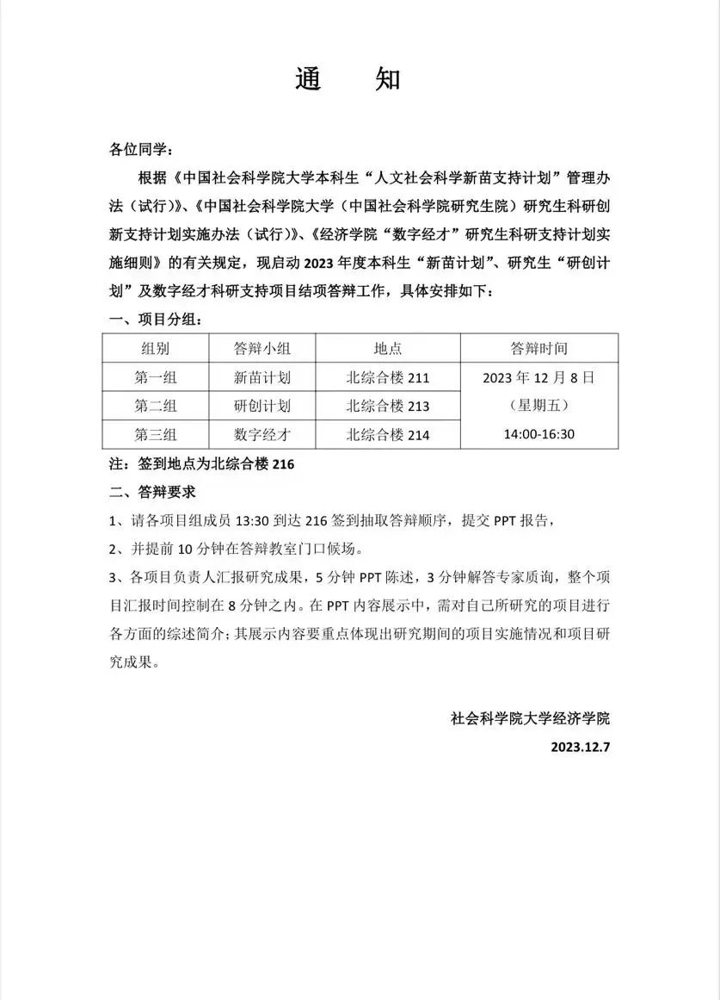

请相关部门及时关注并跟进问题。

## 1 答辩安排

> “社论君，经济学院的科研项目提前一天通知答辩，要准备ppt等材料，大家表示太仓促了！老师还是说时间安排不变，学院说一定要明天答辩。希望以后不要再有这种事情了！我们希望能够通过充分的准备来为项目画上完整的句号，而不是在24小时里紧踩deadlline匆忙结尾！”

## 2 考表问题

## “希望可以尽快出考表，能够提前计划一下。”

“麻烦考表早一点出好不好，大家真的需要早点拿到考表合理安排自己的时间，真心不想拖了。”

## 3 回归理性

## “那些不敢回归理性正视问题的朋友，应该从各种微妙因素的保护壳中探出头来了。”

——给这位同学点赞，说的太好了！

什么是人文之光啊，敢于指出问题，敢于正视问题，敢于解决问题，这样社科大才能变好！

反之，对问题避而不谈，并试图给指出问题的学生扣帽子，只会越来越差。”

（见《

【读者投稿】回归理性抑或回归护壳

》5.2)
