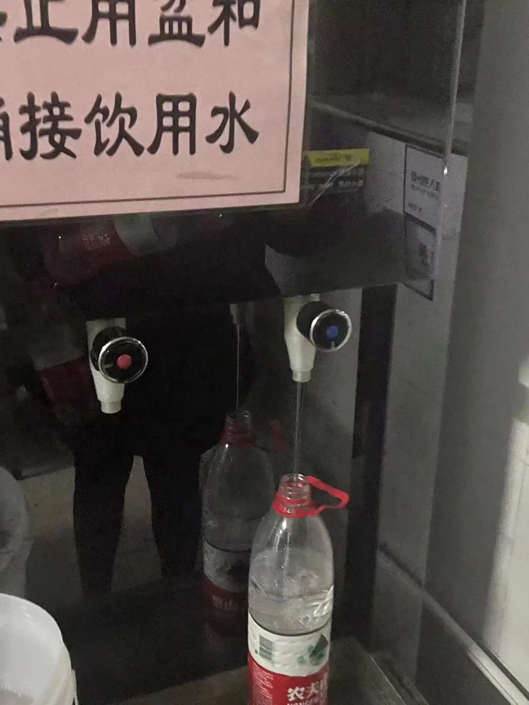
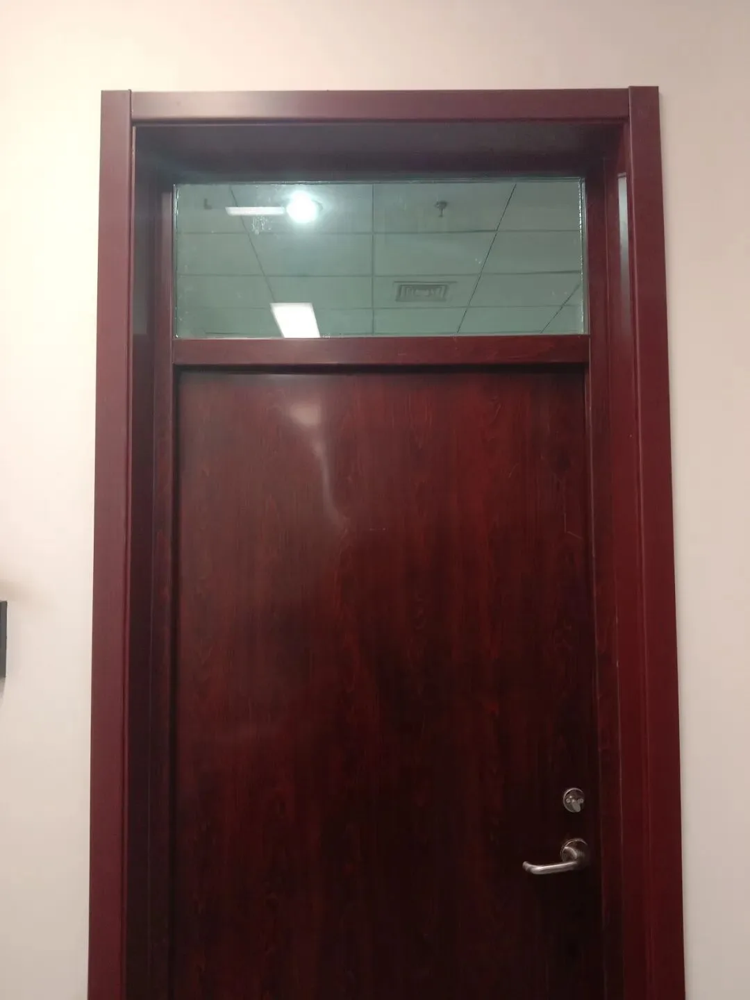

请相关部门及时关注并跟进问题。

## 1 五号楼饮水机

## “感谢学校后勤处以及关心5号楼饮水机的同学们！终于这个饮水机修好了！”

（参见[《【读者投稿】楼层再高 高不过部门的霸气》](https://mp.weixin.qq.com/s?__biz=Mzg2MjcwNzQ1Mw==&mid=2247486990&idx=1&sn=8d9c1373261b7cf968f11f28eaa5845d&scene=21#wechat_redirect) 1.1）

## 2 图书馆

> “良乡校区图书馆305阅览室，希望学校能重视起来，这本来是拿来安静上自习的地儿，奈何隔壁“噪音”太大，聊天寒暄各类噪音。事件起因是学生图书室和工作区之间留了三扇门，两大一小，大的还好 ，小的旁边噪音不断，不是偶尔，几乎天天如此，正在全神贯注突然哈哈一笑，还主要都是工作人员，偶尔也有保洁……实在是忍无可忍了，已将向工作人员反映过，希望学校重视起来！！！留了个门🚪 ，平时又不走人，要不堵上，要不门里测贴上警示语，这是图书馆不是菜市场，你们在门后聊天，305三分之一都受影响。学校为学生做这点事情应该不难，这点都做不到……”

## 3 奖补问题

## “望京校区什么时候发补助！”

## 4 医务室

“为什么秋季毕业生不能报销了秋季毕业生也会发烧啊！不让秋季毕业生报销医疗费，这么快就不把我们当成学生了吗？”

## 5 查寝

“谁允许男老师进女寝的，谁允许男老师进女寝的，谁允许男老师进女寝的？非得查的话让女老师或者女辅导员来完成很难吗？”

（参见[《【读者投稿】把事情当个事情》](https://mp.weixin.qq.com/s?__biz=Mzg2MjcwNzQ1Mw==&mid=2247487040&idx=1&sn=9775c148e0329202de95bd7f3de62b50&scene=21#wechat_redirect) 第4条）
