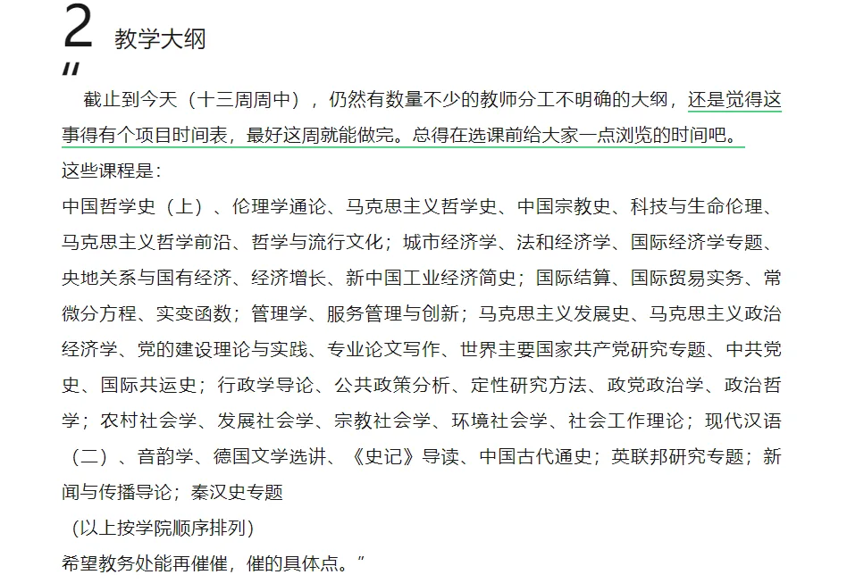

请相关部门及时关注并跟进问题。

## 1 课程大纲

## “投稿：团队授课的课程大纲到底什么时候才能更新完？为何一周过去了完成度依旧感人。

我们可以看看上周社论已经指出的这些课，现在整整过了一周，教务处完成了多少呢？就这个里面还有30来门没有更新具体分工。这难道没有给老师时间吗？就这么一个小小的事情，为什么这些学院和教务处就做不好呢？到底是不重视诉求还是应付了事呢？也请及时完成这个工作。

那么还有什么课没交呢？一统计还真不少：

中国哲学史（上）、伦理学通论、马克思主义哲学史、中国宗教史、科技与生命伦理、马克思主义哲学前沿、哲学与流行文化；国际结算、国际贸易实务、常微分方程、实变函数；管理学、服务管理与创新；习近平法治思想概论、民法总论、刑法总论、合同法、人权法、民事案例研习、党内法规学、人工智能伦理与法治导论；马克思主义发展史、马克思主义政治经济学、中国共产党思想政治教育史、世界主要国家共产党研究专题、中国共产党历史文献导读、中共党史、国际共运史；中国政府与政治、行政学导论、公共政策分析、定性研究方法、政党政治学、政治哲学；农村社会学、发展社会学、宗教社会学、环境社会学；现代汉语（二）、音韵学、德国文学选讲、《史记》导读、中国古代通史；英联邦研究专题。”

（参见[【读者投稿】回归理性抑或回归护壳](https://mp.weixin.qq.com/s?__biz=Mzg2MjcwNzQ1Mw==&mid=2247487032&idx=1&sn=f8b73b8b8420c07ab1859b68840d35cf&scene=21#wechat_redirect)2.1）

## 2 宿舍检查

“宿舍检查是用脚做的决定吗？一个宿舍四个专业的，要有四个不同的老师来检查，想想就荒谬，笑死了。”

（参见[【读者投稿】饮水机已修复](https://mp.weixin.qq.com/s?__biz=Mzg2MjcwNzQ1Mw==&mid=2247487045&idx=1&sn=63ed18ce7ac4d2b34fb077f223c88dd5&scene=21#wechat_redirect)5.1）

## 3 补助问题

## “望京校区到底什么时候发补助，真的没钱了，不想每天只吃一粒老干妈喂”

（参见[【读者投稿】饮水机已修复](https://mp.weixin.qq.com/s?__biz=Mzg2MjcwNzQ1Mw==&mid=2247487045&idx=1&sn=63ed18ce7ac4d2b34fb077f223c88dd5&scene=21#wechat_redirect)3.1）
