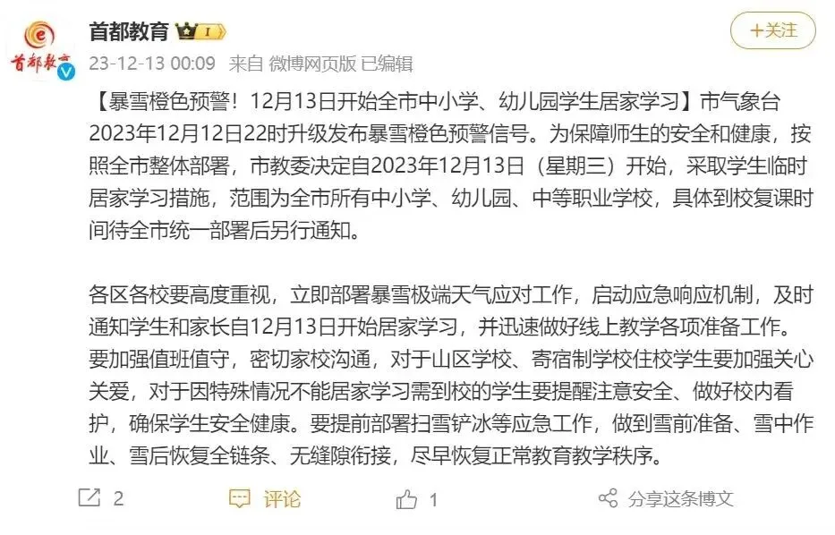
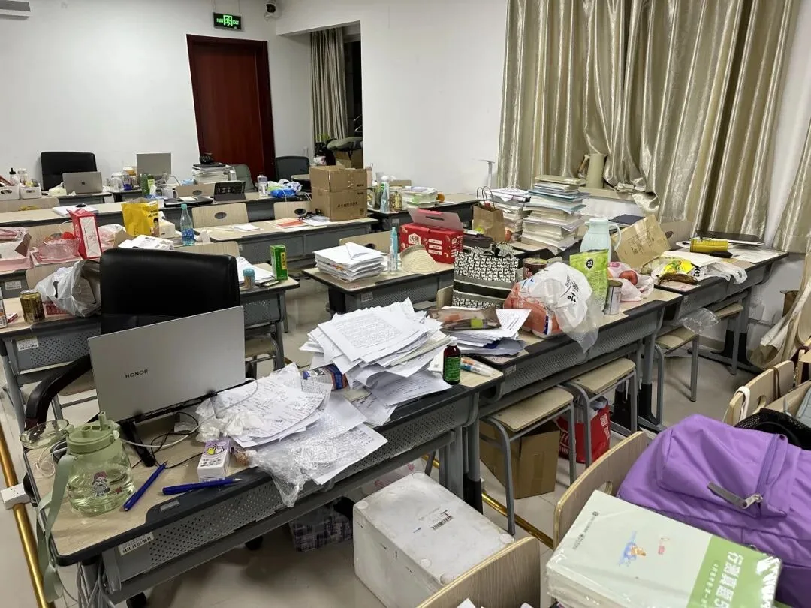

请相关部门及时关注并跟进问题。

## 1 补助

“投稿：每日一问：学校的补助和助学困难补助什么时候发放啊，真的已经没有几顿饭钱了”

“投稿，学生的每个月补助和奖助金什么时候发放啊？这么冷的天，让大家受冻又挨饿吗？每个月能不能固定日发放？？这么少的补助还要拖欠，怎么好意思的？”

（参见[【读者投稿】课程大纲仍未完成](https://mp.weixin.qq.com/s?__biz=Mzg2MjcwNzQ1Mw==&mid=2247487051&idx=1&sn=a5ef77feb9943a3dd974030a9b1242e0&scene=21#wechat_redirect)3.1）

## 2 教务问题

> “投稿：北京都发布暴雪橙色预警了，教学管理部门是不是也应该根据气息条件适时安排线上上课？教务处行政水平如何先不谈，最起码应该有点人性吧。老师们顶风迎雪来这里上课很容易出现安全问题、上课延误什么的，这几天线上上课无疑是较为合适的选择，希望教学管理部门能人性化管理，在风雪天让师生感受到工作的温度。”

> “看接诉即办，大家询问选课时间的也不少。不知教务处是否可以及早发布下学期的教学安排？其实不一定开选课系统，可以先行下发全部课程的汇总Excel表供大家浏览，如果有信息变化在系统中更新就是。这个应当不难，希望这周就能发下了供大家研究，不必一定要等到15周才能发。大家询问选课时间更多的只是希望尽快下发全部课程的汇总单子而已。请教务处协调一下，现在各门课的信息理应汇总完了。”

## 3 教室问题

> “望京校区的领导开开眼吧，不知道我们学校大部分就业率都靠考公吗？现在是考公关键时期，你们搞个形式主义的清理教室是想绝毕业生的路吗？毕业生忙着各地考试，谁有时间配合你这种无用的形式主义?”

## “社论君您好，我想投个稿，关于望京校区的教室占座问题

今天早上收到通知，望京校区终于开始清理教室占座的行为了，可谓是大快人心，必须点赞支持。每个自习的地方都需要清理，望京这边教学楼，报告厅一楼三楼的教室都存在大量占座位的情况，占了不学习看视频打游戏的，占了座位又经常不来的，占了一段时间走了还不收拾自己东西的等等情况都有出现，让真正需要学习的同学没有学习的位置。而且更不能忍受的是部分占座位的同学直接把公共的教室，桌椅当自己家，往教室里放躺椅，被褥各种生活用品，成箱的搬饮料，水果，乱扔垃圾，果皮，鼻涕纸等且不清理，还能见到腐烂的水果，放坏的零食，把公共的教室当成自己家，搞的一片狼藉，更有甚者直接在教室门口贴张纸，写上教室已满，禁止进入。任何一个成熟的，有管理的学校都不可能出现这样的乱象，望京校区还是我见过的第一次，良乡校区据我所知也不是这样。教室是公共资源，本就不该为任何人私用，刻苦的同学起得早就可以坐自己喜欢的位置，既然想睡懒觉，那就去别的空座位座，望京的自习资源本就不紧张。一天学完清理干净自己的垃圾，收拾东西回寝室。如果说连拿着学习用品去教室都嫌累，我只能说再没有比望京校区还小的学校了，就背着包宿舍到教室这两步路都嫌累，真不知道本科四年是怎么读下来的。

附上部分教室的图片”

## 4 图书馆

## “望京校区：图书馆暖气不足，可以麻烦暖气加足点吗？”

## 5 食堂

“望京食堂的菜很难吃，之前还不错的菜为什么没有了，比如毛血旺，肥牛卷加豆芽（不是那道全部都是肥牛的）”
