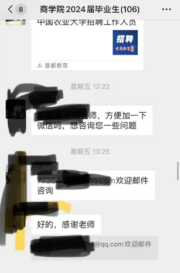
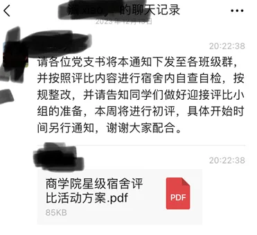
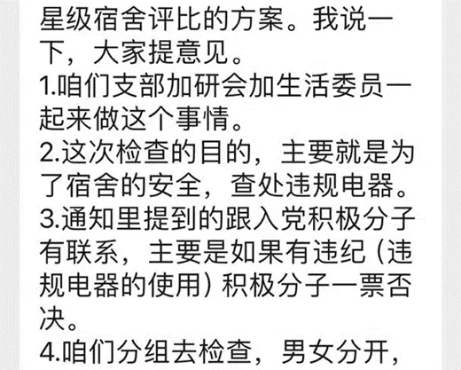
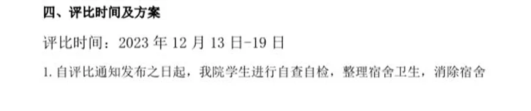
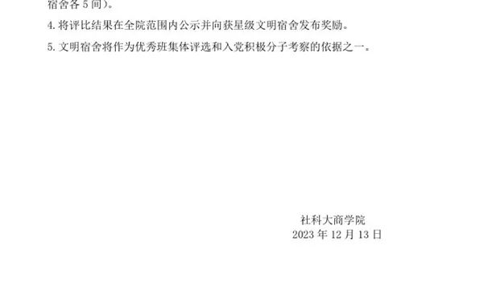
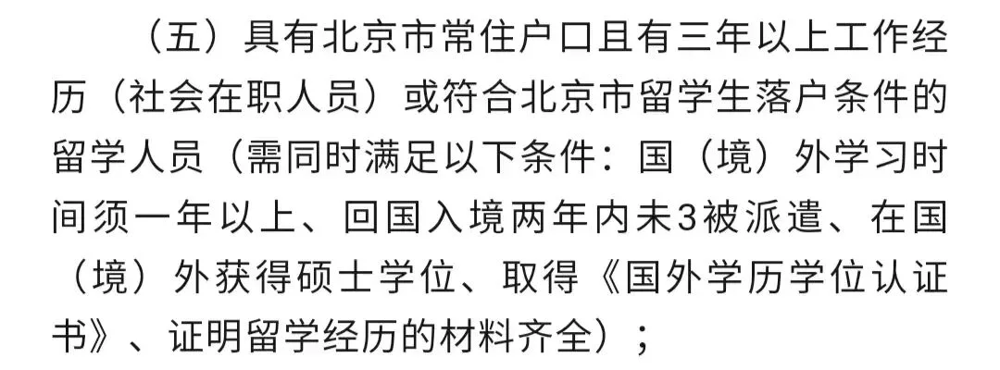

请相关部门及时关注并跟进问题。

## 1 入党评优

## “望京商学院研会疑似一手遮天，干扰党员评选

事情起因是商学院某专业22级两个班级进行预备党员选举，学生会重要成员落选，随后几天时间，商学院便发布了《商学院星级宿舍评比活动方案》，其中重要一条规定，发现违规违纪电器，一票否决积极分子身份。

事情看起来合理，但是处处是疑点。首先，12月8日两个班级进行党员评选，在结束以后，研会重要主席团成员在毕业群里联系负责学院党团工作的老师。

12月13日，该老师以党团名义令各班党支书向班级内发布活动方案，并未通过研究生会公众号、官网、企业微信等公开渠道。

随后负责该项工作的老师特意强调该检查的核心是检查违规电器，并且与积极分子直接挂钩。

最重要的是，商学院党的发展对象（预备党员）报送时间为12月20号，而此次活动的截止时间为12月13-19号，仅仅提前一天。

并且该活动并没有学院党委盖章。

疑点梳理：

1.动机：首先，商学院前几届都未曾有过这个活动，并且关于宿舍问题，限电问题理应有学校统一检查，一个学院为什么要举行这种活动？其次，为何偏偏与积极分子和党员挂钩？逃课等其他违纪不抓？偏偏具有一票否决权，虽然违纪，但这绝不是一棒子把人打死的理由吧？再次，事件是否太过蹊跷？同一个老师发布任务消息，事先学生会落选重要成员与其有联系，且不通过公开渠道，而且时间也刚好卡在预备党员申报的前一天。大家有足够的理由质疑其动机是否合理。

2.活动性质：首先活动没有盖章证明，难以说明其效力及负责方，如果关系到评选党员一票否决等重大问题，谁能对此负责？其次，这到底是学生会的平常活动？还是学院领导的正常检查？如果是学生会自发地组织活动，那么就没有强制权，也没有与党员评选挂钩的理由。如果是学院正常检查，未审核不盖章，为何不通过公开渠道通知？策划者如果是学生会，那么本身有巨大嫌疑。

3.活动本身：活动是从党团口下发，且由党支部通知，也关系党员问题。但是其执行与评选过程均未有党员、团委参与，全程由研会，生活委员参与。那么这究竟是什么关系？是否是研会的某些人借着党团活动的“皮”去给自己背书？

（最初发布的版本只有学生会和研会及生活委员参与打分，后期在同学反映下才变成加入党支部成员）

4.公平公正问题：两个班中，几乎占据了商学院研会90%上的人员。其中一个班级，学生会重要成员（在评选中落选）、一名党员、一名生活委员均在一个宿舍，而其中两人与老师直接对接，并由两人负责执行检查评选，请问如此安排如何让人信服？

5.附加：从22级商学院研会成立至今，主席团成员就利益占尽，优秀学生干部、三好学生、奖学金、助学金，无一不收起其囊中，大家早已心生不满。光就奖学金问题，大多同学也有质疑，为何主席团几名重要成员能在学习成绩、科研能力并不突出的条件下在90余人中获得学业一等奖学金？就算活动有加分，但是大多数同学也都是可以满足上限分值，评价评分不公开，难以令人信服。奖学金到底是评与老师关系好、活动办的多，还是学生的成绩与学术？所谓民主公开，是否尽是拉帮结派，利益关联？

对此，希望商学院能对此做出合理解释与回应，我谨代表所有老老实实、本本分分、正直的商学院学子，讨一个说法，为何在这个时刻，这个节点，要通过与入党联系到一起去避免宿舍安全隐患？难道不能通过宣讲，竞赛？学校不应该是助长歪风邪气的地方、这些机关算尽的人也不配入党！我希望这是我个人的小题大做，但是如果学院问心无愧，那也应该根本不差对我们一个合理的解释！我们要防止的不仅仅是不公平结果，更是所有不公平的动机。”

## 2 图书馆

“数据库：北大法宝和威科先行怎么都没了，学校能不能续购啊，这对法学生真的很重要。”

## 3 望京教室问题

> “关于清教室，某些人要是合理利用为什么最后要靠清教室来维持正常秩序？之前甚至在教室看到过电饭锅、取暖器和茶具，各种零食水果也是不用多说了，让你们把学校当家不是让你们把卧室搬到教室😅搞得一片狼藉了反过来咬学校一口说没人性，你还就惦记着不违法就不触碰道德底线啊？本来就是公共的教室，凭什么你放点自己的破烂就相当于标记领地呢？现在说是形式主义，确实，对于死皮赖脸的人来说什么不算形式主义呢，就你还考公呢，你能不能说一下什么是公什么是私啊？”

“针对望京清理教室的问题绝对同意，一个教室里，一个人能占四张桌子自习，就这种占座的行为，必考不上”

（参见[【读者投稿】下雪之后怎么办？](https://mp.weixin.qq.com/s?__biz=Mzg2MjcwNzQ1Mw==&mid=2247487057&idx=1&sn=4f31a3078e052ba8bb504028b1fe2173&scene=21#wechat_redirect)3.1）

## 4 线上上课

> “投稿线上上课无疑是较为合适的选择，教务处起码应该有点人性：老师们顶风冒雪来上课，教务处就没有人性了，那是不是也应该后勤人员 行政人员 医务人员 最好也通知外卖人员 快递人员等都别来，这些人顶风冒雪来也很容易出现安全问题，上班延误的问题，这样是不是更温暖？已经是成年人了，非要往中小学里掺和，老师如果有困难不能克服的，你怎么就知道不允许线上上课？难道只有一刀切 才有人性或者按照你的想法才有人性？”

（参见[【读者投稿】下雪之后怎么办？](https://mp.weixin.qq.com/s?__biz=Mzg2MjcwNzQ1Mw==&mid=2247487057&idx=1&sn=4f31a3078e052ba8bb504028b1fe2173&scene=21#wechat_redirect)2.1）

## 5 就业问题

## “就业办能不能筛选下就业信息再发”

## “建议一下：

社科大可以设置一个平台，对内公布一下各专业本硕博同学的就业去向的统计数据吗，学校年年都有统计，但是还没见有过公布，只能自己私下打听。如果有一个内部公布平台，这样也为大家秋招春招找工作提供一个参考。谢谢”
