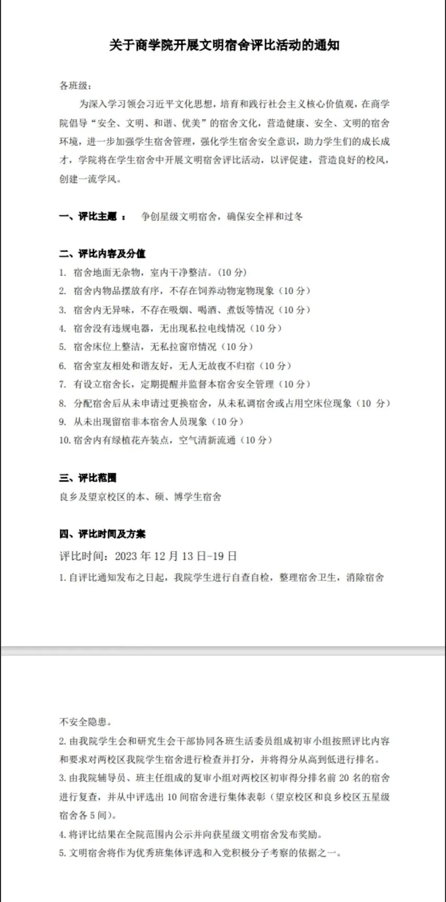
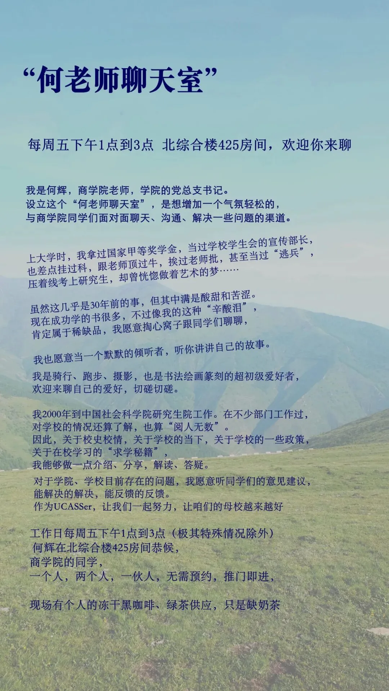

相关部门及时关注并跟进问题。

## 1 就业数据公开

## “支持5

就业去向有什么不能公布的？众所周知，国内绝大多数学校都会公布就业率，就业去向等相关数据。尤其是国内知名大学，一流大学，无一例外都是公布的。

堂堂人文之光，世界一流文科大学，人文社会科学的最高殿堂。连这点气量和胆量都没有吗？不公布就能隐瞒隐藏问题吗？这是逃避？😅😅😅”

（参见[【读者投稿】小小的学院 大大的谜团](https://mp.weixin.qq.com/s?__biz=Mzg2MjcwNzQ1Mw==&mid=2247487079&idx=1&sn=adfe4b9421d0d2968d2a0aedd687ebbd&scene=21#wechat_redirect)5.1、5.2）

## 2 入党评优

## “对人文之光 12-15日 第1条的回复

我是何辉，商学院老师，负责学院的学生工作。

我关注人文之光很久，甚至想过在这里发一下招聘信息，招聘我科研项目的研究助理。希望通过这种方式，让人文之光的信息更多元，多一点正面的信息。

没成想，第一次出现在人文之光，竟然是通过今天这样，以回复“望京商学院研会一手遮天 干扰党员评选”的方式，实在汗颜。

我简单说一下这次活动的想法。先看一下活动通知的内容。

该活动是“文明宿舍”评比活动，希望“以评促建”，在学院倡导“安全、文明、和谐、优美”的宿舍文化。通知里，有具体得评比内容，既有安全层面的“没有违规电器”等内容，也有文明、和谐等层面的“室内干净整洁”“有绿植花卉装点”“室友相处和谐友好”等内容。

这个活动之前没有做过，这次是第一次。是我提议做的。也是我推动学院文化建设的一个小步骤。

时间也是我定的，原来具体做方案的老师提出评比时间可以紧凑一点，我说咱们的目的是以评促建，所以要给同学多一点时间。顺便说一句，我在写这篇文字之前了解了一下，帖子里提到的给学校报送的时间是22日，不是20日。

在方案发给各班之前，负责老师曾建议通过学院官网、公众号发布一下评选通知。我说，学院的公众号上经常会有“案例大赛来啦”“案例进行中”“案例大赛成功举办”等文章。我觉得这样一个活动，前后多次报道，稍微显得繁复。不过，这些活动都是由同学们提议发起的，我当然要尊重和鼓励，也就不说什么。但这次评选活动既然是学院学生工作部门发起，就尽量少占用公号资源，等活动结束时，写一个全面的新闻报道就可以。

我说上面这些，是想说，这个活动的设计，并不是像帖子中推理的那样，被某些人暗箱操作，专门为个别几个人的利益服务的。

稍微理性地思考一下，动用学院的力量，来为某几个同学的私利服务，这一定不是什么划算的买卖。因为按阴谋论的推理，那几位同学得上下左右打点多少，才能搞定所有这些人，为他们的利益服务？

如果按帖子的设想，某几个同学真有“一手遮天”的能耐，岂不是应该在班级党支部的环节，就搞定了一切，何烦现在还要设计这么个活动来搞的震天响，竟连“人文之光”都惊动了。

至于文章中说的，如果有违规电器，积极分子一票否决。一来，通知中没有这么写。再者说，如果使用了违规电器，那是违纪，学校会按校规校纪处理。当然，如果违规使用电器的恰好是某一位入党积极分子，那么，首先是违纪处理，取消入党积极分子是后续的工作。也就是说，本次评选是面向全体同学的，而不是专门为入党积极分子“定制”的活动。第三，本次评比活动重在评优，方案中特别写明”文明宿舍将作为优秀班集体评选和入党积极分子考察的依据之一”。也就是说，我们重点考虑的是，获评文明宿舍可能会为入党积极分子的考察过程加分的事情。

至于文章中说到的奖助学金存在不公，某些人“利益占尽”等说法，如果发文章的同学觉得有问题，可以向学院反映，大可不必在此将其与此次文明宿舍评比关联起来。关于奖助学金评选，学院评选时是严格按学校或学院制定的规则来进行的，若有同学觉得有问题，可到学院学生管理办公室来查询。如果查询后，还有不解或疑问，老师也无法给你很好的解释，你那时完全可以像帖子里说的，大胆怀疑。但似乎在你没有这样做的情况下，就认为存在“歪风邪气”，我觉得这样不妥。

当然，我仍然欢迎你有空时到学院老师这边了解一下具体情况，我可以全程为你服务。

最后，我想稍微延伸一点，多说两句。

一是我不排除在个体层面，会有人总想让自己利益最大化，但从一个个体到班级，专业（系），再到学院。一手遮天的事那么容易？不要轻易把老师想像为被收买的，无原则的，甚是同流合污的人。我可能没有你聪明，但我也像你一样（你在帖子中有意表现出来的样子），是有基本的良知的，也希望凡事，特别是自己经办的事情尽可能公平公正的，我也是爱惜自己的羽毛的。我认为，这也是大多数人，绝大多数老师原本的样子。

因此，你昨天的帖子，如果针对一人说，例如针对我，倒没啥。但请不要把整个商学院都带进来。那样不公平！

第二，学校毕竟与淘宝和一般的服务机构不同。人们在购物或者购买服务时，可以从“消费者是上帝”的地位，来对卖家提出种种苛刻要求。在世界范围内的市场化趋势下，大学，似乎也被越来越当做一个服务机构看待。从为同学成长成才服务的角度，这个也没有错。但，大学还是有她特殊的地方，就是育人。我为MBA22/23级同学都上过课。我在上课时，一直在鼓励同学们上每一门专业课时，要尽快掌握科学的思维和研究方法，要从写一篇合格毕业论文的角度去加强训练。因此，我希望有的同学在以消费者“上帝”视角对学院、对老师的工作指指点点时，要尽可能 “大胆设想不乱想，小心求证要实证”。

最后，我发一下我的电话和邮箱，81360369；hehui@cass.org.cn。欢迎同学有问题随时跟我联系。

为了让这个回复的帖子不显得那么“被动”，我也发一个我的“何老师聊天室”的广告（这张海报是去年6月份，何老师聊天室开张时我自己设计的，虽然过了快一年半了，但长期有效），欢迎同学来访。”

## “关于商学院举办星级宿舍评比，主要目的是查处违规电器的三问：

一问：检查宿舍的违规电器，查到后直接取消入党积极分子的身份，说取消就取消，是否有相关的党纪说明或者书面规定？

二问：活动要检查违规电器，为什么不先界定一下违规电器的范围？哪些电器属于违规电器？或者功率超过多少属于违规电器？

如果不界定违规电器范围，是否存在一种可能，有别有用心的人来检查，指着只要是用电的都说是违规电器，借此来达到自己的其他目的！

三问：什么时候来检查？为什么还不确定时间？大家最近都很忙，还有考试，宿舍得提前商量一下时间留个同学，这个得当着同学面来检查吧！

如果不当着同学的面检查，是不是存在着有可能乱翻私人物品，侵犯同学隐私，造成财物丢失的情况？更严重的有没有可能直接栽赃嫁祸说从这宿舍中查出了一个原本不属于这个宿舍的“违规电器”！

所以，如果学院要办这个活动，就请尽快完善相关细节，规避相关漏洞和风险，打消大家疑虑，公开公正公开，以正风气！！”

（参见[【读者投稿】小小的学院 大大的谜团](https://mp.weixin.qq.com/s?__biz=Mzg2MjcwNzQ1Mw==&mid=2247487079&idx=1&sn=adfe4b9421d0d2968d2a0aedd687ebbd&scene=21#wechat_redirect)1.1）

## 3 校园网问题

> “校园网问题真的是老生常谈的问题了，不知道为什么学校网络办这一块的负责人怎么就这么坐得住。北大法宝没了，好，忍，至少还有威科先行，但是我输入网址校园网没了，真的压死法学生的最后一棵稻草了，成年人的崩溃就在这一瞬间。网速奇奇怪怪地差，流速也就是用量奇奇怪怪地大，是谁偷了我的校园网？？？”

## 4 教务问题

## “回复今天p4

本意也不是要一刀切，必须线上，只是希望可以灵活协调。

一个班的同学，一半以上都生病了，全班带着口罩上课、做pre，这样真的合理吗？

我们的诉求不是要求一刀切线上，而且教务处可以灵活处理，允许老师结合具体情况考虑采取线上。（现在目前的教务处回复是不允许线上的，一刀切必须线下）”

## “回4.1

这个稿件有一种混沌的美。首先，不同工作的工作性质决定了有些工作人员的确无法线上工作，对这些在雪日加班加点的工作人员当然要致以崇高的敬意。但大学教师的授课工作在大雪这种极端天气下无疑是可以较便捷的转到线上的，为什么本可以有更好、更人性化的解决方案却不予实行呢？

其次，这位朋友一会又说老师们和其他职工一样不需要线上授课，一会又说你怎么知道没有线上授课的安排，这种胡言乱语让人无力吐槽。

同时我要给投稿的同学一点辩护，从人家的稿件来看，人家举中小学的例子只是为了说明天气之极端。

不过，这位朋友想必不是老师，同时我也相信这话不是行政工作人员说的，因为这稿水平实在太次了，学校应该没有水平这么差的行政工作人员吧？那么我希望这位朋友能早日成人，因为成人需要基本的逻辑能力其似乎仍需锻炼。”

（参见[【读者投稿】小小的学院 大大的谜团](https://mp.weixin.qq.com/s?__biz=Mzg2MjcwNzQ1Mw==&mid=2247487079&idx=1&sn=adfe4b9421d0d2968d2a0aedd687ebbd&scene=21#wechat_redirect)4.1）
