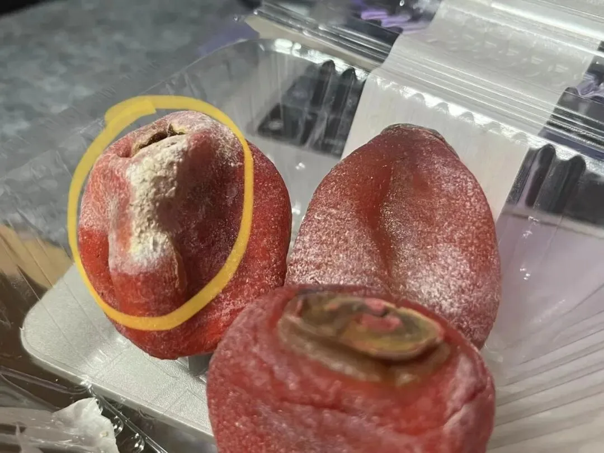

请相关部门及时关注并跟进问题。

## 1 勤工俭学

> “来学校一年多了，但是在学校通知里很少能看到有勤工助学的公开招聘需求，不清楚是咱学校勤工助学岗位太少，还是有别的原因。之前见其他学校不论是学院招聘还是各职能部门招聘，都会统一公开发布信息，让所有的学生都能在第一时间知晓。希望学校能多提供一些勤工助学岗位，降低信息壁垒，提高信息公开化、透明化程度。”

## 2 学校超市

## “学校研缘超市赚这几块钱究竟为何？为了赚钱不择手段吗？

今天中午在超市买了吊柿，9个里面藏了2个有霉菌的，还垫在最下面根本看不见。等吃到下面才看到有发霉的。吊柿是糖渍后的加工食品，短期内很难发霉或变质，装盒之前没有检查过吗？？？就这么卖给学生吗，没有一点责任心的。

不知道霉菌有没有沾染到其他的吊柿上...霉菌吃了轻者呕吐、发热、腹泻，重者猝死或患癌都有可能...这超市背后到底是什么势力，敢做出这样的事情！！在离人文之光最近的地方差点被害死...太可怕了，谁懂啊，差点被毒死！一点没有人文关怀。”

## 3 入党评优

## “回复12.16第二条入党评优

非常感谢何书记的回复。打消了我许多不合理的怀疑。在看过何书记的文字后我也深刻反思了自己，我非常理解老师们的辛苦，并且我郑重表示我对商学院的老师是没有任何看法的，我所接触过的所有授课、行政老师们都很亲切，也都热心地帮同学们解决问题，尽心尽力在为学院的发展做贡献。但可能一时冲动使得自己在编辑文字时加入了太多个人感情，如果因此给学院、相关老师带来不好的影响我确实对此深感抱歉，所以我在这个平台做出回复澄清。

作为一个普通甚至边缘的学生，我只是想好好地度过自己的校园时光，与同学们留下美好的回忆，好好学习充实自己，找一份心仪的工作。但是不知何时开始，同学们之间总是因为利益问题渐行渐远，甚至相互敌对，如果环境变成这样，我相信对学院的发展一定不是好事，如果同学们之间都不能产生连接，又怎能指望大家毕业以后对学校有所留恋和正向影响呢？我相信很多大学、很多专业在发展完善中也都存在这样的问题，原因主要是因为在规则与细则之间有很大一部分灰色地带，如果有人别有用心，可能会导致不公平，就算事实并非如此，也应防止负面舆论的可能。

我想要公平公正的环境，并把它带给我们的学弟学妹。我希望每个人都公平公正、名副其实、各有所得，每个人都有权利从不同的方面体现出自己的优秀。但是学院这么多专业，这么多班级，老师们不可能照顾得到，所以建议对于标准制定，流程制定等方面需要更统一、更清晰、更明确、更全面的要求，整个过程、评价也应该更透明、更公开。对于学生工作、如果参与的学生本身就涉及到利益关联方，更要注重人员分配，个人的责任与义务划分，以及群众举报途径，打消一些人的误解。

之所以选择这种方式，是因为确实不知道有其他渠道，也担心自己人微言轻会被针对，给自己造成伤害，但是确实没想到会有这么大的影响。有很多东西确实没法有实质性的证据，但是在这里生活了一年多，很多真切的感同身受与流言堆积才导致产生了这些猜测。

最后，我再次对之前的冲动文字中的不妥之处表示歉意，并向何书记表示感谢，希望这一次“空中对话”能真正打开普通学生与老师之间沟通的桥梁。真诚希望学院和学校能发展得更好，也希望同学们能够保持正义，成就真正的人文之光！”

## “致有良知的、敬爱的何辉何书记：

1.您早干嘛去了？

关于商学院奖学金评审规则不公开一事，公众号上多少人吐槽过了？劳驾您再作一次公开回应吧：迟迟不公开的考虑是什么？按您的意思，如果学生不去学院办公室亲自查，那就永远别想知道规则。请问何书记，我这样理解，对还是错？

2.公章呢？

查寝文件没盖公章一事，您为什么不作回应？既然第一次不回应，我就帮您再提一次。没加盖学院公章的文件，是否具有相应效力？如果大家拒不执行，会有什么后果？

3.什么是理性思考？

“稍微理性地思考一下，动用学院的力量，来为某几个同学的私利服务，这一定不是什么划算的买卖。”

何书记，请问在您二十多年兢兢业业的辛勤工作中，您是否听说过、见识过这种事情的真实发生？

您大概率会说：“当然没有！”，我相信您，也想送广大同学们一句话：连何书记都没见过，你们肯定更没见过咯！别瞎猜啦，该干嘛干嘛！”

> “我想请问一下何辉老师，学生的保研、升学、就业时的推荐权都在你手里，你想卡人政审档案，随时都可以卡，而你的升官、发财权都不在学生手里，这种双方权力完全不对等的情况下有什么好谈的？”

“投稿：非利益相关方，针对双方的内容指出几点商学院还没有解答的疑问。 1、商学院回应了活动举办的正当性——领导班子提出，但尚未回应活动执行实施的公正性，周五的同学投稿中明确提到了“宿舍检查的实施由学生会重要成员（在评选中落选）、一名生活委员负责执行检查评选，如此安排如何让人信服；活动与党员发展工作相关，但全程没有党员、团委参与，全程由研会、生活委员参与”，这点没有做出回应，活动的动机就算再正当，也显得软弱无力。 2、众所周知，在研院、在社科大，宿舍里查到违规电器到底会有什么样的处罚结果呢？学校查、宿管查，把你违规电器收走了事，哪里来的什么处分，如果有，希望商学院能够给出近五年来的其他案例，以说明自己将这次活动的结果与党员评选挂钩的正当性。 入党合格性的考察是一个时间区间内的工作，以这样一种静态的、孤立的“突击检查”来一票否决掉同学入党的努力，这哪里是打同学的屁股，这是打党员发展工作的脸。“违规电器检查”在党员发展中到底是selective and irrelevant，还是compulsory and necessary呢？退一步讲，就算商学院将违规电器列为党员发展的重中之重是合理的，那么之前发展的党员没有这一道流程，商学院又如何保证之前发展的党员符合你们发展党员的标准呢？是否需要回炉重造呢？还是说商学院党员发展工作遇到了新形势，必须要做出这样的改变？道理又何在呢？一把带有偏见的尺子永远也量不出正义的尺度。

——————————————————————————（分割线）

大领导会为了替一个小虾米主持公道，而和小领导闹掰吗？不会。院长会为了替一个毫无瓜葛的学生主持公道，而和自己团队的行政老师闹掰吗？不会。他们的职责都是维护整个团队的利益和目标，维稳永远是第一位的，问题可以暴露，但全程只能在水下发生。哪怕这个老师真的有什么问题，也是关上门来扯扯袖子出出汗，“好吧好吧下次不许再犯”，毕竟将来给自己干活的还是这群人啊。 信任感需要塑造，迷雾没有被彻底拨开之前，每一寸土壤都滋生着这样的想象。”

（参见【[读者投稿】新问题接旧问题 评选疑云有复](https://mp.weixin.qq.com/s?__biz=Mzg2MjcwNzQ1Mw==&mid=2247487085&idx=1&sn=9e0be34f6342bd24eff36e6fece06f4e&scene=21#wechat_redirect)2.1、2.2）

## 4 教务问题

“回复教务问题中：“现在目前的教务处回复是不允许线上的，一刀切必须线下。”建议你做个调研 看看学校近期本科教学有没有线上上课的。如果是有的，这所谓的一刀切就有问题。如果没有 你可以再继续。。。

回复教务问题“这个稿件有一种混沌的美”，抱歉，你说的“这位朋友”还真是行政人员，还是教务处的行政人员，水平也的确太次，次就次点吧，也回复一下：

1.之前的回复仅就“教务处起码有点人性”进行了一下辩解，天气的确极端，有的学院提出，有本科课程的老师觉得家离的远，大雪天不想线下上课，想通过线上上课，我们是同意的，所以也就有了回复中的“你怎么知道不允许线上上课？”

2.当然有更好、更人性化的解决方案，就像你说的转到线上，对于你来说似乎很容易，但是北京市教委、大学城管委会、学校并没有通知要求全部课程转为线上，作为行政人员是不是可以直接发个通知就“较便捷的转到线上”？当然，你也可能不知道我们也是提交了预案的。

3.作为一个水平比较次的行政人员，总觉得经历了三年疫情，同学们能更多的跟老师有近距离的沟通，在线下上课可能更有益于同学们的学习，可能出发点就有问题，应该更为关注的是老师们辛苦的往返，而不是关注学生希不希望线上上课。

4.关于你的辩护，“人家举中小学例子只是为了说明天气极端”，但你并没有提，是不是因为天气极端就可以直接说“教务处最起码应该有点人性”？

5.我在北综合楼435，像此次推送的商学院老师一样，也欢迎随时来沟通。回复依旧是胡言乱语，将就看吧。”

（参见【[读者投稿】新问题接旧问题 评选疑云有复](https://mp.weixin.qq.com/s?__biz=Mzg2MjcwNzQ1Mw==&mid=2247487085&idx=1&sn=9e0be34f6342bd24eff36e6fece06f4e&scene=21#wechat_redirect)4.1、4.2）

## 5 食堂

## “投稿望京食堂：

12月17日，糖醋排骨，我想问下排骨是买的当天新鲜的吗？一股子味，肉质也很难看。如果是新鲜的我也是服气，能做的如此难吃，如果不是新鲜的，麻烦你们食堂拿我们学生当个人吧。”
