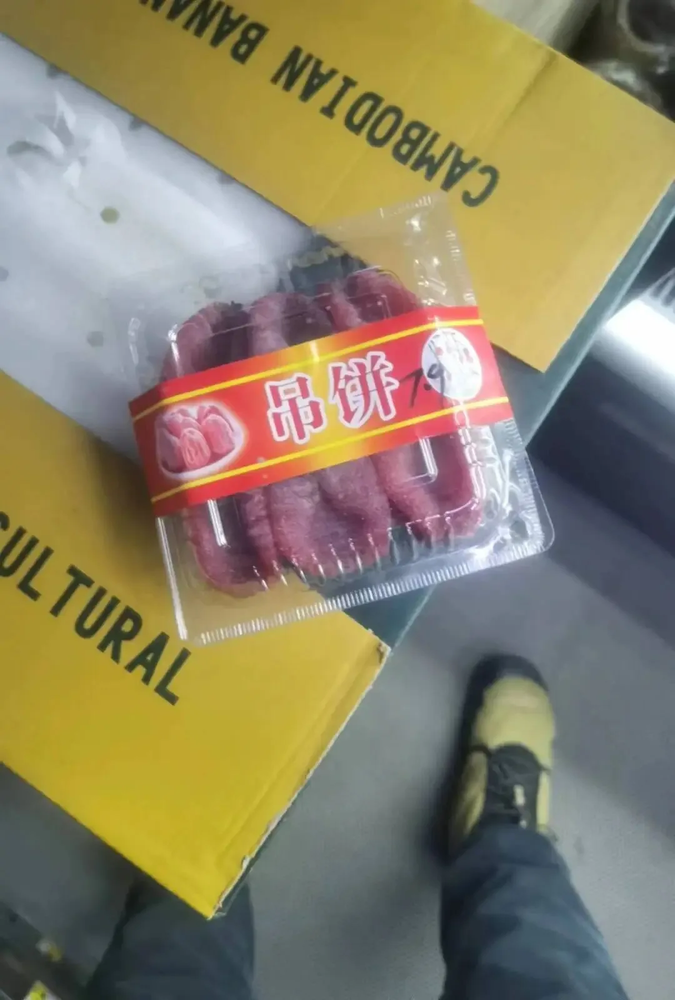
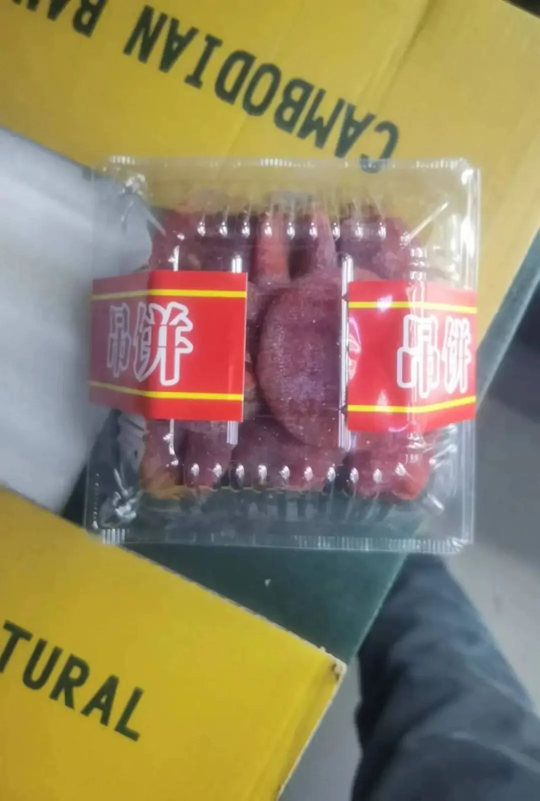
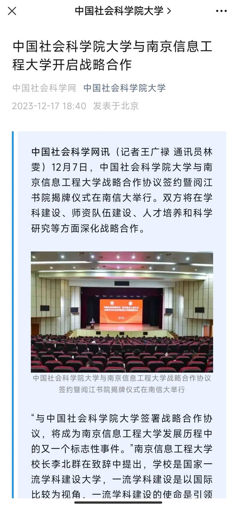

请相关部门及时关注并跟进问题。

## 1 教务问题

## “投稿：未按培养方案规定开课

每一次课表出来都不难发现，有些下学期该开的课却没有开。而且有些时候一个学院每学期都能有三四门课没法如期开设，这是为什么呢？我想，培养方案应该有他的严肃性，不应该说不开就不开。有些困难是否也需要学院去想办法。

退一步说，即使某些课规定学期实在开不了，那是不是应该有一套补开课的措施，比如挪到下学期开设这样。如果没有，培养方案的严肃性何在？

建议教务处老师查一查有哪些学院哪些课没有正常如期开设，督促学院拿出一套解决办法来，能如期开的课尽量如期开，不能开的课最起码推迟一学期开设。这是对学生的尊重，也是对培养方案的尊重。”

## 2 学校超市

“关于柿饼问题，该同学购买当天已经反馈至超市，超市对柿饼全额退款，并向该同学承认错误以及承诺因柿饼产生的任何问题都会负责到底。

柿饼进货是包装好的。因为一般不会清洗食用，所以店里师傅不能打开盒子进行挑选，只能正反面检查。同学们在购买柿饼以后有任何问题均可联系超市微信进行退换。

研缘超市服务微信:yanyuanchaoshi”

## “有些真是乱吐槽，醉了。以为超市的价也是学校食堂补贴价呢？要不要去看看市场价？”

（见《[【读者投稿】评选、教务等问题争议持续](https://mp.weixin.qq.com/s?__biz=Mzg2MjcwNzQ1Mw==&mid=2247487092&idx=1&sn=1ca175233d0f6af39a8f031607fbd00e&chksm=ce0285e6f9750cf092bb43d07af1a98321c77ba34606ba046dd83e4e566f36ea9d9b219a92ab&scene=21#wechat_redirect)》第2条)

## 3 入党评优

“连宿舍不得使用违规电器的规矩都守不了的人，如何严守党的纪律？还入党？真真正正，“嘴上谈的是主义，心里想的是生意”！”

“商学院的入党积极分子和预备党员评选混乱，考核没有统一标准。评审权力下放的太严重，学生的权利太大。”

（见《

【读者投稿】评选、教务等问题争议持续

》第3条)

## 4 校园网问题

> “您好，我要投稿。望京校区校园网络收费太离谱了吧，刚充了10块钱没两天，没看几个视频显示网络就没了？！就没了！还是只用的平板登录校园网，手机都用的自己流量，10块钱流量跑得这么快吗，太离谱吧！ 网络中心每天都能看到反映的问题为啥一直无动于衷啊？？学生花了钱也不是这样花得不明不白的吧！”

## 5 战略合作

“投稿，不能找一些知名学校合作吗，理工类学校旁边不就是北理，去那边走一遭很难吗，这么劫富济贫怎么办好社科大，积重难返的道理不懂吗？”

6

食堂

“望京食堂投稿：食堂的豆角能不能炒熟啊、每次吃都是半生的、豆角炒不熟会中毒的啊！”
