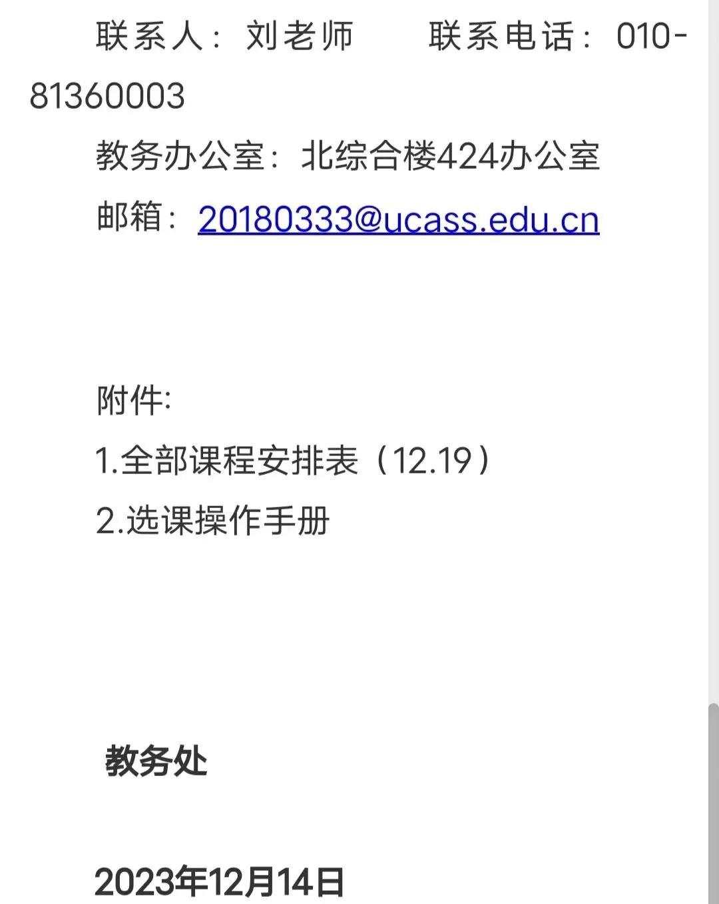
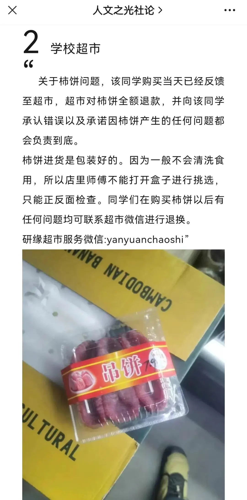
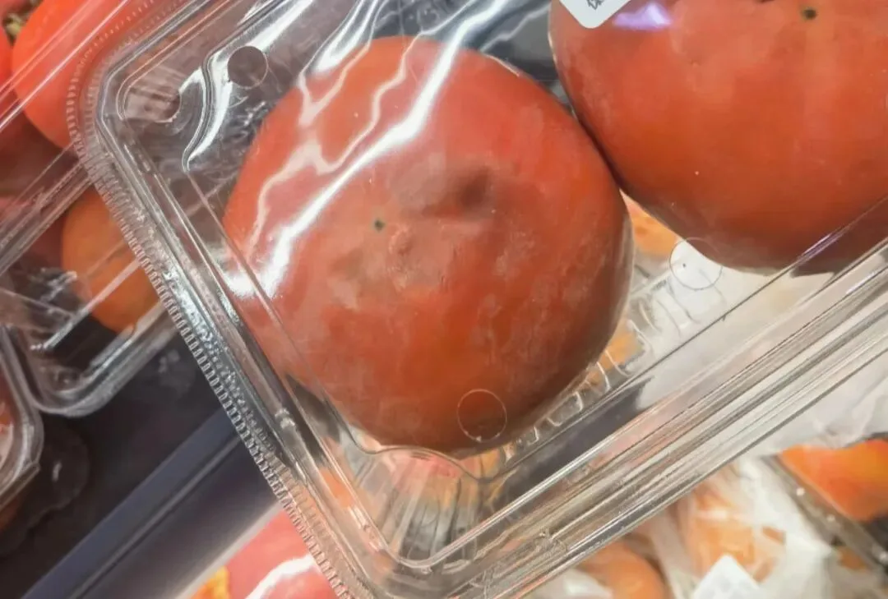
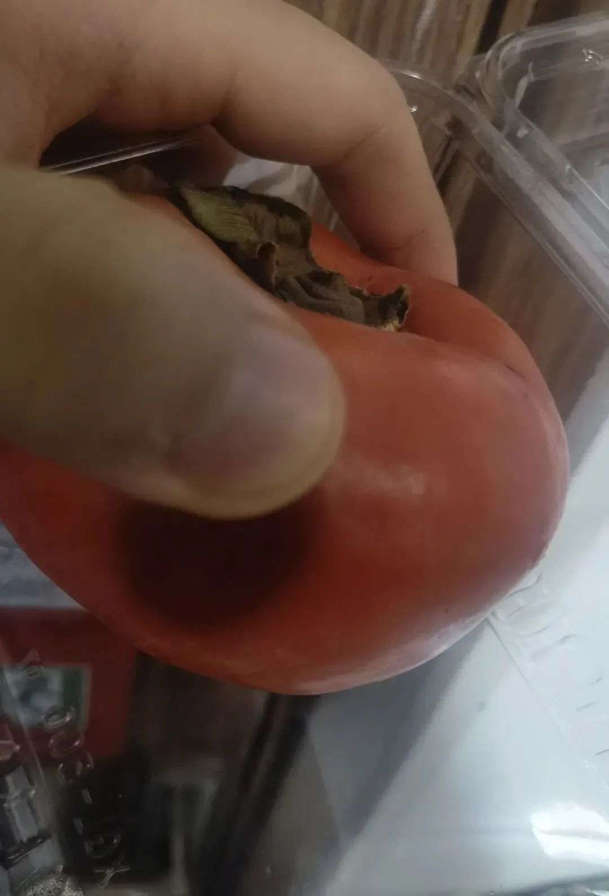
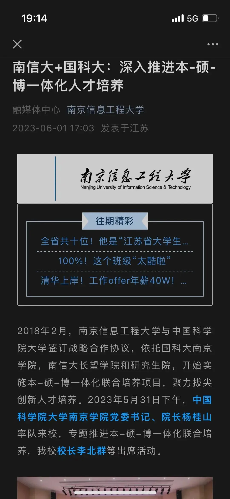
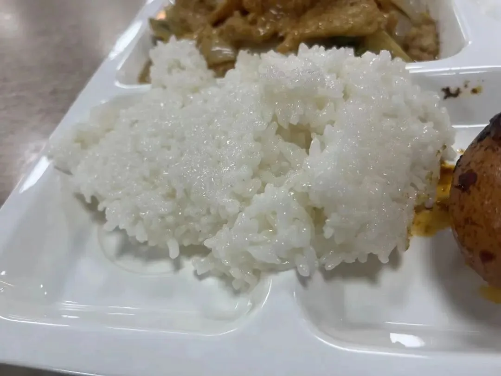
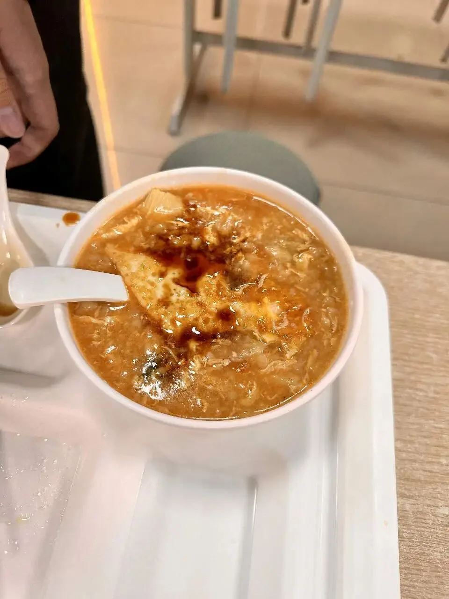
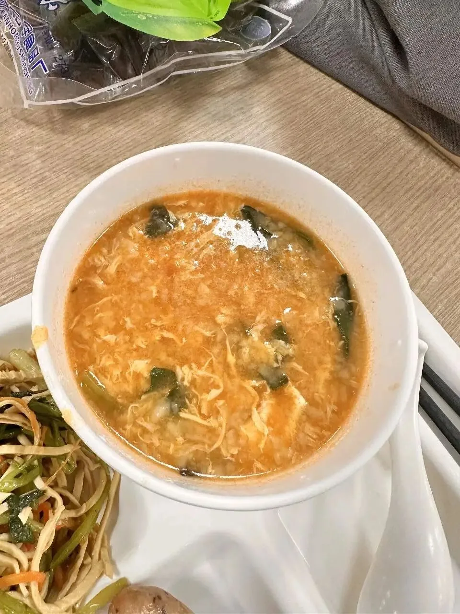

请相关部门及时关注并跟进问题。

## 1 教务问题

> “我想请问教务处丢个联系电话和邮箱在这里只是为了粉饰门面吗？还是取“此地无银三百两”的反义？人家是有银三百两立个“此地无银三百两”的牌子在这，教务处的老爷们🙇‍♂️🙇‍♂️🙇‍♂️在这丢个联系方式的意思是让我们不要联系别去扰了清净吗？🤣👉🤡周五给您发的邮件问您选课的事，您周末没回我姑且理解为周末是休息时间；怎么，都周二了还在休息呢？😘😍图🥰每次到选课的时候教务处就被爆破，您不害怕我都嫌麻烦🤢🤮做点人事吧！”

## 2 校园超市

> “柿饼是已经包装好的，不能拆开看，只能正反面检查。那之前买的“新鲜日期”的柿子，一样正反面没啥问题，结果回宿舍拆开后，中间都是腐烂！这就明显是人为把腐烂部分藏在中间了吧！（不止一次买水果遇到这种情况，身边人也遇过，懂的都懂）更不用提水果的日期是今天，但是水果品相明显是好几天前的情况了吧！还有就是，有些水果之前根本不贴标签，怀疑是需要贴哪天的再去贴。希望大力整顿研缘超市！”

（见《

【读者投稿】校园网等问题热议继续，超市做出回应

》第2.1)

## 3 入党评优

## “商学院入党积极分子名额确实有疑问，有的班级可以有10个名额，有的只有6个。”

（见《

【读者投稿】校园网等问题热议继续，超市做出回应

》第3条)

## 4 战略合作

“那个投稿学校合作院校，还贴出学校和南京信息工程大学合作信息的同学，你是有多么傲慢?按你所说，社科大去找北理工，北理工的同学会不会也嫌弃我们只是“双非”呢?用自己那一套“凡事分三六九等”的观点来评判学校的决策制定，还嫌弃其他学校，也真是够了。那以后别人用这一套嫌弃你的时候你最好不要有任何怨言。

> “本人南信大1校友现身说法。我只是数万南信大校友中一个平平无奇普普通通的人，迄今依然无法让母校以我为荣，只有默默看着母校比我更努力的努力，不曾想到有一天在这里以这样的方式看到我的大学名字。据我所知母校于2018年就已经与中国科学院大学签订了战略合作，至今依然保持合作关系，实在不知同学您张口一个劫富济贫从何而来。”

“

您好，投稿这个“战略合作”这条 这个投稿别太傲慢了，首先人文社科不是意味着高高在上，保持在云端。是要更大范围内弘扬人文精神。和南京信息工程大学合作是什么丢脸的事情吗？人家还是双一流呢。 第二这位同学是不是觉得和北理工合作就是动动嘴皮子人家就愿意合作啊？而且你怎么知道学校有没有正在努力寻求合作只是还没有巨大进展呢？”

“

想对p5说，多结交朋友没坏处。你看不上人家档次低，人家还嫌弃你两轮双一流都没评上呢（南京信息工程大学是原南京大学分出来的一部，首批评双一流的时候就入选，国科大也和它签订了合作协议）。这么自大，除了让外校对本四非大学印象更差，全无益处。”

（见《

【读者投稿】校园网等问题热议继续，超市做出回应

》第5条）

## 5 食堂

“食堂最近能不能认真一点。大米饭做的口口口口的，期末了能不能给学生吃点好的？怀念上学期期末认真做饭，食材新鲜可口的食堂！”

（注：该稿中有些用语过分激烈，故以“口”代替，请大家自行体会当事人的愤怒）

“

学校食堂打饭需要一个标准

在食堂打饭时我发现给的菜的数量全凭借打饭师傅的心情，同样是一两饭，有的师傅能打出将近二两的量，有的师傅似乎连一两也没有，而且如果打了很多菜，师傅可能会给其中某一个菜小分量，具体表现是有的菜能把最大的格子占满甚至突起很多，有的菜仅仅占满大格子。最严重的是汤。我晚上和疙瘩汤，大家都是用大碗盛汤的，可是有的人是整整一碗，我的确实半碗多一点，碗的边空出来很多。交了一样的钱，为什么有时候多有时候少，有的人多有的人少呢，这个标准的统一是有必要的。”

