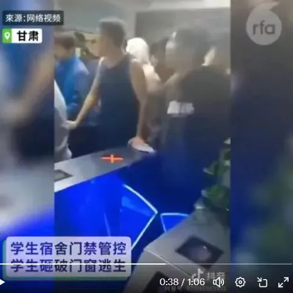
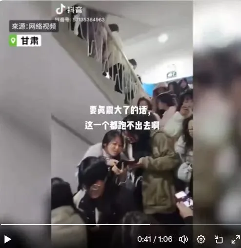
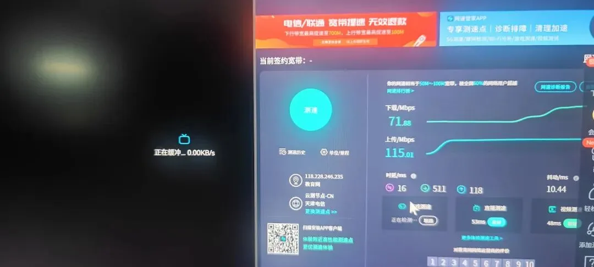

请相关部门及时关注并跟进问题。

## 1 闸机

“社论君，这个是我看到的甘肃地震时候高校的门禁状态，这已经是一个老调重弹的话题了，还是希望学校能够引起重视。”

## 2 校园网问题

## “看不懂望京的校园网🤭”

## 3 入党评优

“看人文之光投稿里为了入党名额扯头花这几天我一直想问一个问题。一切的起因是因为第一次有人投稿认为学校老师组织查违规电器是为了夹带私货让自己不能入党，让其他人入党。我很想问一下投稿的这个同学有没有读过社科大之外的正经大学？哪一个大学不是把违规电器和违纪取消评奖评优挂钩的呢？怎么这种全国大学都通用的校规到了这里突然变成老师包庇他人而针对单独某个人的私刑了？

一开始只是看了投稿觉得这种想法难以理解，接着看了几天才明白为什么这么疯癫，能在老师澄清之后继续写着17日这种造谣全世界并且人身攻击的投稿（同时我质疑本公众号为何打着理性讨论的旗号发着这些无锤造谣的内容，是否真正还是一个健康平台），很难说这是不是出于一己私利而选择在匿名平台实施打击报复。把一潭清水搅浑，便宜的是不是浑水摸鱼的人？请受委屈的同学勇敢地站出来，把你了解到的入党竞争中的黑暗内幕给予曝光，是被谁抢了你的名额，说说那位被你指控包庇了别人又打压了你的老师和别人到底有什么利益勾结。我相信真正优秀的同学不会被党组织遗漏，不会把一位备受委屈的优秀预备党员逼到四处造谣的路上！”

（见《

【读者投稿】教务联络引发疑问 超市等问题争议不断

》第3条)

## 4 宿舍

## “请问望京校区的暖气越烧越凉是怎么操作的？”
