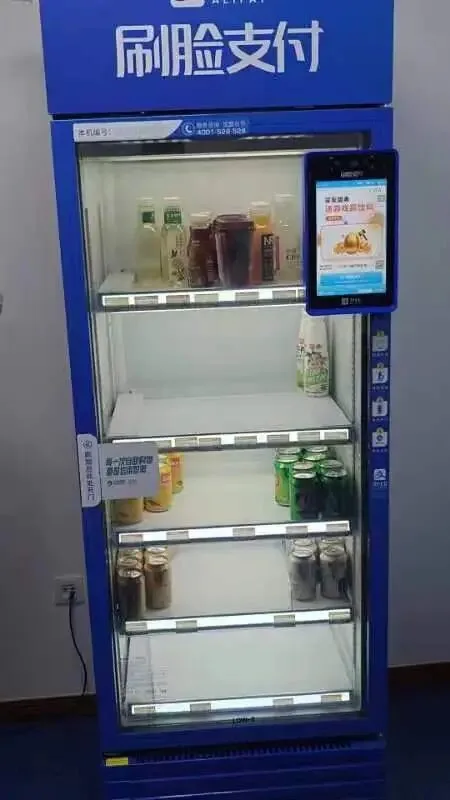

请相关部门及时关注并跟进问题。

## 1 学校超市

> “望京超市能不能选点好的水果啊，好几次买香蕉都是烂的，重点它也不是那种看着熟透了才烂的，它看着就是刚熟，但里面都好多烂的，而且全军覆没，买三根三根烂，买四根四根烂，虽说好的部分不是不能吃，但是买三根只能吃到一根的量，烦死了！”

## 2 宿舍

“今天参观了三个宿舍，竟然发现两个宿舍都开了空调，这这这望京这边暖气是摆设吗？还是说挣点电费钱过年吗？”

（见《[【读者投稿】老问题引发新疑虑](https://mp.weixin.qq.com/s?__biz=Mzg2MjcwNzQ1Mw==&mid=2247487285&idx=1&sn=e1dc8689f6019c8b1836a83422382701&chksm=ce0284a7f9750db112ba0a37f7bbc07e8169088b626cd08824ff6bf32b65a73c57dde5a77358&scene=21#wechat_redirect)》第4条)

> “必须要感谢学校保卫处和宿管，非常尽职尽责。昨晚二食堂保安和工作人员、六号楼值班阿姨以及不知道从哪里被摇来的保安大哥们帮忙把喝多的同学抬回宿舍，太感动了！还有一大哥睡到半路被喊起来帮忙，深表歉意和感谢！你们就是深夜寒风中的小太阳！”

## 3 图书馆

“望京图书馆的这个售货机已经一个月没动过了，我之前来买东西就这样，现在一个月了也不补货，实在不行，希望可以开放给我们，让我们有些需要冷藏的东西有个地方存放。”

## 4 教室问题

“党校楼二楼自习室空调无法调控，一直吹冷风，教室冷如冰窑，这是正常的吗？两天了，孩子快遭不住了。。。”

“给后勤提一个建议，可不可以定时擦一下教室的黑板，并且及时更换教室里的黑板擦啊？好多次上课前看老师用已经沾满粉笔灰的黑板擦去擦上一个老师留下的一黑板内容，越擦越糊。

以前上学的时候，值日生会用沾水的抹布擦黑板，效果比较好，保洁人员可不可以在大课间（中午、晚上等）这样做一下？”

## 5 食堂

## “投稿，食堂提议（叠甲：别批评我，你说就是你对）

一食堂早餐能整一个外卖窗口吗，整到8点就行，就是只能打包，给我们卡点上课的学生一个吃饭的机会吧。”
