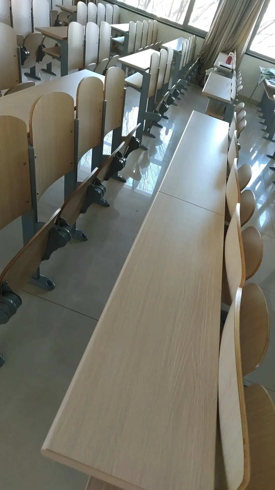
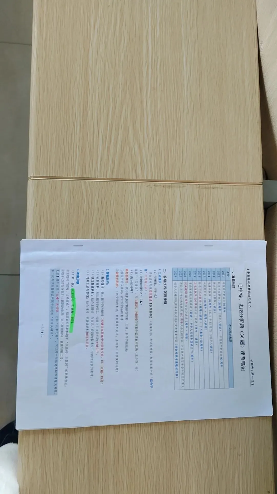

请相关部门及时关注并跟进问题。

## 1 考研教室问题

“我是一名考场被安排在研教楼301的考生，该教室的桌子甚至放A4纸都稍微短一点点。而考研政治答题纸是A3的且需要考生尽量写满。（相信大家都知道政治需要多写）所以真的很希望学校能给我们在301的考生换个桌子纵向大于45cm的教室！或者给301教室批量更换成大桌子！谢谢！

在301教室，需要写到卷子的底下半部分时胳膊无任何支撑点。且该教室桌子与前排椅背紧紧相贴（是直接焊死的，挪动不了）

1.无法把卷子推至前方空处以便写下半部分，前排椅子挡住了（而且政治答题纸需要机扫，不可以弯折）

2前排的人一旦抖腿，后排桌子将剧烈摇晃，答卷过程受到很大打扰。（相信在我校这种教室上过课的同学都经历过）。

咱们偌大的学校，北综合楼空空荡荡，不做考场，研教楼209，207等教室桌子大小正常，纵向长度大于45cm。而我却被安排在桌子纵向长度小于一张A4纸（29cm）的考场考试💔

因此，恳请招生办给在301考试的考生换个教室，研教楼207的桌子纵向长度大于45厘米，完全可以放下试卷。而本教楼也有很多长度大于45厘米的桌子。本次考试好像并没有启动北综合楼作为考场，而去年的考试则是研教楼北综合楼都使用了。（其他大部分学校下载准考证的同时就公布考场，而我校21号早晨在公布，我想这不是学生的错误，更不应该学生来承担后果）。为什么别的学生可以在210等桌子大小正常的教室考试，而我只能在桌子是其他教室一半大的教室，连A4纸都没法完整摆下的教室。

毕竟，这是我在skd最后的也是最重要的一次考试了，想要恳求招生办老师给我们301的考生换一个纵向大于45cm，大小足够放得下试卷和胳膊的桌子。毕竟在我校考试的所有考生应该都需要答政治，对文科生来说，一张大小能让自己在写政治下半张卷子时作为支撑的桌子真的很重要！！！因此，恳求招生办能给301考生换个考场，换到一个桌子大小同北综合楼一样的桌子，求求你们了！谢谢！！

说真的其实蛮想死的，这半年已经很痛苦了，工地无休无止的装修，午休和半夜都在发出噪音；学校曾在9月安排我们这一级学生军训，让本不充裕的复习时间雪上加霜……这半年来我吃的药比过去三年都多，没想到临到考试了学校给我玩了个大的，安排我在一个大小完全放不了胳膊的桌子考试，真的没想到学校有这么多方法把我们这一级学生往死路上逼💔”

## 2 保安人员值班

> “最近北京的天气将近零下十几度，每次进校路过东门，看到门口的保安在寒风中冻得缩成一团就感觉于心不忍，这么冷的天长期在室外，容易把身体冻出问题。现在门禁刷卡进校，大多数情况下都不需要保安守在室外，但是保安还得24小时在室外守着，确实没有必要。学校门口都有相应的室内值班空间，只要安装监控，室内完全可以监控室外的情况，没有必要让保安24小时守在室外。呼吁学校出于人情化的考虑，在极端天气下，让保安进室内值班。”

3

教室问题

“

投稿：你们班没有班干部吗,这种擦一下就行有必要麻烦后勤吗？”

（见《

【读者投稿】冬日取暖竟成问题？

》第4.2）

4

宿舍

“

请问学校能更新一下良乡校区的沐浴用水充值方式吗？既然饭卡能实现线上即充即用，那热水卡应该也能实现小程序/一卡通平台即时充值吧？现行热水表也没有余额告急预警功能，以致于每次都要在冷水旁等半天才突然发现要去充值，然后就得重新穿好衣服、大晚上地跑出去充值……在—10度的气温里遇到这种情况真的很无奈，希望学校能更新一下设备！”

5

食堂

“

投稿望京食堂，中午听到有同学在大声斥责面食窗口工作人员突然拒绝单独卖卤料，气得这位同学点了一份牛肉面不要面，以前单卖6元一份的牛肉刷了同学一碗牛肉面14块的价格，好气又好笑。食堂到底是学校服务师生的部门还是一个盈利机构？说到底还是服务业，以不单卖为由拒绝学生的普通合理要求，然后又以两倍还多的价格单卖出去，这是想吃学生的烂钱吗？食堂饭菜的肉质本来就差劲不新鲜，单独买点肉吃还要翻倍卖给你，这是何居心？希望相关部门能对此事给出正面直接的回答。

”
