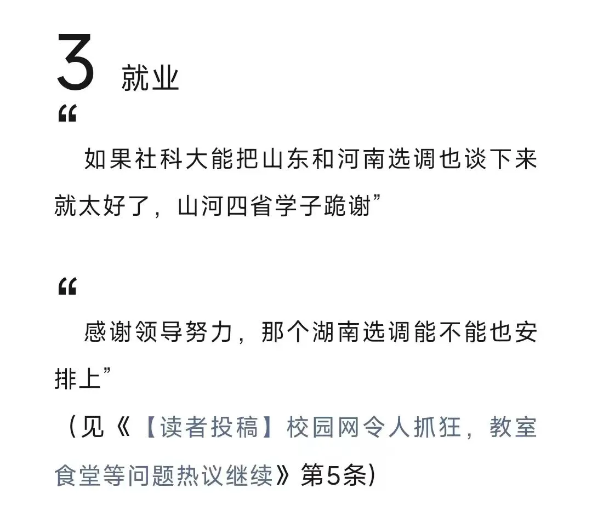
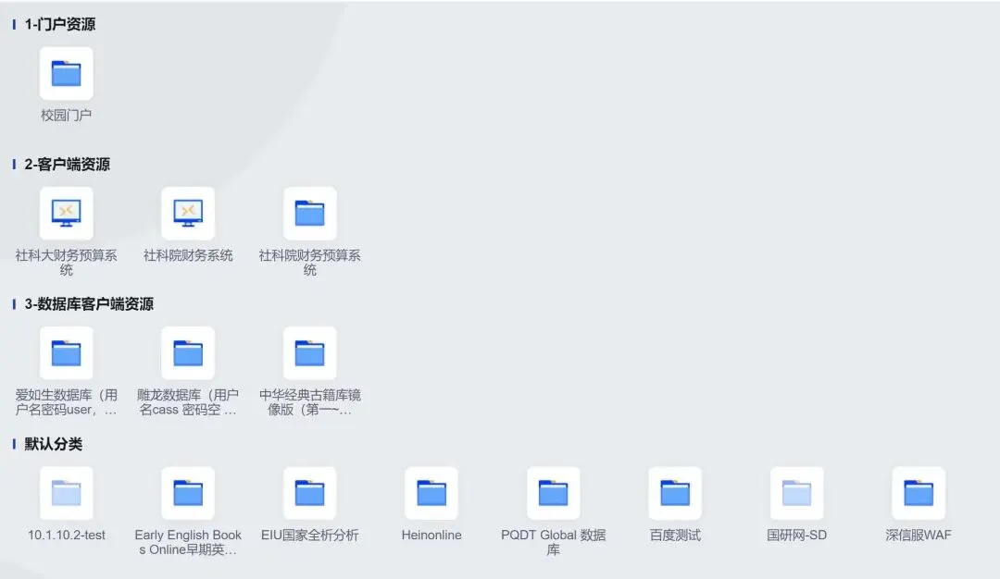

请相关部门及时关注并跟进问题。

## 1 食堂

“学校食堂的有些菜，很早就凉了。比如我刚刚12点之前买到的土豆丝。 在接诉即办反映过很多次了，每次都说会做好的”

## 2 就业

“回复截图上关于定选的话题，河南选调早就把社科大纳入了，湖南选调改革不分定选和普选，全国高校满足条件都可以报。山东选调确实没纳入，学校加油💪”

（见《[【读者投稿】两校区教室问题争议不断](https://mp.weixin.qq.com/s?__biz=Mzg2MjcwNzQ1Mw==&mid=2247487348&idx=1&sn=1dd173663ef4282659a73dd8584d2162&scene=21#wechat_redirect)》第3条)

## 3 自习室

“望京开始清理教室大快人心，之前一片狼藉堪称垃圾堆的教室终于慢慢变得干净起来，看着我们的小院儿在一天天变好，心里确实很开心。瞅瞅教室门口清理出来的东西就知道原来在里边霸占公共空间的人有多没素质，清理出来的东西包括不限于n双拖鞋，无数吃剩下的零食，大量快递盒，废纸，生活垃圾，锅碗瓢粉化妆品.......其素质可见一斑。

现在看到有人又开始说教室外边不能放东西，每周清理有问题。只能说是真是特权享受惯了，不能霸占公共空间，要像大多同学一样背着书包来回难受的不行了。教室里边清理了，外边不清理，那无非就是把垃圾场从教室里搬到外边，霸占教室内空间变成霸占教室外空间。其次架子之前没有清理的时候，上边也各种放着生活用品与垃圾，什么调味料、玩偶，屡见不鲜。目前架子的存在就是把占座的，或者是单纯忘了带走自己东西的同学的东西放到外边，暂时存放，等待学生认领带回自己的寝室，不仅教室是公共空间，教室外边的架子也是公共空间，绝不是少数人存放自己私人物品与生活垃圾的地方。如果之后学校能研究出既可以让大多数同学存放书籍，又不会让架子成为少数人储物空间的架子利用方案，那当然是好事。在此之前，作为暂时存放教室清理出来的物品的暂存处，就是架子最好的使用方式。 再说回来，望京校区有多小不必多说，几本书加个笔记本从寝室拿到教室都嫌累只能说终究是特权阶级，之前去图书馆自习的，去教室自习但不占座的，那是不是都得是运动员？学习完带走自己的东西，清理自己的垃圾，还原教室的学习和公共属性，不把教室当自己家、餐厅、菜市场，啥时候变成了超人的行为。 最后再说清理完教室后，门口清理出来的有用没用的各种书籍、杂物、垃圾，已经一两周了仍有许多没人拿走。我还记得之前看到清理教室的叔叔阿姨们往外拎鼻涕纸、烂水果时脸上尴尬的表情。一个研究生还得让别人把自己的臭拖鞋从教室里拎出来，这样的人我们还能对他抱什么期待呢。”

（见《[【读者投稿】两校区教室问题争议不断](https://mp.weixin.qq.com/s?__biz=Mzg2MjcwNzQ1Mw==&mid=2247487348&idx=1&sn=1dd173663ef4282659a73dd8584d2162&scene=21#wechat_redirect)》第1.1)

## 4 毕业论文

> “社论君，投稿： 教务处要求本科毕业论文开题报告必须线下进行，且不说本科论文才多少字也要开题答辩，很多真正的双一流大学压根就没有这种形式主义的规定，而且之前说可以线上，很多同学都买好票了，现在又得线下，教务处可以报销退票费吗？为了这么一个形式主义的东西拖着不让大家回家有意义吗？”

## 5 知网问题

## “请问VPN改版后中国知网去哪里了？截图如下：

