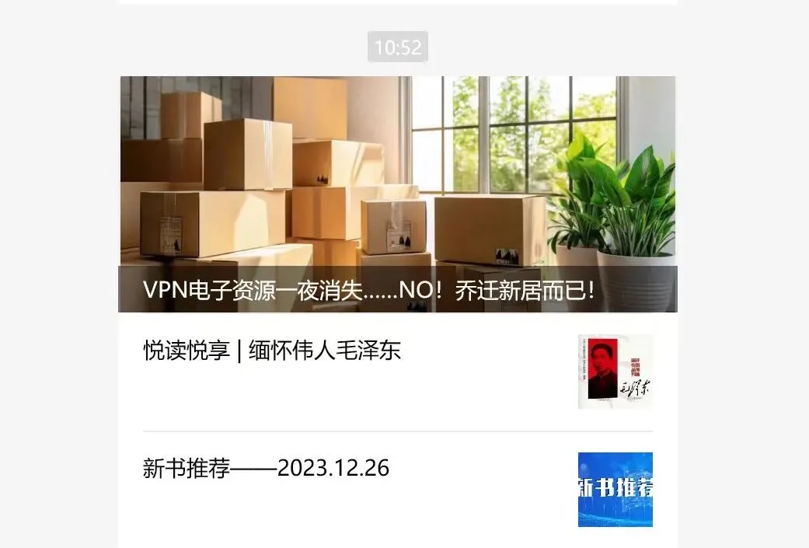
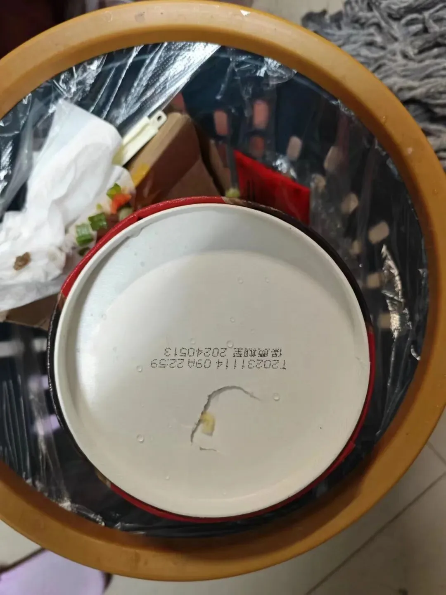
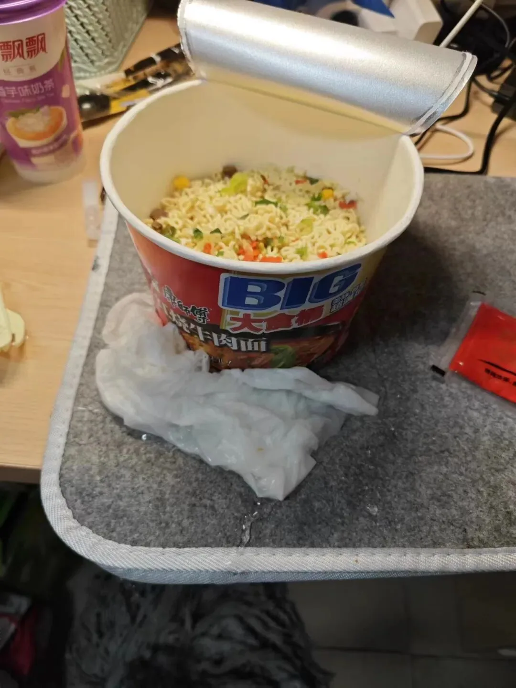

请相关部门及时关注并跟进问题。

## 1 教学资源

“您好，帮忙转发给这个学生，电子资源访问路径和方法： 新版网站延用原网址，打破内外网络限制，可通过互联网直接访问，解决了长期以来校外使用的痛点。图书馆网站、所有应用系统以及数据库均实现了校内外网络访问，无需登录社科大VPN，并且与我校统一身份认证系统对接，实现一套账号密码登录。 1图书馆网站地址 https://lib.ucass.edu.cn 2电子资源访问图书馆主页电子资源导航 电子资源远程访问云系统 https://libdb.ucass.edu.cn 3访问条件需连接互联网，校内外均可访问，无需登录社科大VPN。

所有的资源都放在“中国社会科学院大学图书馆”里面了。大家登录

https://lib.ucass.edu.cn/，

点击首页的“资源远程访问”就可以看见知网等等资源网站。”

（注:近日本公众号收到知网相关稿件数量较多且内容基本相似。本公众号综合选取问题囊括较为全面的一份投稿予以刊发。）

“社论君 之前有同学投稿说VPN改版之后找不到知网了，今天图书馆公众号最新推送了改版后查找电子资源的方法，来扩散一下~”

“前几日就发现用校园网连VPN在知网下不了论文，今天还是如此，而且今天连上校园网发现一些期刊的官网都进不去，用自己流量反而能进去。想知道到底是出了什么问题？”

（见《[【读者投稿】毕业就业齐发力](https://mp.weixin.qq.com/s?__biz=Mzg2MjcwNzQ1Mw==&mid=2247487354&idx=1&sn=a181ccefbaf2e01af62b966623bb02f7&scene=21#wechat_redirect)》第5条)

## 2 交通安全

> “今天从北门正常过马路（绿灯），一辆SUV急驰而来，看见有人紧急刹车，完全停下时车头已到了斑马线中间，吓得我魂飞魄散。 北门马路中间的那一道隔离栏有一米二三的像子，正好会遮挡住司机和行人向两侧看的视线，造成视觉盲区。所以大家在遵守交规过马路时，也要注意看，谨防有不守规的疯子。 也谢谢国家、谢谢政府、谢谢学校在北门路口添置的新红绿灯~”

## 3 校园网

“你好，建议校园WiFi充值达到不限量充值的数额时，自动转为不限额，满足学生的用网需求。”

## 4 食堂

“望京食堂今天下午的红糖姜汤上面有一层油膜，我读书少，不知道红糖姜汤还要放油啊。”

## 5 学校超市

> “社论君，提醒大家注意一下食品密封性问题，今天在楼上超市买了一罐泡面，在塑封完好的情况下，底部破了一个洞。（ps：超市维权记得拿塑料袋装好实物，人家不认视频和照片）”

