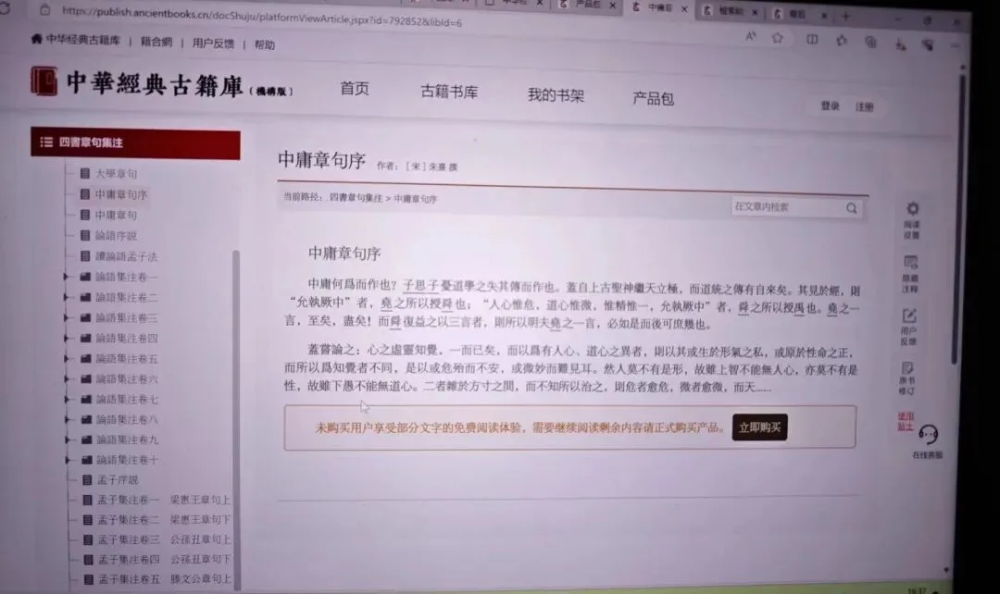
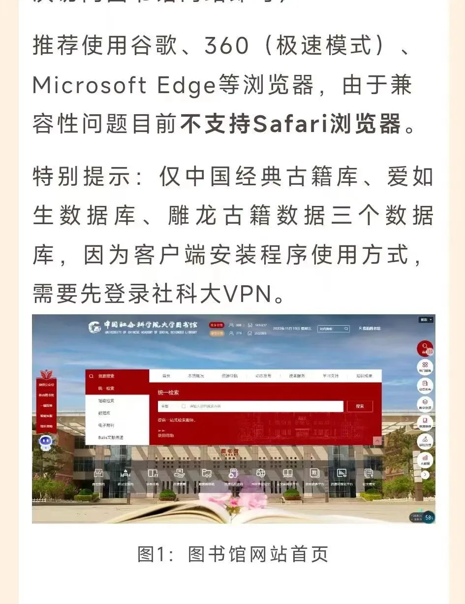

请相关部门

及时关注并跟进问题。

## 1 食堂

> “良乡二食堂换承包商吧，别搁这半死不活了，群里反应问题，也不回应。之前的承包商虽然饭做的也一般，但是服务态度还是好的，现在难得让人家有一个回应。 不想干就别干了！ 同时，学校是不是抽税太重（猜测），为什么每个二食堂承包商都做不好，只有刚开始那个好。”

“打饭的语气 常看到同学们对学校食堂议论颇多，此前不曾参与讨论，总觉得吃个饭而已，互相理解忍让一下，你好我好，岂不美哉？前些日子在一食堂二楼看到一个同学打饭时，语气强硬，颇有霸道总裁的风范，点菜时指点江山，斩钉截铁，打饭的大叔虽也不甘示弱，但想必不想让事情闹大，所以只在嘴上你来我往，嘟囔几句了事。当时我不由得心生不平之气，同情这位打饭大爷的遭遇，每日劳作辛苦如此，打个饭还得和学生置气。可直到今日，亲自领教了另一位打饭阿姨的厉害，才明白了那位兄弟的所作所为原来是久经沙场，实乃经验所致。

以下是我今天中午在一食堂二楼和打饭阿姨的完整对话和个人反思： 我：阿姨，我要麻辣香锅、豆腐海带，（犹豫了两秒）还有酥炸里脊吗？ （事后回顾可能正是这罪恶的两秒钟为我招致了这场口舌之争） 阿姨：（不耐烦脸）酥炸里脊没有了，有水煮里脊（边说边去打餐）。 我：（诚恳脸）那还有麻辣排骨吗？ 阿姨：（训斥脸）你到底要吃啥？ （此时我的心里其实很疑惑，甚至还想着是不是没说清楚；但同时也有点生气，心想我招你了吗？） 我：（斩钉截铁脸）麻辣香锅、豆腐海带、麻辣排骨、二两米饭 阿姨：下次能不能说清楚一点？ 我：（克制的愤怒语气）我刚才就说清楚了呀，我要里脊，您说没有了。 阿姨：酥炸里脊是没有了呀，有水煮里脊。 我：所以我又说要麻辣排骨，您也没给我打呀？ 阿姨：谁不给你打了？（继续嘟嘟囔囔） 我拿着饭走开……

拿了筷子找到座位，心里觉得憋屈，边和朋友吐槽，边思考着一个问题：在社科大，打饭究竟需要用什么样的语气？有没有这样一种语气，既坚定又平和，既善解人意又不卑不亢，既能展现个人应有的礼貌和教养，又能保有一个学生并不膨胀的尊严；既能展现出对食堂打饭这份工作的理解和尊重，又不会因个别工作人员无来由的戾气而生闷气、吃哑巴亏？ 朋友的建议也许是对的：放弃食堂，拥抱外卖，好吃不受气。

可我还是觉得，对于一所高校来说，学生对于食堂的印象和记忆可能比想象的更重要。让食堂变得更好也是学校和学生共同乐见之事，因此我给食堂提出以下建议： 是否可以加强对打饭人员的话语培训。 建议多用：“同学你想吃什么？”、“这个菜没有了，可以换一个吗？”、“同学，我没听清，可以重复一下吗？”、“同学你稍等一下。”这几种说法应该可以覆盖到大部分产生冲突的情况。尽量不要用“你到底想吃什么？”、“一次说完行吗？”、“你能不能说清楚了”、“你着什么急？”这一类情绪化的表达。 如果是工作强度太大导致工作人员的情绪不稳定，可以考虑适当增加人手或者完善排班制度。 对于像我一样平时说话没那么强势的同学，也有几点打饭攻略可供参考。看着可悲，但也实属无奈之策。 语气可以不强硬，但是不能过分礼貌谦卑。（被无端训过的同学应该懂是怎么一回事） 尽量一次把要吃的菜提前想好，并准备好一两个备选项。（就像面对面试官一样，自信从容，对答如流，不要紧张，备选答案多多益善，加油！你可以的！） 不要询问！不要询问！不要询问！ 建议如上，有人看完可能会觉得“这学生吃个饭还这么多屁事儿”，有这种想法的话，那就拿以上所述当茶余饭后的一个笑话，还请老爷们一笑则个，切勿放在心上。 待到下次成功地心平气和地打到饭时，我愿接过金牌讲师的衣钵，拿起手机对着镜头说上一句：“又打到饭了兄弟们！”

## 2 教学资源

> “社论君，我发现这个新的数据库系统有点奇怪。需要挂VPN的数据库这边，中国经典古籍库无论怎么点都进不去，从图书馆网站入口进入中华经典古籍库，发现并不能享受我们购买的资源。”

“其实关于这个数据库，他图书馆公众号推文上有说，但是我们操作下来感觉还是有点摸不着头脑”

