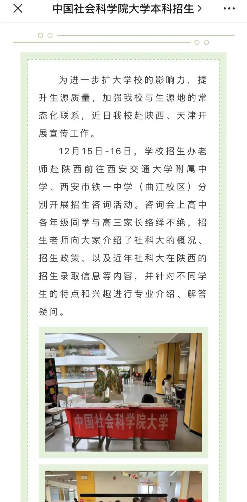

请相关部门及时关注并跟进问题。

## 1 自习室

“想问一下学校，设置自习室的目的不是为了固定吗，考四六级考研等大型考试就算了，怎么28号又有考试占自习室啊，不会期末考全都占自习室吧？”

## 2 就业

“现在各个学校都公布就业情况了 咱们学校可以公布一下就业情况 包括薪资 就业单位 就业率”

## 3 宿舍

> “建议几栋宿舍楼取消男女混寝（良乡校区） 1.学校宿舍楼的数量足够，满足男女分寝条件，没必要混寝，分宿舍时候计划一下即可解决，应该不是很难解决的问题(不清楚当初宿舍怎么划分的) 2.男女分寝降低宿管人员的管理难度，减少宿舍群里面一些矛盾 3.生活上真的很多需要注意和避免的情况，尤其对于女生极其非常不方便 4.部分素质低下的男的每天在宿舍楼里面抽烟，整个楼道弥漫着烟味，有极大火灾风险，经常整宿打游戏(尤其学校宿舍隔音怎么差)，深受其扰，不想和他们住一栋楼。想和礼貌、善良的女生朋友们住在一起享受一个整洁、干净、无烟的宿舍环境。 5.分寝无论对男生还是女生都是你好我好大家好 6.暂时先这些，其他同学也可补充”

## 4 食堂

> “投稿：望京食堂中午的冬瓜炒肉，为什么带一点苦味呢？不知道是变质了还是其他问题？我并不是挑食找茬，只是想着望京食堂能重视一下这个问题。同时也建议学校：负责食堂餐食管理的领导下一下学生食堂，针对每天食堂的菜，每一样菜做出来打一两口品尝一下，看看是否口味得当。虽然咱们食堂便宜，但是能够做到便宜又有点口味，是不是也是一份对外宣传好的名片呢。民以食为天，况且学生一日三顿在食堂，负责食堂管理的学校领导一口试菜，并不会增加食堂食材成本的增加”

## 5 招生

> “招生办：众所周知，西安市铁一曲江校区，是初中，而不是高中。那么请问推送里，哪来的高三家长络绎不绝？是不是因为我们学校已经招不到学生了然后招生办老师就自欺欺人，还是说，我们学校招不到人就是因为老师们懒政怠政？或者也有可能是推送文案单纯写错了？不管怎么样！请招生办一定要解释清楚！”

