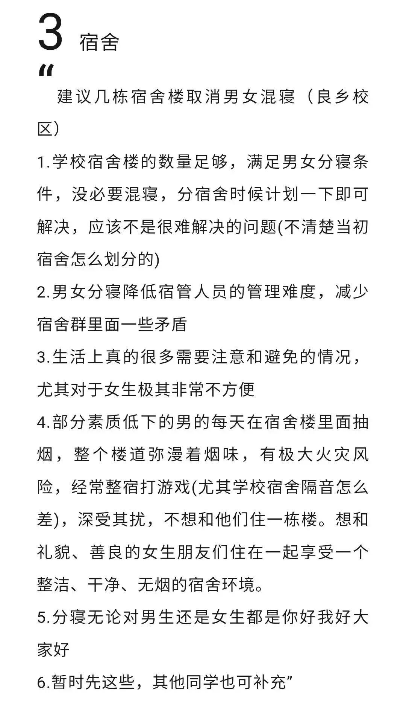
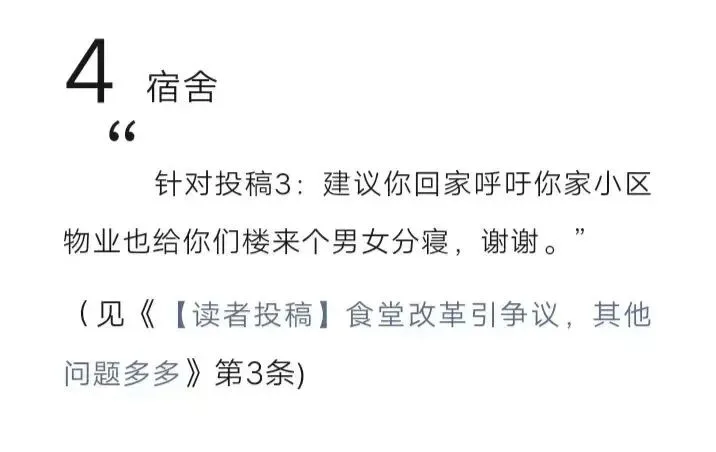

编辑部全体同仁

恭祝读者朋友们新年快乐！

请相关部门及时关注并跟进问题。

## 1 校园网问题

> “望京校区：校园网真的巨难用，每个月花钱了，但是网络依旧让人破防。天天说提速，到底提速提到哪里去了。不是我想吐槽呀，真的是每次网络卡顿的时候，极度抓狂，看剧卡住，刷课不动！！拜托 上点心好不好不好，我也不想吐槽，也想做个文明人，麻烦给我个机会让我做个文明人！！！”

## 2 图书馆

“校外登录图书馆新系统，尝试进入部分数据库时都会出现这种情况，不知道其他同学有没有这种情况。以及该如何解决”

## 3 就业问题

## “投稿，新的一年，祝愿学校领导老师新年快乐！

希望学校就业办再多关注下学生的就业问题，再接再厉，再谈下几个省市的定向选调。希望对内公布本硕博就业情况，为接下来的师弟师妹们提供下就业参考！”

## 4 学科评估

“我突然意识到社科大名声小和分数线下滑也有不参评学科评估的原因，国科大A+数国内第三，因此自媒体谈到学科评估都会提到国科大，等于是自来的流量，同时在招生时也能以此作为宣传点。社科院在第一轮学科评估中成绩也不错，不再参评是有一些特殊缘由吗？

## 5 资金审计

“望京的保安人员越来越少了，记得当时有40多个现在也就20人左右，学校给的是40多人的工资，这部分差额的钱

会不会落入有些人的腰包呢？也可以说是国有资产流失，有关部门是不是关注一下，当然了也可以看看保安队打卡记录，学校的钱也不是大风刮来的。”

## 6 新年贺词

## “期待校长的新年贺词，之前是团委发，给人不伦不类的感觉。”

## 7 食堂

## “餐厅打包真的太浪费时间，怎么不解决一下呢？”

## 8 宿舍

> “社论君，想回复一下昨天第三条关于男女混寝问题的。想和“提议分寝”这个朋友讨论一下，怎么就变成了部分男生抽烟、打游戏，过度强调性别，我请问你，如果是女生也做同样的事情，请问怎么办。提议解决问题，而不是把性别之争强行套在这种个人的坏习惯问题的上。怎么就变成了“想要和善良、礼貌的女性朋友住在一起”，怎么学校还得按您的标准给您配个“礼貌、善良”的同一栋楼的女生吗？请问男生不善良不礼貌吗？和男生住在一起不安全？拜托！不安全的是“人”和性别有毛线的关系，女性会不会犯罪啊？换句话同一层如果有女性对你持刀犯罪，旁边有男生那会不会更安全？有人抽烟，打游戏，这只能说学校这种管理的力度不够，关性别毛线啊？希望学校能有个好一些处理方案。还是那句话，解决的“人”的问题，不是性别！”

> “路过，回应投稿4：怼人谁不会？先分析一下居民社区和学校宿舍的可比性？或者同学可以试试建议一下学校像居民社区楼那样开放学生任意选择寝室、任意选择室友、男女自由同居。大多数学校(作为封闭管理的公共机构)男女分寝是传统，传统不一定正确，但创新总得基于一些理由；我校是本硕分寝、个别楼层的博士混寝，这种区分的意图也是不够清楚的。有鉴于此，那些有困扰的人总是可以发声要求学校解释并不过分。或者这位同学也可给出自己反对男女分寝的理由，促进互相理解也是好的。叠个甲：本人经验匮乏，眼界窄，理解浅薄，欢迎理性补充，嘴下留情。”

“针对 宿舍那条 首先，可是这里是学校欸，扯到小区干什么。其次，有些不自觉的在宿舍楼道抽烟的人学学北京市禁烟条例吧”

> “针对这个问题有些人可能理解错了！男女宿舍分寝不是目的，目的是给那那些受到困扰的同学解除困难！良乡校区1－4号楼的隔音有多差，大家都清楚。再者说了，这是学校不是小区，小区男女同床都可以，希望学校也如此?学校是公共场所，不是私人家园。目前学校宿舍楼，1-4号硕博楼就是存在相互干扰情况，这是事实，有人没遇到就不等于不存在。时间主要是集中在晚上。希望学校能够想办法解决好这个问题，不是一个宿管过来劝说，然后说是哪里哪里投诉你，最后制造人和人之间矛盾。有些宿舍，半夜一两点甚至三四点不睡觉，打游戏等各种噪音，这些人考虑过楼上楼下左右邻舍吗？互相干扰谁都会，互相理解与尊重是根本。一般晚上十一点半，再晚十二点进入不干扰状态，这不过分吧！主要是后勤宿管和各院系应该达成共识。当然有人会以熬夜学习为理由，如不打扰别人另论，不过学校不是提供了通宵自习室吗？学校应该为走正常路线的人提供便利，保证同学们晚上12～7之间七小时睡眠。”

（见《[【读者投稿】各类问题讨论持续](https://mp.weixin.qq.com/s?__biz=Mzg2MjcwNzQ1Mw==&mid=2247487381&idx=1&sn=bb2a4549091be6fad15a416c03197350&chksm=ce028407f9750d117584f1bb9ee0e58d02a19b4fbf020305ccd8249dfc8d44780bf92d4a162a&scene=21#wechat_redirect)》第4条）
