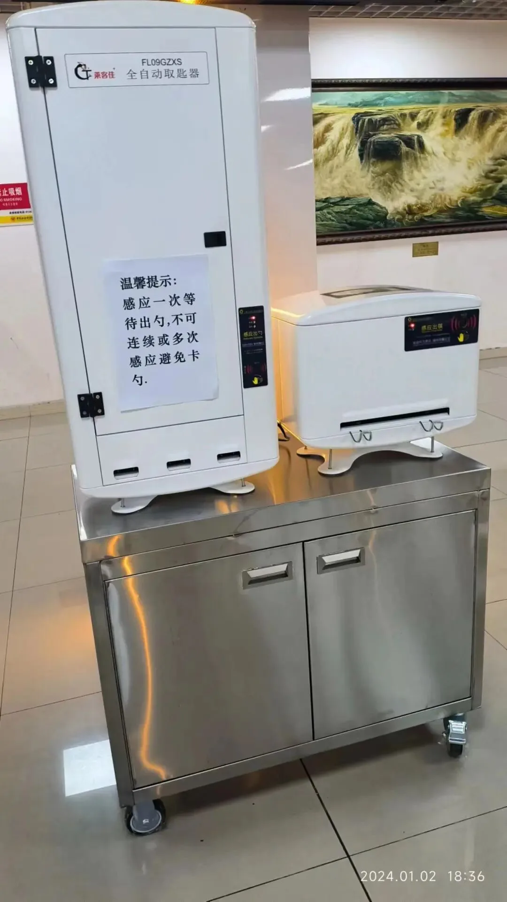
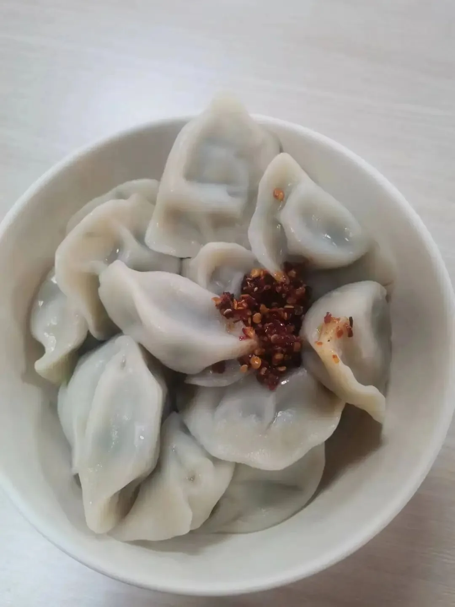
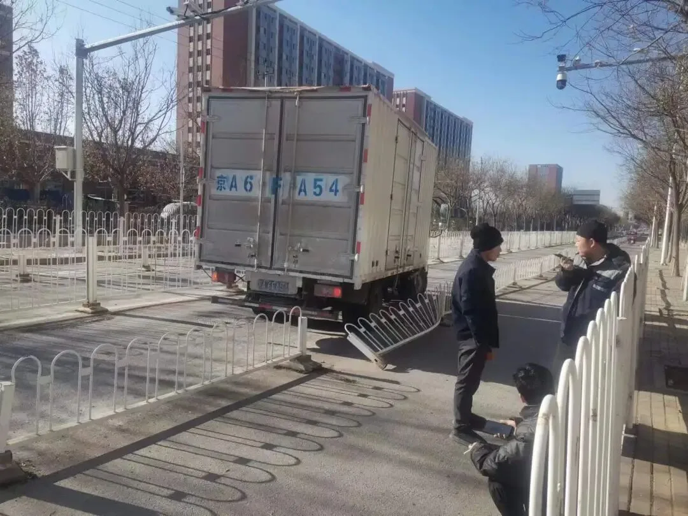
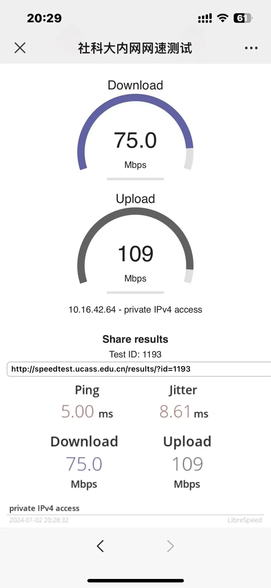
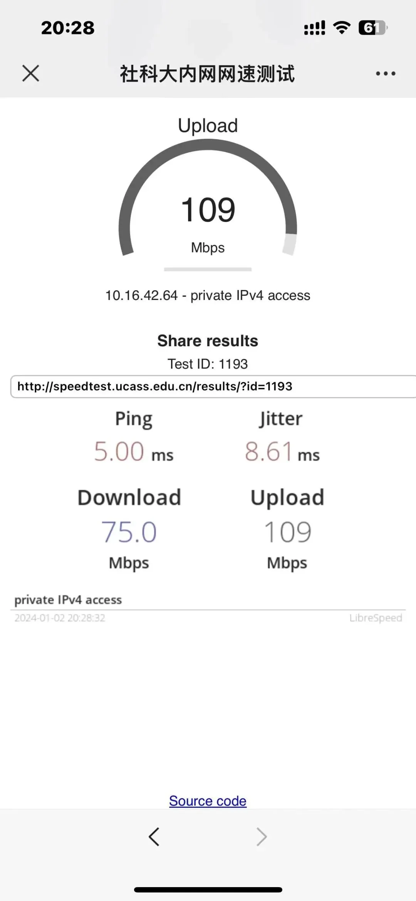
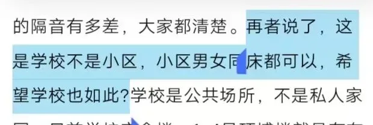
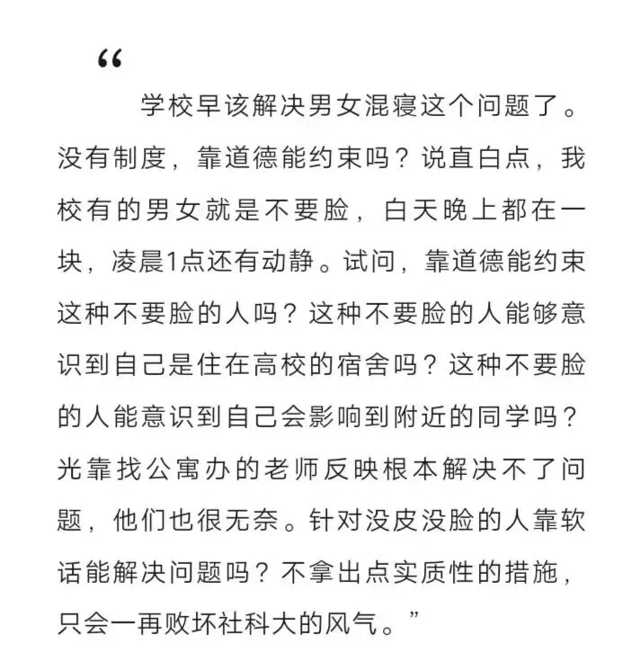

请相关部门及时关注并跟进问题。

## 1 就业问题

> “咱们就是说关于公布就业情况领导能不能回复一下。怎么说呢，你不公布总有一种藏了私房钱被知道了还扭扭捏捏不承认不拿出来的感觉。咱们都是一家人还会笑话你怪罪你吗？更何况退一步讲，就算你不公布，难道有些同学就搞不到吗？救救我们这些社恐没人脉的孩子吧。不要让咱们学校多一项信息差好不好。”

2

博士安排

“

我想请问一下，2024级法学博士录取后是住在哪里呢，然后上课一般都要去哪里呢？”

## 3 食堂

## “夸夸一食堂的新机器，看到了老师们的态度”

## “3号晚上去一食堂吃饭，打了水饺，结果食堂一层呢，是既没有醋，也没有辣子。

只好端着饭跑二层去，结果只有辣椒，没有醋。辣椒还是色香味全无的辣椒籽儿。

最后一份饺子就那么夹着吃了。

这点小事儿，同学们一再反映，都不好使。该找谁解决呢？”

## 4 交通安全

## “北门门口路段很邪门，经常出车祸。大家注意出行安全”

5

教学评估

“

回复学术评估那条：

教师评科研成果的时候有一项要求就是要挂社科大的名，不然参评不了，所里也是一样要求，只能说有老师忘了。”

“

投稿，回复教学评估问题。之前很多院所的老师投稿不署社科大的原因不在于老师，而在于社科大岗位聘任制度卡住某些“级别不够”的老师无法署以社科大的名义，也不知道现在这个问题是否解决。”

“

投稿：规划评估处曾在接诉即办回复学科评估为自愿参加 我校未参加第五轮学科评估 不要轻信网络消息。”

（见《

【读者投稿】校园网问题何时休？

》第1条）

6

校园网问题

“

对于望京校区同学们反映的校园网问题，不知道和账户有没有关系，我和室友是同款型号的设备，但他的校园网却非常流畅，没有任何卡顿的情况，而我的网络奇卡无比，延迟也很严重，测速却发现不了什么异常

”

（见《[【读者投稿】校园网问题何时休？](https://mp.weixin.qq.com/s?__biz=Mzg2MjcwNzQ1Mw==&mid=2247487450&idx=1&sn=6cd7d6ee0de0c64a243b2825dcab8179&chksm=ce028448f9750d5eebf7c7494af3ab5d19197ad4cf20a26fc00dd65fbd0f4bced7863d041377&scene=21#wechat_redirect)》第1条）

## 7 宿舍

“社论君你好，望京校区寝室楼打扫卫生的阿姨们很辛苦，也很认真，但是，可不可以不要在使用洗手间的高峰期进行打扫呢？地方本来就很挤，还得给阿姨让位置，虽然阿姨们说不要在意她们，但是怎么能不在意呀，有时候即便是让开了也会被阿姨刚捅完蹲便器或者刚倒完垃圾桶的手套蹭到衣服，更何况是不让位置呢？希望可以合理安排错峰打扫，谢谢！

> “宿舍楼工作人员每天的工作任务就是在走廊上大声聊天嬉笑吗？你们睡得早要上班，我们学生睡得晚要休息，要聊天可以去值班的地方聊，好几次在走廊上大声聊天嬉笑被吵醒了，宿舍隔音不好。如果工作是聊天，请你们找个专门的房间好好聊。”

## “你好

我是男生 麻烦望京校区有些男生吸烟的时候不要在3号楼男生宿舍门口吸(就是紧挨着宿舍楼门口)

宿舍楼门口人流量很大 进进出出 有天我进宿舍楼大门吸二手烟，出宿舍楼大门也吸二手烟。

开学我吸的所有二手烟全是在宿舍楼门口(我来上学不是来吸二手烟的)

学校虽然38亩 但是也有可以吸烟的地方 一般吸烟的同学都在宿舍楼前的亭子不咋影响别人”

## “针对宿舍那条

个人感觉混寝相对于分开肯定是更多一些不便之处的，给了一些人空子钻。这几天陆陆续续也爆出一些大家分享的经历令人咂舌，说明至少不是完全没有问题，有很多人是受到困扰的。

而没有遭受过这方面困扰的同学因为自己没有受到这方面影响就觉得完全没有问题感觉不太合适，没有经历过不能感同身受的情况下发言还是谨慎一些，毕竟有些人不能管好自己总是影响别人的正常生活，为什么要让能管好自己的人忍受那些管不好自己人带来的麻烦呢。虽然分寝不能解决全部问题，但是还是可以解决部分问题

## “

请这位看清问题，人家说的啥！！！学校允许合法夫妻同寝这当然理解，但是啥叫管好自己不干涉别人，只允许州官放火，不允许百姓点灯?不打扰别人，别人都吃饱撑的吗？大早晨六七点还发出有些声音，靠自觉根本解决不了这事儿，敢于这样不停的把自己暴露给左邻右舍，这些人就没怕过学校干涉！这算不算是非法同居?……甚至更严重的问题，这个问题校方可以关注一下，监控是摆设吗？请不要乱带节奏，要守住法律底线。请不高举包容、开放的旗帜，把学校推往火坑，学校是绝对不支持非法同居和嫖娼之类事情，学校的包容只针对合法夫妻。打扰不到左邻右舍，大家都吃饱撑着了吗！！！同时，支持一下下面这位同学：

（见《

【读者投稿】把学办好，把钱花对

》第2条）
