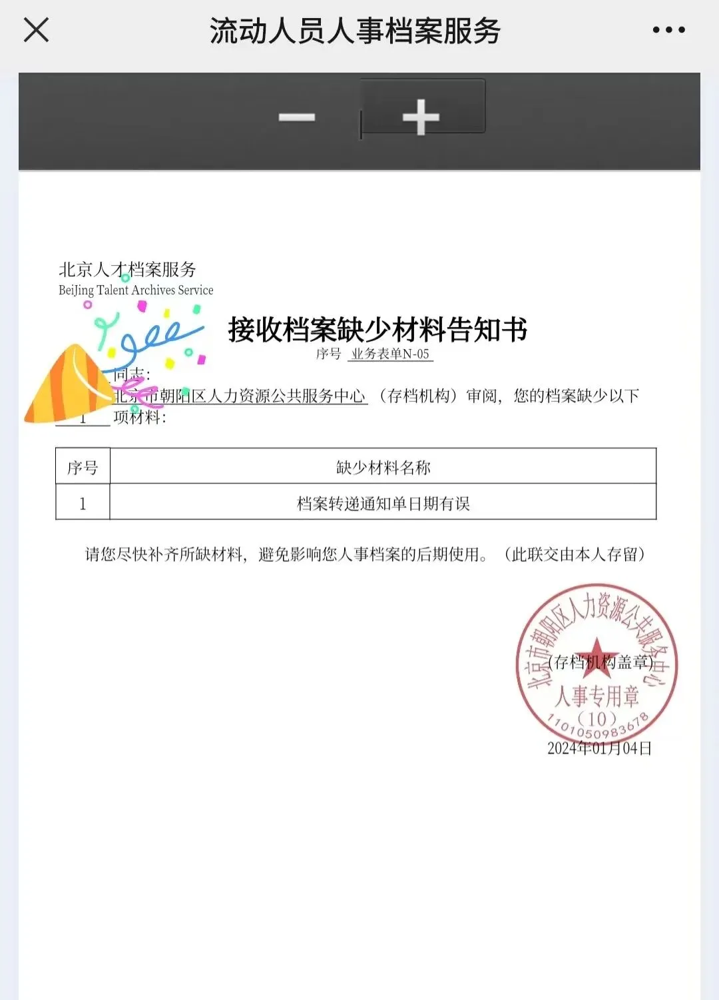

请相关部门及时关注并跟进问题。

## 1 档案转递

> “投稿：学校档案室的老师很不负责任，我是2022年毕业的，档案暂存在学校，近日申请转递档案，老师把档案转递通知单日期写错了，导致接受单位拒收，老师转递日期写的是2022年，振振有词说2022年毕业的就直接把当年的通知单放进去了，但是转递通知单日期就是邮寄档案的日期啊？这是常识吧？你写2022年当然人家拒收了！问题是知道自己错了，还要我写说明，让人力资源中心把通知单寄回学校，才能重新开！一个简单的事情，为什么要这么折腾学生！问题是你错了，我为什么要写说明，学校就是这样为学生服务的，耽误学生落户，没完没了折腾学生？”

## 2 就业问题

## “回应一下上一期关于就业问题的投稿。23届本科生就业数据在规评处网站是公布了的：

https://ghypgc.ucass.edu.cn/info/1032/1195.htm

2023届应届本科毕业生373人，其中国内升学223人，境外深造26人，签约就业41人，灵活就业7人，未落实76人。

但是后面升学情况又说“在国内升学的本科毕业生中，从升学方式上看，推荐免试研究生占到 57.3%，参加全国硕士研究生统一入学考试的有42.7%。从攻读学校上看，44.86%的学生升入本校攻读研究生，55.14%的学生升至外校攻读研究生。”这个百分比我怎么算也对不上，恐怕是错的……”

（见《[【读者投稿】该找谁解决呢？](https://mp.weixin.qq.com/s?__biz=Mzg2MjcwNzQ1Mw==&mid=2247487458&idx=1&sn=4d9b7e0efcb1c9ac6ac0c8ae1f8e06af&chksm=ce028470f9750d66a953510be48389388725408e17a7c27791e24c16e6a0239331ee2eef1f4e&scene=21#wechat_redirect)》第1条)

## 3 教学评估

“问一下上期说规评处在接诉即办平台上回复第五轮教学评估事宜我校未参加的朋友，请问去哪里看规评处关于这个的回复啊？我在平台上找了半天没发现……”

（见《[【读者投稿】该找谁解决呢？](https://mp.weixin.qq.com/s?__biz=Mzg2MjcwNzQ1Mw==&mid=2247487458&idx=1&sn=4d9b7e0efcb1c9ac6ac0c8ae1f8e06af&chksm=ce028470f9750d66a953510be48389388725408e17a7c27791e24c16e6a0239331ee2eef1f4e&scene=21#wechat_redirect)》第5条)

4

宿舍

## “说起这个宿舍，真是一肚子苦水没处倒：

这个隔音效果，很难不让人怀疑是不是偷工减料了，薄薄的楼板和墙符合学生宿舍建筑标准规范吗？满足抗震和防火要求吗？(北京难道就不会地震吗？大自然面前人都是渺小脆弱的）盖1-4号宿舍楼招投标流程规范吗？建设单位、施工单位、监理单位资质满足要求吗？竣工验收合格吗？是不是非得找住建局申请检测一下？学生的人身安全能保障吗？

还有这逆天的层高，跟绿皮火车上铺似的，在床上根本不能有坐着这个姿势，腰都直不起来，脑袋天天撞天花板，都快脑震荡了。

感觉身心都严重受到影响，学校不能老是想着有问题就打个小补丁，现在这个问题已经千疮百孔了，想想怎么从根本上解决一下吧！

> “光光，最近看到论坛上在争论寝室问题，我突然想起录取开学前学校让在迎新系统填过一次信息，不知道大家还有没有印象其中有一个模块就是寝室问卷调查，我真的觉得那个很敷衍，在关键问题上：如你是否抽烟？你是否接受室友抽烟？你是否有凌晨后熬夜的习惯？你是否习惯于在寝室吃饭（包括泡面、螺蛳粉）？你是否接受室友习惯于在寝室吃饭？你是否耳机外放？你是否接受室友耳机外放？等等关键性问题上没设置一个选项，反而设置了“你是否注重卫生”这种傻缺题目，首先，我觉得就是一个脸皮再厚的人也不会明着说自己“不注意卫生”吧，这个选项真的很像“你觉得你有最起码的礼义廉耻吗？”这种选项除了“是”难道还有第二个答案吗？其次，“是否注意卫生”很难评判吧，现在冬天，我身边有同学仍然一天洗一次澡，也有同学两三天洗一次，也有同学运动出汗了就洗，请问上述三种谁算“不讲卫生”？真的很好奇这种统计有什么意义，希望学校相关部门能够重视开学的那个调查问卷，这样后续可以避免很多问题。”

> “回一下7那个吧，阿姨打扫卫生就要在八点之前，否则你上厕所又该吐槽阿姨不打扫卫生了！而且五六层的卫生间，阿姨一层两个，要体谅阿姨。我们可以错峰或者去其他楼层上卫生间，但是阿姨错峰是把哪一层放在后边呢？我想拿一层放在后边都不合适吧！很多问题我们可以自己解决，我觉得还是要自己解决一下！”

（见《[【读者投稿】该找谁解决呢？](https://mp.weixin.qq.com/s?__biz=Mzg2MjcwNzQ1Mw==&mid=2247487458&idx=1&sn=4d9b7e0efcb1c9ac6ac0c8ae1f8e06af&chksm=ce028470f9750d66a953510be48389388725408e17a7c27791e24c16e6a0239331ee2eef1f4e&scene=21#wechat_redirect)》第7条）

## 5 食堂

“良乡二食堂自选菜，这是什么肉啊，没吃过多少肥肉的我很害怕。麻烦大家注意一下，真的很害怕😨头皮发麻了”

