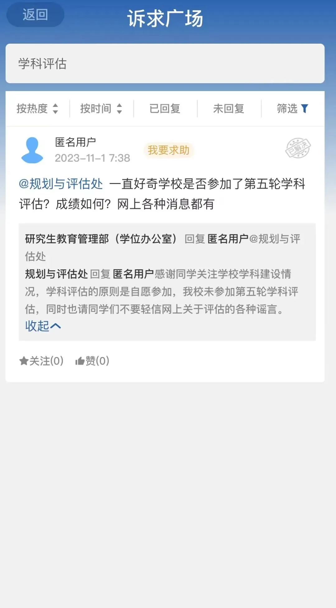
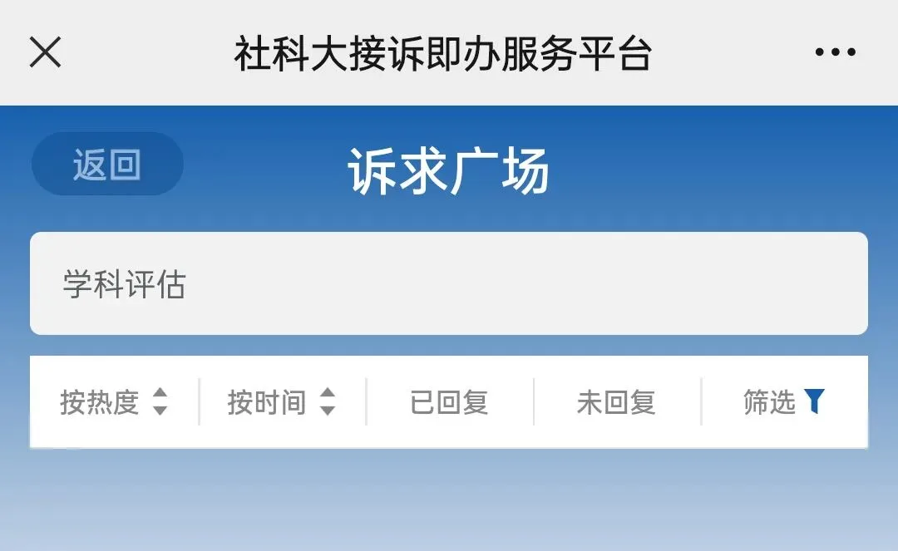
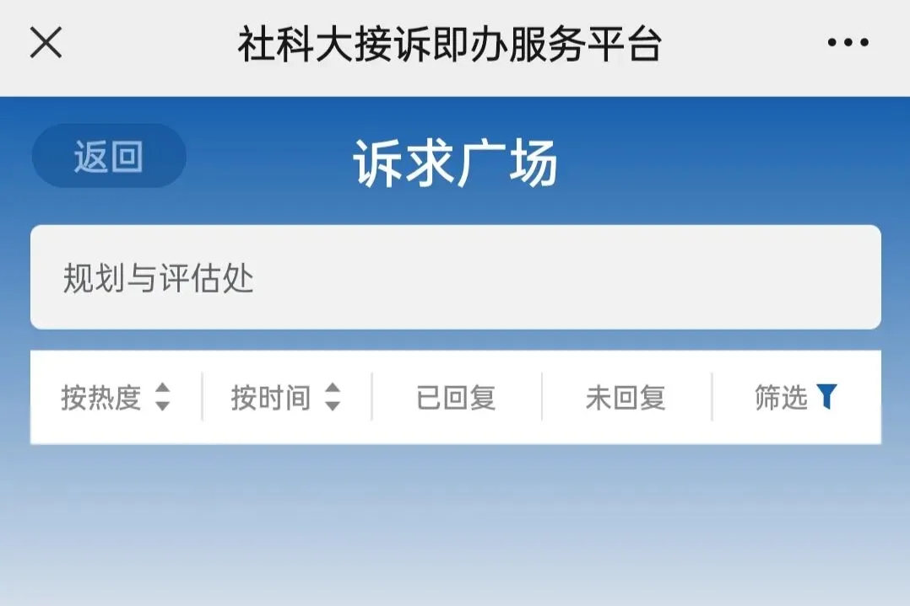

请相关部门及时关注并跟进问题。

## 1 助学金问题

> “我真的很苦恼啊，助学金给我停了四个月了，一个月之前打电话说是休产假老师名单没对接好，这一个月了还是没发，助学金的概念不就是助学吗，这学校为什么这个工作效率？稍微上点心对一下名单不行吗？”

## 2 图书馆

> “良乡校区：想问一下放假的时候怎么使用知网资源，在校外没办法登录学校账号，校园官网远程访问以及图书馆电子资源页面也登不进知网，希望知道如何操作的同学留言一下方法全过程，或者是学校有关部门发个登录小攻略，这件事对社科学子来说很重要，拜托了！谢谢”

## 3 自习室

“望京校区：点赞望京校区自习室的常态化清理！真正实现了早起的鸟儿有虫吃！~ 起早去教室能够有干净的而不是之前各种乱物占座的教室学习，真的很幸福！”

## 4 就业问题

## “考完没事回复一下昨天的第二条关于毕业去向的帖子：

这个百分比你“怎么算也对不上”，我寻思是你没认真看。我来浅算一下哈，应届毕业生总人数累加对得上的就不多说了。国内升学的本科毕业生就两种方式，一种是【推免】一种是【统考】，通过【推免】升学的学生占了国内升学总人数的57.3%，通过【统考】升学的学生占了国内升学总人数的42.7%，另一条数据是关于升学去向，不就是在本校（通过【推免】和【统招】两种方式）继续攻读研究生的学生占国内升学总人数的44.86%，去外校的占了55.14%，怎么会“对不上”？

## “那个就业问题，是不是把单位1找错了哈哈哈哈哈哈哈”

（见《[【读者投稿】档案转递引发疑问，宿舍问题争议继续](https://mp.weixin.qq.com/s?__biz=Mzg2MjcwNzQ1Mw==&mid=2247487480&idx=1&sn=e6560ecde6feaf24332dec978cde31e8&chksm=ce02846af9750d7c08563090c64abaa082481ee94e0fb9d5a947238113eaa0a5319e903b9a75&scene=21#wechat_redirect)》第2条）

## 5 教学评估

“回复这名同学问一下上期说规评处在接诉即办平台上回复第五轮教学评估事宜我校未参加的朋友。

”

“关于学科评估的事儿，我咨询过规划与评估处的老师，回复说咱们校确实没参加第五轮学科评估哈。”

“同问学科评估相关事宜，我也去平台搜了一下，没有结果。不知道是不是关键词的问题，真的很好奇学校对学科评估的参与状况…”

（见《[【读者投稿】档案转递引发疑问，宿舍问题争议继续](https://mp.weixin.qq.com/s?__biz=Mzg2MjcwNzQ1Mw==&mid=2247487480&idx=1&sn=e6560ecde6feaf24332dec978cde31e8&chksm=ce02846af9750d7c08563090c64abaa082481ee94e0fb9d5a947238113eaa0a5319e903b9a75&scene=21#wechat_redirect)》第3条）

## 6 宿舍

> “社论君你好，想回复一下第四条最后那条回复，望京早上上课时间基本是在九点二十和八点半两个时间点，七点半到九点之间基本上都是晨间洗漱高峰期，而阿姨在八点之后还在打扫卫生，如果您所说的“阿姨打扫卫生就要在八点前”的意思是在八点前打扫完毕，那么这一事实和您所说的规定并不一致，如果是阿姨本来就要在八点之前才开始打扫的话，那打扫时间确实和高峰期撞了呀。此外，午饭结束和晚饭结束的时间也多次遇到阿姨打扫卫生，这几个时间段确实都是学生们回寝室洗漱的高峰期。请您不要因为别人基于遇到的事实提出的一个错峰打扫小建议，就给人扣一顶“嫌阿姨不打扫卫生”“不体谅阿姨”的帽子来，那条建议分明一开始就肯定了阿姨的辛苦和劳动成果。您可以错得开时间，并不代表所有人都可以错得开。谢谢！”

（见《[【读者投稿】档案转递引发疑问，宿舍问题争议继续](https://mp.weixin.qq.com/s?__biz=Mzg2MjcwNzQ1Mw==&mid=2247487480&idx=1&sn=e6560ecde6feaf24332dec978cde31e8&chksm=ce02846af9750d7c08563090c64abaa082481ee94e0fb9d5a947238113eaa0a5319e903b9a75&scene=21#wechat_redirect)》第4.3）
