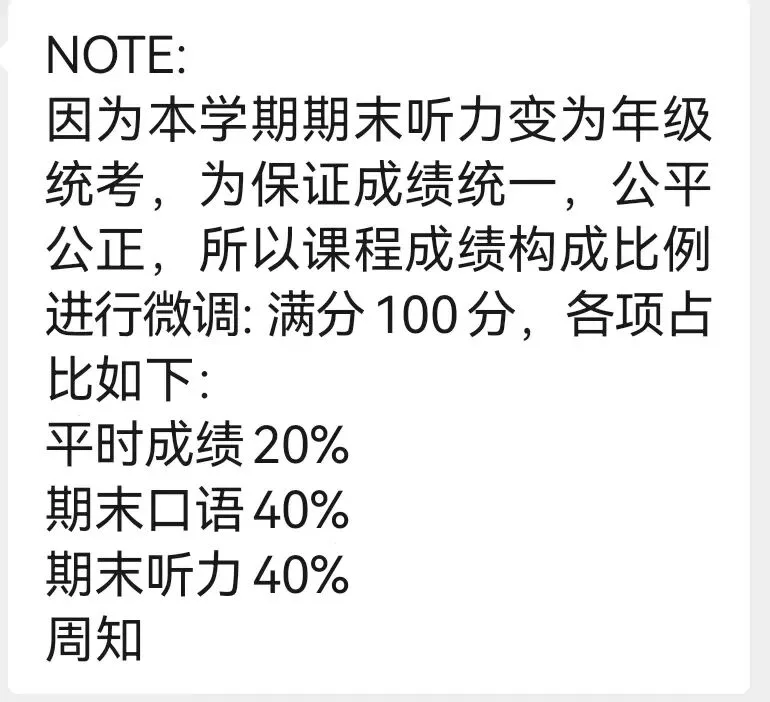
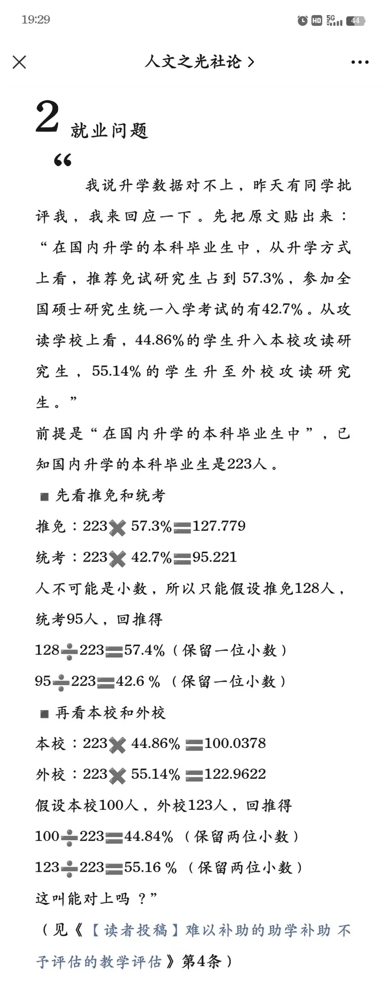

请相关部门及时关注并跟进问题。

## 1 期末周宵禁

“某位校领导大人是怎么想的我请问呢😊期末周门禁是想我们期末周的本科生怎么样呢😊就算不是期末周，大家都是成年人了又怎么样呢😊”

> “真的好离谱，不知道良乡校区宿舍楼什么时候开始搞宵禁了。现在是考试周，大家复习任务繁重，有时经常需要复习到很晚，没想到这个时候宿舍楼突然搞起了宵禁，一问就是“上级做出的决定，我们也只能执行”。我想请问一下，校领导真的知道现在是考试周吗？如果不知道，天天高唱“了解学生的需求和期望”，原来就是这样去了解的啊；如果明明知道还这样做，看来所谓的“优化管理服务机制”不过是一个笑话罢了。大家天天吐槽这所学校的行政给学生提供除了帮忙以外的一切支持，果真是名不虚传。”

> “难以置信宵禁制度的幽灵又开始回荡在社科大的上空了。先不论在一所研究性大学搞这样的一刀切宿舍管理机制，除了彰显校领导的淫威之外毫无实际意义；现在是期末周，很多人都会早出晚归进行复习，校领导不会连这个也不清楚吧。只能说某些人真的是好大的官威啊，这么大的能量，怎么不去解决学校中存在的这样那样的实际问题，反而对着学生的期末周开刀，着实可笑。”

> “关于宵禁问题：为什么要搞这个11点宵禁呢？社科大是不是越来越想要往大专的方向发展了？我自己是艺术团成员，我们在春季学期经常有各种活动，话剧队，电声乐队一排练就得排到十一点以后，以及对于夜猫子同学，在自习室学到十点多十一点多，这就不能回宿舍了？我们以后难道还要搞限电不是？社科大就这么想把自己办成大专吗？”

> “关于最近搞出来的本科生门禁，我想请问学校又是哪根筋没搭对用脚做出来决定啊？ 本来我们学校期末周和别的学校相比就又臭又长，排考排的零零散散，搞得人身心俱疲（不说远的，隔壁北理工都已经放假了），偏我们学校不在图书馆开放24h区域就算了，还倒行逆施整出个本科生宿舍门禁，过了点就刷不开闸机了？原本以为是某些个领导一天一个主意为了所谓的双一流建设和本科生教学成果验收拍拍大腿用脚做决定，现在人家人都走了，才发现是我们学校的整个行政系统都已经烂透了，是百足之虫死而不僵。也别搞什么本科成果验收了，有自知之明就顺势趁早把本科指标还给国家让会办学的来办，我们学校干脆结算结算倒闭得了。这么喜欢用行政手段规定课该怎么上、学生该怎么生活，这么喜欢无所不用其极地干预人的自由学习和生活的话，我看不如早点改名，去办像衡水中学那种以考试为导向而不是以学生的全面发展为导向的学校才更适合你们这套行政班子。”

“现在正是考试的要紧时期，辛辛苦苦在教室复习一天，回来居然连宿舍楼都进不去了。是哪个口口领导在期末周想出这样的决策？真的无语！”

(注:本稿中有言辞过激的言论，故以“口”代替，请读者朋友们自行脑补当事人的愤怒)

## 2 宿舍

“宿管科要么是堵墙洞、要么杀虫、要么安全检查……各种名目隔三差五的敲门，图书馆座位有限，宿舍学习休息的学生不胜其烦！

能不能减少骚扰？？？”

## 3 考试安排

“今年研一英语考试期末成绩占比由35％改为40%，还是在考完试快一周后告知，真的让人无语……直接挂人好了”

## 4 食堂

## “能帮忙问一下，1月8号晚上有人在望京食堂吃完饭后，身体不舒服吗？”

## 5 就业问题

“这位兄弟，你自己看看自己算的数，和学校官网公布的，差距零点几，那叫对不上吗？？？你都能四舍五入，学校不能吗？？？你这纯纯杠精”

（见《[【读者投稿】军训安排疑问再起 就业教评争议不断](https://mp.weixin.qq.com/s?__biz=Mzg2MjcwNzQ1Mw==&mid=2247487501&idx=1&sn=e016f021e9b06671abeaf3f60616f66f&chksm=ce029b9ff9751289e8a4a41cb0316f986ab58e061550c451d1538ddec0263c29388df7ee0e90&scene=21#wechat_redirect)》第2条）
