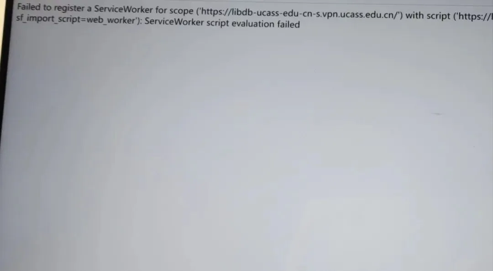

请相关部门及时关注并跟进问题。

## 1 宵禁问题

> “最近的宵禁真的有点过于荒谬了。闸机防君子不防小人已经老生常谈，上次七八号楼突然停电门口大堵车阿姨手掰闸机历历在目。期末周这么关键的时候是看大家都没空出来骂搞突然袭击吗？大家最后还不是要进门直接结果就是阿姨睡不好。十一点的门禁，要建设高中式大学？晚了出去还要知会导员？导员闲着没事干吗？向来觉得不严格设置门禁是学校很大的优点，给了大家自由选择生活方式的空间。有些人就是白天起不来晚上才能进行生活的动物，只要不互相打扰就是你好我好大家好。人文之光理当有这种包容，不要让学生连一点可自我安慰的地方都没了。”

“学工处和后勤部是登记上瘾吗？去别的宿舍楼要登记，自己宿舍楼还要规定门禁，闲的慌是吧，管的未免有点太宽了。

社科大是大学，不是tmd幼儿园！！！

ps：社科大但凡能把买闸机的魄力用在给学生涨低保上，也不至于补助是全国硕博补助中最低的！！！”

“没想到某些校领导官威还真不小，面对大家的诉求，不仅不从善入流，反而倒行逆施，装模作样地为期末周的大家宽限了一点可怜的时间，以显示自己的大慈大悲。

我们倒要问问，这宵禁制度在实行前有征询过真正与宿舍楼相关的大家的建议吗？从实行上是否有相关部门的文件背书或者法律依据？在实行时又是否考虑过这样做会有什么样的后果？

答案只能是没有！没有！没有！我们看到的，是校领导连大家不需要宵禁的基本常识都严重匮乏，是一纸什么缘由也没有的通知就搞起宵禁来肆意妄为，是各个宿舍楼内宿管人员和宿舍住户被大加折腾怨声载道。

然而就是这样一个近乎无脑的为满足某校领导个人行政趣味的宿舍管理决定，还是被坚决且不容置疑地实施了。这是什么？这是权力的傲慢自私、是权力的任性狂妄。这种权力很“聪明”，因为它巧妙地选择了期末周大家无暇多顾的时刻试图迫使你我接受既定事实；但同时它又极其危险，因为它已经听不得除了自己之外的任何声音，也看不到除了阿谀奉承之外的任何实际情况。天知道在这样一只蒙眼塞耳的怪物引导下，社科大这列火车会迎来怎样惨烈的脱轨事故。

最近一段时期，从考研安排到寝室争议，自军训疑问到教学评估，社科大糟糕的行政管理水平一直饱受质疑。而最近的宵禁事件，无疑再次暴露出了这所学校行政的底色：水平低下，且自我感觉良好。究竟要想办好社科大，首先应该大力整顿站到师生教职工对立面的谁？每一个社科大人都值得深思。昨天，是不明不白铺张浪费的闸机安装问题；今天，是自行其是干扰正常教学工作秩序的宵禁；明天，明天又会是什么？会是你我吗？还是说，其实一直都是你我在忍耐那些不该忍耐的东西？”

## 2 知网

## “想投稿问问大家从图书馆进知网有出现这种情况吗？换了三个网都不行”

## 3 就业问题

> “关于就业数据统计的“对不上”，我想再说一下。按照学校提供的数据223人，其0.1%为0.223，0.2%为0.446，人不可能是小数，所以这样的差距在实际上不构成较大的错误。至于所提到的四舍五入问题，我也存在疑问，但我认为这个问题实在算不上大。如果学校有心在就业数据方面做点什么，在小数点后两位下功夫就显得非常多余且令人费解。不过还是希望我校在数据方面能做一个简单回答，不知最近接诉即办是否有同学反馈相关情况？希望社论的意见和接诉即办保持相对同步，这样能够比较实时地解决问题。”

（见《

【读者投稿】就业宵禁热议持续 硕博教务引发疑问

》第2条）
