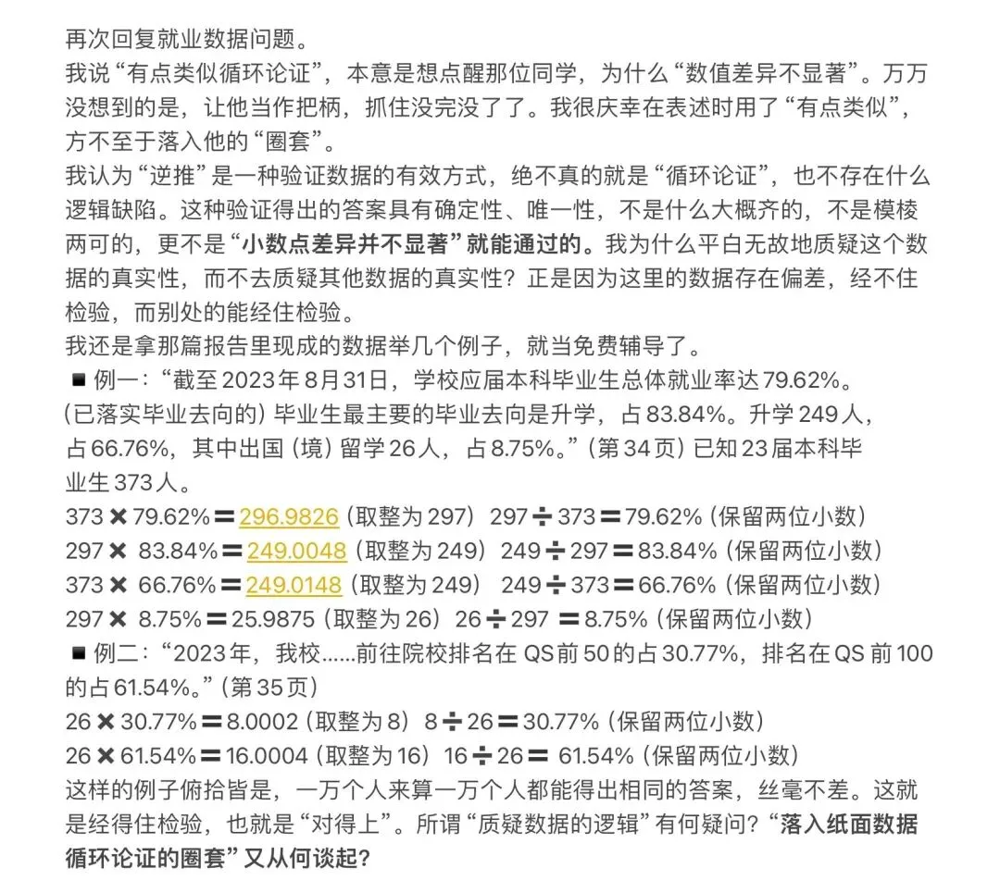

请相关部门及时关注并跟进问题。

## 1 教务问题

“请问忘记教评怎么查成绩呢？已经问过教务处说是可以从一体机打印，可是一般什么时候出成绩呢？”

## 2 就业问题

## “

（见《[【读者投稿】生活就业热议不断](https://mp.weixin.qq.com/s?__biz=Mzg2MjcwNzQ1Mw==&mid=2247487536&idx=1&sn=a046a8eef97cd1965dbe0d0871a0db59&chksm=ce029ba2f97512b47ce1bc8e64d4003bdecb4d6bb857050e110d6d23d866679f27eb6c6d9183&scene=21#wechat_redirect)》第2条)

## 3 宵禁问题

“今天的投稿很搞笑，清华有宵禁，不代表社科大要有宵禁。你自认为逻辑学的很好，实际上根本看不到本质。我认为，本次宵禁有两点值得讨论，第一，学校在不征求学生意见的情况下在期末周这个正需要熬夜的时候私自定了宵禁的规矩，今天拍脑子做了宵禁的决定，明天他就敢拍脑子做每天晚上查寝点名的规定；其次，我们都是大学生，我们也有各自的校园卡，这已经保证了宿舍安全，而大学生自己又有各自的事情，有的学生会同学开会开到很晚，有的艺术团同学排练到很晚，还有的同学比如我，每次回家都五点出门赶最早的火车，这一个宵禁把所有人都一刀切，这是典型的教条主义，不懂得灵活变通。

大搞形式主义，宿舍安全与闸机，学生卡认证以及宿管阿姨三重保障，再弄宵禁，纯纯是画蛇添足，给学生带来不便，给阿姨带来不便，给社科大建设双一流的路上填堵！我希望有一些人能够多看看大家是怎么想的，不要一味地维护现有不合理政策，合理的、利民的政策是需要研讨争论的，而不是说像你这样，别人怎样我就怎样，一拍大腿决定的。”

“领导真是深谙斗争之道，趁期末放假之际推行宵禁，“大发慈悲”给各位延长宵禁时间，瓦解一部分反抗力量。随着人逐渐回家，反抗力量就会越变越小，经过一个假期的推行，下学期回来“宵禁”也就成为了常态。

预测一下：会搬出“文件”让上面背锅，以及指出北京有宵禁的高校作为例子。

就像图书馆最开始的时候21点闭馆，拿出北京市的文件和走访调查成果，论证自己开馆时间没毛病（真应该把当时图书馆的回应存下来，让新生观摩一下），最后还得学生自己找其他高校开馆时间进行反驳（社科大读书真tm累，每一点进步都要学生鞭策），社科大这些官僚套路整不出新花样～

ps：当然，如果上面确实明令各高校宵禁，那权责也确实不在学校。”

（见《[【读者投稿】生活就业热议不断](https://mp.weixin.qq.com/s?__biz=Mzg2MjcwNzQ1Mw==&mid=2247487536&idx=1&sn=a046a8eef97cd1965dbe0d0871a0db59&chksm=ce029ba2f97512b47ce1bc8e64d4003bdecb4d6bb857050e110d6d23d866679f27eb6c6d9183&scene=21#wechat_redirect)》第3条)
