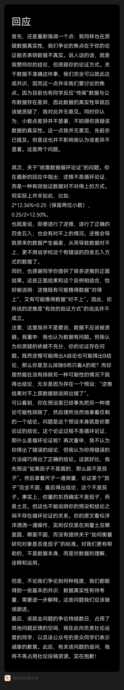

请相关部门及时关注并跟进问题。

## 1 培养方案

## “投稿：经济学院硕士培养方案至今没出。”

## 2 就业问题

## “

”

（见《[【读者投稿】宵禁就业持续热议](https://mp.weixin.qq.com/s?__biz=Mzg2MjcwNzQ1Mw==&mid=2247487544&idx=1&sn=2cb21fddc79ea69c134932c4dd26011c&chksm=ce029baaf97512bc6707cb862c23216ebd5c699fd2760b5d87e14eb83d16635497df0fe97e6b&scene=21#wechat_redirect)》第2条)

## 3 宵禁问题

> “不知道消息是不是在这里发，但是我想和广大本科生们说说，本科生宵禁这是很正常的现象，不知道你们在说什么，你们没有宵禁是因为硕博没有宵禁，你们沾光了，不意味着你们本身就没有门禁或者说你们可以用你们沾的光说三道四，如果你们在入学的时候就有门禁你们也不会说什么，只不过学校完善了之前没有的制度。所以，期末了还是好好学习吧，别把自己想的太高。”

（见《[【读者投稿】宵禁就业持续热议](https://mp.weixin.qq.com/s?__biz=Mzg2MjcwNzQ1Mw==&mid=2247487544&idx=1&sn=2cb21fddc79ea69c134932c4dd26011c&chksm=ce029baaf97512bc6707cb862c23216ebd5c699fd2760b5d87e14eb83d16635497df0fe97e6b&scene=21#wechat_redirect)》第3条)
