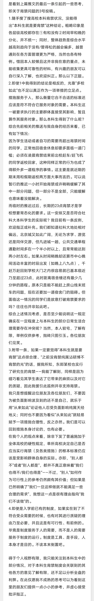

请相关部门及时关注并跟进问题。

## 1 就业问题

“既然这位同学还有疑问，我就再回复一次。真理越辩越明，公道自在人心。首先，这位同学是否质疑数据的真实性我不关心，和我们的辩论也没有关系，无需车转辘话来回强调。我的上一篇投稿通篇都是针对他所质疑的我的论证方式和推理过程进行答复，希望该同学能仔细阅读体会，抓住重点。在上一篇投稿中，我解释了为什么会对规评处报告中两组特定的数据提出质疑，表示我的质疑不是臆测的，也不是“传闻”的，而是有坚实的数据作为支撑的。后面我拿报告里面现成的例子来说明逆推是验证数据的有效方式，前后数据必须严丝合缝，不能以“差异不显著”为由搪塞。从这位同学的回应来看，他是一点都没看进去。确实，我认为““逆推结果对不上原数据就说明(原数据)出错了”，因为并不存在“逆推结果对不上原数据，而原数据依然正确”这种相反的可能性。该同学举了一组“反例”来证明逆推会导致“数据产生偏差”，因此并非验证数据的有效方式，大谬!我上次所举的两组例子都是在报告原文里找的，竭力避免编造数据从而歪曲事实这位同学倒好，直接编了一组数据，然后对我大肆批判。我们来看他给的例子:2\*12.36%=0.25(保留两位小数)，0.25/2=12.50%。我前面举例时都有一个前提，就是在算部分人数占总人数的比例。人数取整，比例在百分号前保留两位小数(当然保留几位小数无关紧要，和原数据保持一致即可)。由于这位同学并没有交代自己在算什么，直接甩过来两个式子。那我只能权当他也是在算部分人数占总人数的比例了，否则我们的讨论没有意义。按照这位同学的算法，总人数是2，部分人数占总人数的比例是12.36%，他据此算出部分人数是0.25，还照猫画虎地加了个说明“保留两位小数”。这位同学，你把谁给剁成0.25个了?你在编数据的时候，压根就没有考虑过这些数据表示什么意思吗?没有想过开始的12.36%是怎么来的吗? 这个12.36%表示的是部分人数占总人数的比例，它恰恰是经不住检验的，需要质疑的错误数据。因为部分人数取整应该是0，0作分子神仙也算不出12.36%。退一万步，即便部分人数取1，比例也应该是50%，而非12.36%。

负责老师一开始给的部分人数占比不是像你那样拍脑袋编出来的哈，而是用“部分人数➗总人数”算出来的。我们所做的第一步无非就是根据老师给的比例和总人数算出部分人数，这个部分人数必须取整，因为老师也是除的整数。第二步所谓逆推就是把老师的运算过程重新进行一遍，验证一下老师算得对不对。如果老师也跟你一样拍脑袋编个数据，怎么可能经得住逆推检验?怎么可能不露出马脚?我之前还以为这位同学是故意找茬，现在看来不是，他压根没有考虑过这些数据表示什么，也没想过一开始给的比例是怎么来的，结果绕进迷魂阵里出不来了。至于茄子土豆这样不伦不类的比喻就更不值一哂了。后面有句话我觉得说得还在理:对我们更有帮助的，不是数据本身，而是对数据的理解、诠释和运用。”需要补充的是，对数据的“理解、诠释和运用”首先应该基于正确的数据。像这位同学随心所欲地编造数据，当然也就于发现问题解决问题无所助益。

补充一点，我注意到这位同学还表示他所进行的是“正确的四舍五入”，而学校的数据是经过“有错误的四舍五入”得出的。前半句我在文中已经驳斥了，再就后半句略作说明。

我不知道这位同学是如何作出如此论断的，依我的理解，恐怕是看到我通过逆推验证，发现数据“对不上”才这么说的。我之前说过，数据“对不上”的可能性有千千万万，有可能是分子(部分人数)错了，有可能是分母(总人数）错了，也可能是一时疏忽写错了数，当然也不排除像这位同学一样四舍五入都能搞错（我本以为这是一个成绩中游的小学生都不会出错的，从这位同学的表现来看，难说）。不论出于哪种原因，数据都是没对上，都是存在错误，需要作出解释。拿会计举例，一个会计算账差了几毛钱，很可能是加错了好几笔，如果觉得无所谓自己把那几毛钱添上，查出来可是要坐牢的。”

（见《[【读者投稿】培养方案引发疑问 就业宵禁争论持续](https://mp.weixin.qq.com/s?__biz=Mzg2MjcwNzQ1Mw==&mid=2247487551&idx=1&sn=82d2c2565253c73dce2afb509fd825ff&chksm=ce029badf97512bb7f8b01f9fb58a78624cd4f34443efd1a07ce487f32100c091c2991857ead&scene=21#wechat_redirect)》第2条)

## 2 宵禁问题

## “本人硕博，坚决反对今日推文中疑似硕博的爹味说教。

正常？正常nm正常，社科大层层闸机，串楼还要登记，再加个宵禁。本人不是本科生，但也觉得不正常，压根就不是这么比的，全国高校硕博宵禁的也有，是不是实施硕博宵禁也可以用“正常”二字？不帮助本科生维护权益也就算了（毕竟没侵害到自己利益），但搁那自觉当学校“爪牙”，站着说话不腰疼，一股爹味说教，还给硕博招黑就很恶心。

以后硕博利益受到侵害时也可以用一句“正常”回怼，比如你领着全国最低的“低保”，也正常哦。

同样回你一句：不要因为年龄大就把自己想的太高。”

> “回博士关于本科宵禁投稿 都是读博士的人了，怎么还和我们这群本科小朋友一般见识呀，这点媒介素养过滤信息的能力都没有吗？社科大的博士竟然会在乎这点和自己无关的小事，真是让人大跌眼镜。 再说了，博士那可是真正走学术道路的，与其冲着本科生的意见发脾气，不如关心自己的论文写怎么样了，能按时毕业吗？投出去的稿件被接收了吗？这可是真真要紧的事！”

> “想请问评判本科生宵禁那位“硕博生”，宵禁是一项什么专属于硕博生的特权吗？大家都作为学所谓文科的学生，都应该了解一些基本的现代社会应该有的理念，您是怎么心安理得的说出那样不可理喻的话的?如果您引以为傲的学历并没有给您带来应有的素质，那就不要再出来卖弄了。也许是封建遗毒，是不是总得比别人多点特权，才能有理由活着，和别人平等，您很难受呢？您说让我们安心当奴才，您以为您就是老爷吗？”

## “

“

投稿，昨日那位朋友的言论令人齿冷。这样居高临下的辩护，很难不让人联想起某些校方行政人员的工作态度。如果这个与大家对我校某些行政工作人员颐指气使的“刻板印象”十分相近的稿件真的是由其做出的回应的话，

不禁要为这种工作方式点一个大大的“赞”。不去解决宵禁问题，不敢公开做出回应，而是以阴损挑起本硕矛盾的方式转移大家对宵禁问题的关注焦点，我们行政工作人员真是太有智慧了。

抛开这个实在是和宵禁管理本身一样荒诞不经的言论，着眼于宵禁问题本身，没有任何真正处在宿舍中受其影响的朋友会认为此等管理方式是合理的，这就已经可以说明宵禁的荒唐了。既无相关政策文件背书，又无征集教职工与学生意见，也不考量推行政策导致宿舍内无论是管理人员与被管理的朋友都不堪其扰的后果，这样一种管理规定除了说满足某些校领导的恶趣味之外有任何存在的可能吗？在这样不负责任的管理之下，我们，每一个在宿舍楼内深受其害的人，是应该思考如何让我们自己为我们自己负责了。”

（见《[【读者投稿】培养方案引发疑问 就业宵禁争论持续](https://mp.weixin.qq.com/s?__biz=Mzg2MjcwNzQ1Mw==&mid=2247487551&idx=1&sn=82d2c2565253c73dce2afb509fd825ff&chksm=ce029badf97512bb7f8b01f9fb58a78624cd4f34443efd1a07ce487f32100c091c2991857ead&scene=21#wechat_redirect)》第3条)
