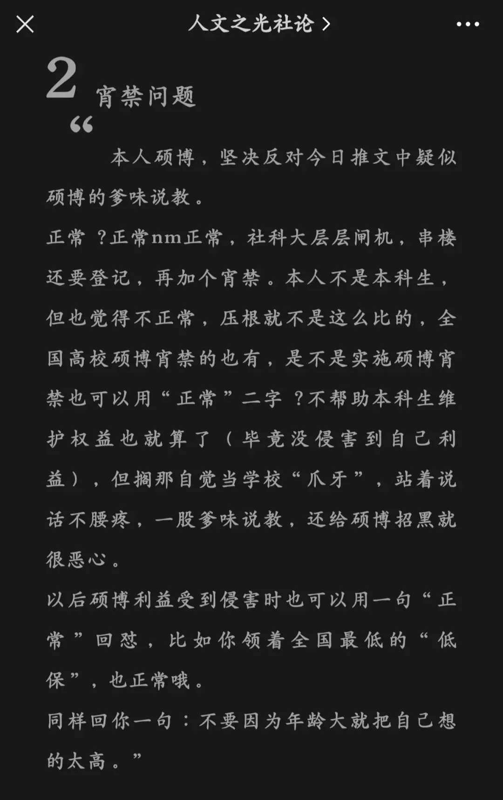

请相关部门及时关注并跟进问题。

## 1 校园网问题

“别吵啦别吵啦！你们争论的推文，望京的同学点进去看都要加载好几次才加载出来！救命，谁来管管望京的网啊！”

## 2 报名费问题

“我言简意赅，硕博连读报名费并没有提交报考文件材料，准备放弃，请退钱！退钱！你收两百块我忍了，我在提交材料前就放弃凭什么不退，人文之光成圈钱之光算了👍👍”

## 3 宵禁问题

“我硕士，本科就读于北京某211，对于学校的宵禁政策非常反对。我读本科的时候，哪怕就是疫情期间，也没见学校搞宵禁。现在疫情过去了，学校居然搞宵禁？？？闻所未闻，在北京读这么多年的书第一次知道“宵禁”。 其次，非常赞成下图同学说的话

搞宵禁完全是滑天下之大稽，也不怕传出去被其他高校笑话。还有前天说，本科没宵禁是沾了硕博的光，这话的依据在哪里？你是在高校进行调查过吗？还是自己杜撰？好好去看看吧，北京高校有哪几个搞宵禁的？？领导层的也不怕这政策传出去被笑话。”

## “投稿：

个人认为，本科生的宵禁政策并没有什么大问题。首先，很多高校都存在本科生宵禁，上次那位硕博同学的话，只能说话糙理不糙。这个问题我们从三个方面讨论：

第一个方面，如果经常有学生半夜回来，你们自己觉得开门关门的，不会影响到其他同学的休息吗？宵禁现在延迟到12点了，如果说11点还有点早，12点其实是合适的时间，你在外面学习到十一点多，回来收拾洗漱，有什么问题呢？你天天磨洋工磨到半夜一两点，你那是在学习吗？你的学习效率怎么样，自己也应该清楚，不用大家多说了。

第二个方面，一堆人说期末了要考试，得熬夜复习的，想问问你们平时都干嘛去了？人文社科是比较容易，但是天天在学校混日子，靠着考前突击过考试，恐怕不符合当代大学生的风貌吧，如果社科大的学生都是这种状态的话，我看也不用评双一流了。

第三个方面，有些学生在外面不知道干什么，也没有在学习，也不在学校的这种状况，如果经常经常这么晚回学校，我想应该是不太合适的。如果出了什么问题，还要把责任赖到学校身上，针对这部分学生，宵禁政策就是给你们定了一个deadline，过了时间你们就在外面找地方住得了。

基于以上三个方面，我们认为宵禁不存在实质上的问题，如果有细节需要讨论，可以一起商量，如果就是为了抨击，那还是算了。社论经常是个别学生在里面疯狂发声带节奏，搞得好像带表了大多数学生的心声似的，如果真的是大部分学生都对此不满，局面也应该不是现在这个状态。”

“发现社科大一个有趣的现象，每次一条针对一个群体的不合理规定被骂多了，就会出现另一个疑似非受害群体对受害群体的说教，进而由学生对不合理规定的对垒转变为学生间的对垒，不得不说高啊！真的是高👍👍👍

已经被骂到现在了，官老爷可真是铁了心不改啊，记得今年大家回去招生宣传的时候给如实反应一下。”

（见《[【读者投稿】宵禁就业大争议](https://mp.weixin.qq.com/s?__biz=Mzg2MjcwNzQ1Mw==&mid=2247487559&idx=1&sn=c29eb85e0f870093bf1227ddc89ea070&chksm=ce029bd5f97512c339a9564b1ae4c2cdf5324eda3b5bdfc1f4762b3fc0563fbc94994ebf8c3f&scene=21#wechat_redirect)》第2条)
