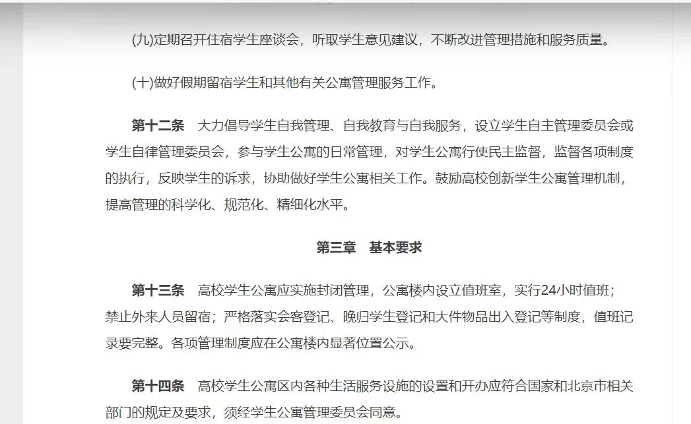

请相关部门及时关注并跟进问题。

## 1 考试作弊

## “关于考试作弊问题

学校发了那些人在哪场考试通过什么手段作弊，那能不能把处理结果发出来啊，例如，某某同学因作弊取消该科成绩这类的话，至少我高中的时候考试前会把作弊分成几类，每一类都有相应的处罚方式，而且是公布处罚方法的，直接立板子写的那种，要是没有惩罚机制，将来大家就都无所谓了，毕竟作弊没有后果，没人知道”

## 2 校园卫生

> “吐槽一个，北综2楼北面的男卫生间门口能设立个帘子或者给门改成常闭设计吗，刚才我在那里小便，又进来个哥们，站最外面那个发现后面能被看见，就到最里面，发现挨着我，给他逼的差点去洗拖把池小便这哥们估计经历了艰难的思想斗争。”

## 3 宵禁问题

## “投稿

回上期有关宵禁问题第一条。有同学怀疑学校宵禁管理缺乏背书，的确如此，我去查看了《北京高等学校学生公寓管理办法（试行）》，里面并没有给学校实行宵禁管理的权力，而只是要求进行晚归登记。大家一直在批评的，是学校不科学的简单粗暴的宵禁管理，而非晚归登记制度。

之所以说宵禁管理不合理，一个是时间过早，一个是到点就禁止任何同学刷开闸机无法进出宿舍，一刀切的管理造成宿舍楼内工作生活的人的诸多不便。纵观这几期下来，引起争议的点在这里。

因此，我建议学校不如直接把晚归登记簿放在宿舍楼门口显眼处，由晚归的同学自行填写登记；同时不在闸机等处设限妨碍大家正常通行；并且适当放松晚归的认定，不应在晚十一时就视为晚归。这样既做到了严格执行晚归登记制度，又符合文件要求的学生自我管理、自我教育自我服务的精神，亦便利了在宿舍楼内工作生活的每一个人，变僵硬的宿舍宵禁为灵活的晚归登记，不失为一个好的方法。

不过，想必学校似乎一直在搞自认为行之有效的“拖延战术”。那只能“祈祷”同学们会遗忘这件事，以及不会因此造成学校管理不被信任的加剧并因此影响未来的招生、宿舍收费或闸机效能等诸项工作。

最后再吐槽一句，信任都是相互的，一边指责大家为何都不信任自己，一边又不相信大家懒于沟通，真不知道学校信息沟通机制建设加强到哪里去了。”

## “关于本科生宵禁问题的投稿：

看到关于宵禁的讨论想到一个问题，有宵禁的话晚上宿舍楼会锁门吗？如果有同学在宵禁之后生急性病怎么办？把宿管叫醒开门虽然乐观的话只需要2-3分钟，但可能会造成极重的不便和风险，遑论其它情境。不知道此时学校是否会用“大多数学校都设置宵禁”的说法置身事外。加强学校对学生的约束以规避监管风险，却给学生带来极度不便，引发更多本可以规避的风险。另外，1.17投稿的的三点支持看法里，管理者对被管理者的态度让人心惊心凉…

## “投个稿，确实是有规定要求要有晚归登记，但我觉得可以灵活一点，规定详见：

https://www.beijing.gov.cn/zhengce/zhengcefagui/202104/t20210428\_2376410.html ”

## “关于宵禁问题

我几个月前晚上一点多进宿舍楼，宿管就在门口桌子后面睡觉，躺在行军床上，我进来了，宿管没有被惊醒，那时候没有宵禁呢。那现在有宵禁了，我是不是就得一嗓子给人家宿管喊起来让他或她给我开闸机然后登记呢？这或许是抽象了点”

（见《[【读者投稿】不知该作何感想呢？](https://mp.weixin.qq.com/s?__biz=Mzg2MjcwNzQ1Mw==&mid=2247487574&idx=1&sn=0ce7a888091650cb7d3de4a3708091e0&chksm=ce029bc4f97512d25cd4012f689af33c57fffc888503e33079706ba8f4a5db0e378095a5214a&scene=21#wechat_redirect)》第3条)
