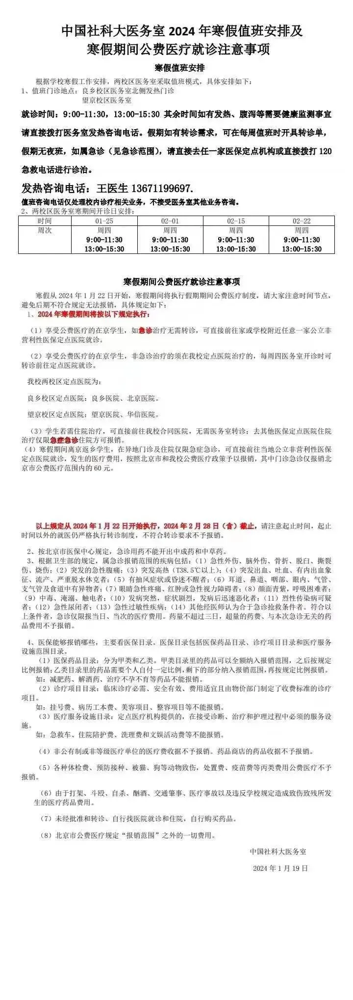

请相关部门及时关注并跟进问题。

## 1 医务室

> “医务室目前是只有周四五个小时值班。通知里的“就诊日”和“值班时间”语焉不详。以为周四就诊其他时间有老师值班呢。今天去医务室打电话才知道，只有每周四的五个小时值班。其他时间连转诊单都开不了。这意味着，比如一个同学周五生病了，而且不在急诊范围内，就只能等待一周的时间。估计届时病都好了。想问问，这个政策究竟是否合理？假期期间每天安排哪怕两个小时值班，就能完全解决问题！”

## 2 宵禁问题

> “关于让不让宿管睡觉的问题，这个其实是宿管工作时间的安排问题，我当时跟宿管阿姨聊过他们工作时间安排及休息的问题，后勤在确定工作时间及工作安排时征求过宿管们的意见，这是他们自己选择并同意这样的工作安排，建议在dis学校前先调查一下，不要想当然发在人文之光，或者问问接诉即办也行。”

## “已经放假了，学校也没有改的意思。

只好恭喜了，恭喜社科大，恭喜伟大的领导，喜提宵禁成就社科学子又多了一道安全锁，大家宣讲的时候一定要好好宣传下，相信他们一定会感动

希望在新的一年里社科大建成一流管制大学，将“闸机经验”“宵禁经验”“甩锅经验”（因为学生太sb，没必要评双一流，以原话为准）“自嗨经验”（明明行政管理烂的一塌糊涂，却觉得自己做的很好）等展现权力傲慢的方式方法教给广大的兄弟院校。”

（见《[【读者投稿】食堂教务产生疑问，宵禁问题争议依旧](https://mp.weixin.qq.com/s?__biz=Mzg2MjcwNzQ1Mw==&mid=2247487585&idx=1&sn=f73a89b6d0647005ed57ada4053a9186&chksm=ce029bf3f97512e57736ef0d17feb0df3d5a418bfa2b126387b59fc1732dc054eb5d40a19bdb&scene=21#wechat_redirect)》第2条)

## 3 缓考问题

> “投稿说一下缓考公平那条。限制满分是不是对缓考同学也是不公平？前两天期末考试时候有个老师说了，缓考的试卷难度会比正常考试难30%，不管你什么原因获得了额外的时间，老师们自然会有相应处理的办法。限制满分这个投稿只会让人觉得投稿人是一个只看绩点的学生罢了。”

（见《[【读者投稿】食堂教务产生疑问，宵禁问题争议依旧](https://mp.weixin.qq.com/s?__biz=Mzg2MjcwNzQ1Mw==&mid=2247487585&idx=1&sn=f73a89b6d0647005ed57ada4053a9186&chksm=ce029bf3f97512e57736ef0d17feb0df3d5a418bfa2b126387b59fc1732dc054eb5d40a19bdb&scene=21#wechat_redirect)》第3条)
