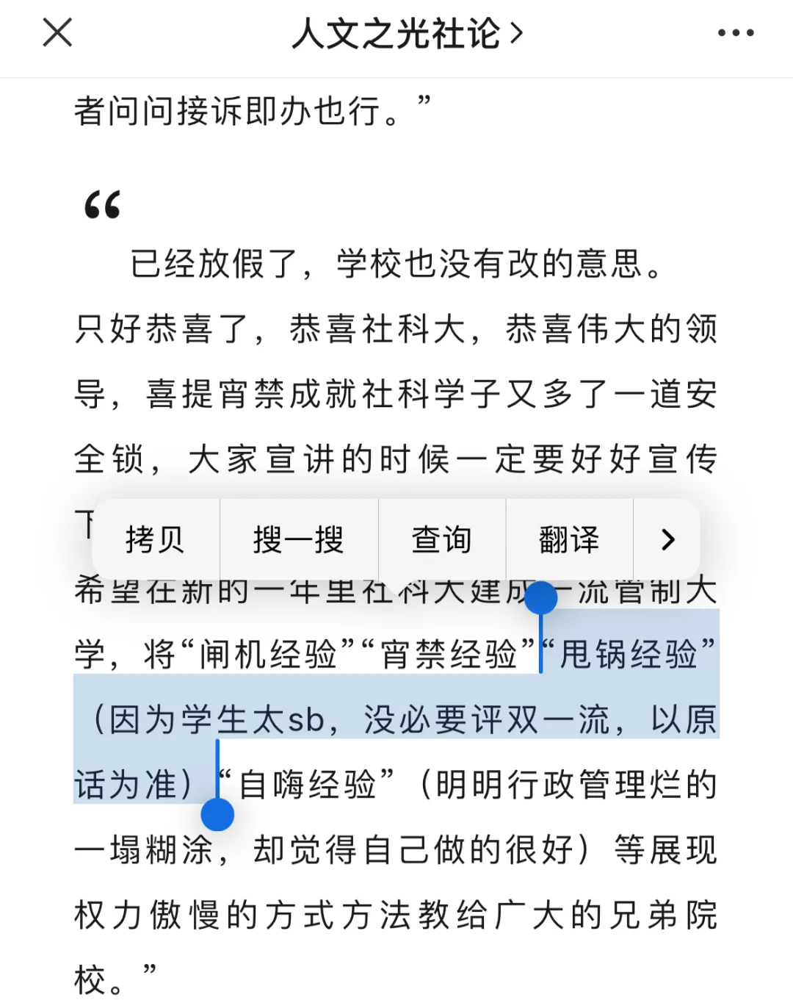

请相关部门及时关注并跟进问题。

## 1 图书馆

> “良乡校区投稿：图书馆放假闭馆期间，想请图书馆完善场内中间位置的座位插座，尽可能每个座位周边或者座位上都配有插座，一方面方便使用，另一方面减少乱接乱拉插板的行为，降低安全隐患的发生。中间位置光线不够的座位，可以增加小台灯。安装插座和台灯可以参考国家图书馆或者望京校区图书馆，别的图书馆建设较良乡早也设立安排了座位插座和台灯。图书馆一楼咖啡机附近的半躺座椅也请安排清洁，有的半躺椅看着挺脏的。”

## 2 宵禁问题

“回昨天第二个宵禁问题第一条。好一个“自己选择并同意”，请问在后勤处与宿舍管理人员这样垂直上下级的强权力关系中，宿舍管理人员真的有很大自己选择并同意的余地吗？请设身处地站在宿舍管理人员的立场想一想，如果是你或任何人去做宿管，与其愿意去商量晚上几点因宵禁被打扰到休息，如果有选择的可能，想必都会更乐意从根本上取缔宵禁，不因其增大被打扰的几率吧。真实情况恐怕是上级扔下宵禁这样不合理的政策，宿舍管理人员在上下级关系中铲不掉这个东西，只能在同意宵禁政策的前提下做出选择。

的确，任何发言都应该尽可能去了解各种情况，但也要对这些情况有一个理性的思考与判断，否则就会像这个只看到形式自由的朋友一样，被某些行政人员的话术所蒙蔽。”

“想知道这句话是否真实，是否有出处，谁说的？能否把这个人发出来？如果是真的，不管这人是校领导还是谁，只想说一句：他母亲跟人跑了。”

（见《[【读者投稿】假期将至，医疗宵禁问题未解](https://mp.weixin.qq.com/s?__biz=Mzg2MjcwNzQ1Mw==&mid=2247487595&idx=1&sn=dc728925a8137ace0d2f5ebc4d84046c&chksm=ce029bf9f97512ef2d8f9831d6f3bab45c3e0a5a438630433bb2b3983b6930ad7f9fa6781607&scene=21#wechat_redirect)》第2条)

## 3 缓考问题

> “看到最新一条投稿中，有同学说缓考试卷难度会比正常难度高30％。如果每门课程都是这个标准，那我觉得大家也不会有什么异议。关键是，教务处在接诉即办中说的是“缓考试卷难度与正常考试试卷难度相当”。而且据我了解，很多门课程中，都是老师提前出好了两套卷AB，教务处抽一套作为期末考试卷，另一套作为缓考试卷，并无难度提高之说。 其实无论是缓考限制高分还是提高难度，大家都是想要一个更加公平公正的考试竞争环境罢了。也希望教务处尽早就这一问题给出明确回复，统一标准，不要让大家再活在揣测不安与焦虑之中了。”

## “投稿

很赞同昨天第三条同学的看法。缓考并不是能随便申请的，只有在每个人都可能面临需要缓考的紧急情况下，以正当理由并经过学院与教务处同意才可以申请；而且缓考所用的考卷难度应该是高于第一次考的卷子，没有理由限制缓考同学获得的分数。”

“针对第三条 不看绩点我看什么，看社科大评不上双一流？还是看社科大烂到底得行政管理水平？ 有本事来互卷”

“回应昨天那个同学，我就是个穷学生，我不看绩点我还能看点什么呢？拼爹吗？评优评奖看不看绩点？推免保研看不看绩点？绩点和每一位普通同学的切身利益息息相关，我为什么不能计较呢？如果说以后我们实行九品中正制，我没意见，但起码现在，教育的指挥棒还是落在绩点上。你这样的人身攻击只会显得你幼稚且没品，用孔子的话来说就是个圣人蛋。我一没投机取巧，钻规则漏洞，二没落井下石，陷害别人。在同台竞争之前，把规则讨论清楚难道是很不齿的事情吗？

再次重申下我的想法，以及我在接诉即办平台看到的一些同学的想法。规则是要保障大多数人的公平，而不该成为少数投机取巧者的帮凶。不管是不可抗力导致，还是为了投机取巧，少数缓考的同学比大多数按时参加期末考试的同学获得了优势是不争的事实，必须要设置惩罚来保证公平！

清华、北大等国内双一流高校都对缓考做出了限制：被批准缓考者须在该缓考课程下一次开设学期选课并参加考试，获得实考成绩后，评定该课程总成绩。

社科大硕博好像就是这样执行的，能否也移植到本科呢？

按照开课分秋季学期和春季学期的传统，在当前学年评优评奖时，缓考同学是一定拿不到这个学分的！而不是像社科大一样开学补考了事，这才是真正的公平！

附——

北大：http://www.dean.pku.edu.cn/web/student\_info.php?id=20

清华：https://qzc.tsinghua.edu.cn/info/1029/1444.htm”

（见《[【读者投稿】假期将至，医疗宵禁问题未解](https://mp.weixin.qq.com/s?__biz=Mzg2MjcwNzQ1Mw==&mid=2247487595&idx=1&sn=dc728925a8137ace0d2f5ebc4d84046c&chksm=ce029bf9f97512ef2d8f9831d6f3bab45c3e0a5a438630433bb2b3983b6930ad7f9fa6781607&scene=21#wechat_redirect)》第3条)
