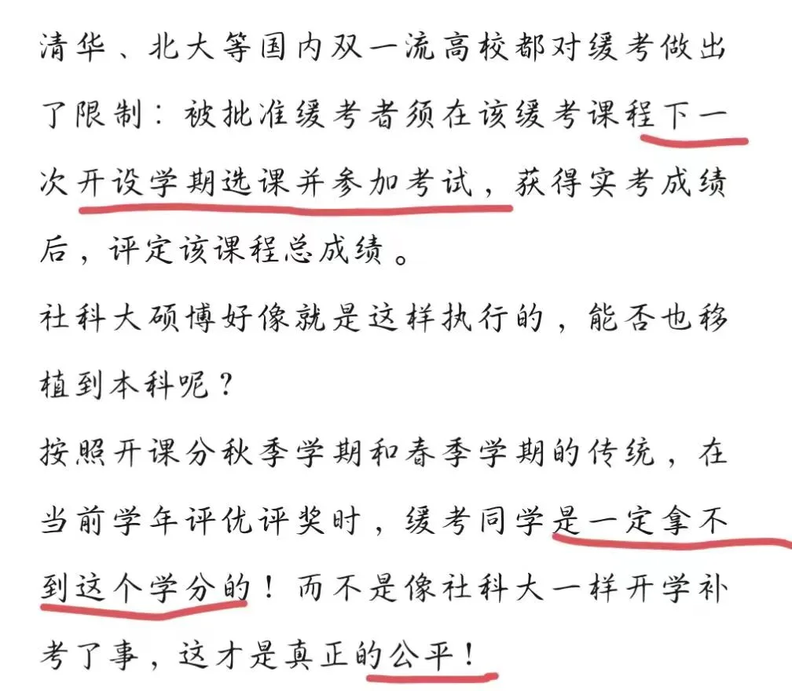

请相关部门及时关注并跟进问题。

## 1 宵禁问题

## “【好一个“自己选择并同意”】

你自己去问问宿管，看看他们到底为啥同意，不要一股嘲讽学校的语气。

跟宿管聊完你就不会这么说了。你以为我在跟宿管聊之前我不反对这种做法么？但我聊完了就能明白了。不要觉得自己想当然的来维护你认为权利被侵犯群体的利益，也许按你方式维权完，可能会实质上侵犯人家的利益。

说话做事请实地的去了解，至少我觉得学校在各方面都会想着尽力去做好的。

“关于“甩锅经验”，原话是在2024年1月17日那条高度疑似行政人员的话的第二部分，投稿说“以原话为准”就是以这句话为准，引用如下：

> “第二个方面，一堆人说期末了要考试，得熬夜复习的，想问问你们平时都干嘛去了？人文社科是比较容易，但是天天在学校混日子，靠着考前突击过考试，恐怕不符合当代大学生的风貌吧，如果社科大的学生都是这种状态的话，我看也不用评双一流了。”

当然，经同学这么一问，我也发现投稿可能说的不严谨，虽然大家都认为是行政人员说的话，但确实无法100％确定是行政人员说的，而且大家理解也可能存在偏差，在此对不理性的用语表示抱歉。

（见《[【读者投稿】图书馆有新建议 宵禁缓考讨论热烈](https://mp.weixin.qq.com/s?__biz=Mzg2MjcwNzQ1Mw==&mid=2247487606&idx=1&sn=997774aaabf72489a3a3e26862355b8b&chksm=ce029be4f97512f23975cedc0259e8ae0e04e533feb00557d1f76f4b8a8f417831f75f656233&scene=21#wechat_redirect)》第2条)

## 2 缓考

“回应缓考问题：缓考同学中很大一部分是因不可抗力导致的突发状况而被迫选择缓考，这部分同学平时上课也付出了很多时间精力，上课全勤、认真听讲等等，并且获得了较高的平时分，而如果让这些同学再在下一学期选课，再付出双倍的时间精力去获得原本就应该已经获得的学分，是否有些不近人情而且多此一举了呢？况且这本身抹杀了缓考同学已经付出的时间精力和已经获得的平时分，是否有失公平呢？

还有如果因为不可抗力因素导致的缓考，就让这部分同学“一定拿不到这个学分”，更甚至“限制学年评奖评优”，难道真的是“真正的公平”吗？

（见《[【读者投稿】图书馆有新建议 宵禁缓考讨论热烈](https://mp.weixin.qq.com/s?__biz=Mzg2MjcwNzQ1Mw==&mid=2247487606&idx=1&sn=997774aaabf72489a3a3e26862355b8b&chksm=ce029be4f97512f23975cedc0259e8ae0e04e533feb00557d1f76f4b8a8f417831f75f656233&scene=21#wechat_redirect)》第3条)
