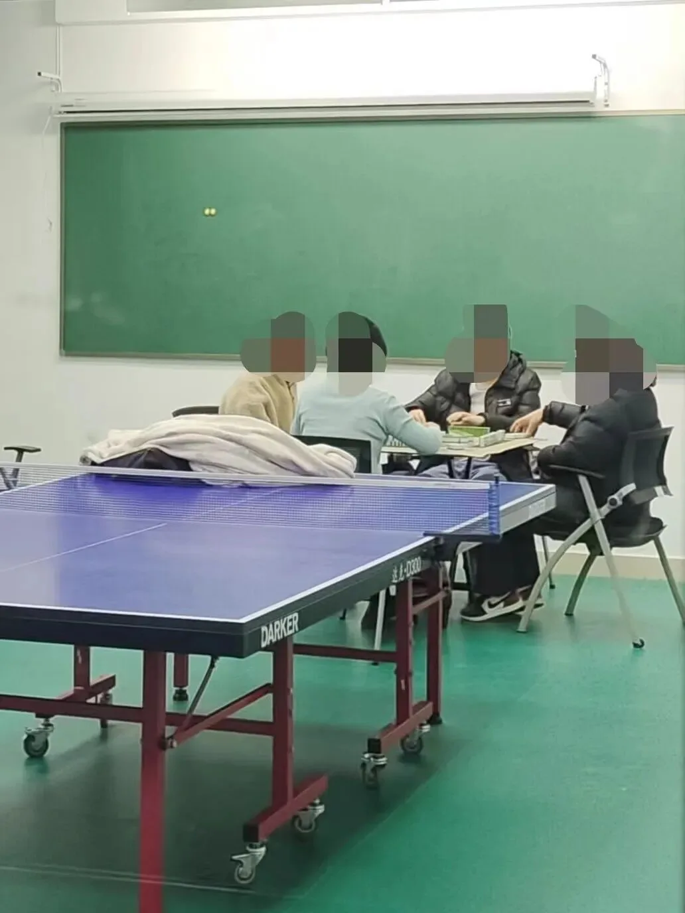

请相关部门及时关注并跟进问题。

## 1 教学科研问题

> “投稿：新学期给各学院执行院长关于学术建设的一点意见。如果社科大还标榜自己特色是研究型大学的话，就好好把学术科研放到工作第一位上。举一个小例子，看看各学院公众号发的内容，再看看北大、人大公众号发的内容，科研动态占比一目了然。不论发表差距，只从关注重心上就很说明问题了。风气好了，一切才会好，不要让一些奇怪的事情劣币驱逐良币。就不拿老师的学术成就做对比了。希望有自知之明，别老做些外行指导内行的事情。 当然，可能是我多虑了。大家乐津于和老师搞关系拿项目评奖、发普刊保研和用经费办神奇的篮球赛和无人问津的读书会。 形势一片大好，每个人的脸上都洋溢着幸福的笑容。”

> “投稿： 1.快开学了，但是正选之后停开通知依然没有发。按照规定，课程人数不达标的话在正选之后应该停掉一部分课程。一方面，教务处及时统计可以告知任课老师情况，免得白准备。另一方面，也可以告诉选修这些课同学让他们尽早规划其他课程。不必要一定拖到退改选才发停课通知。另外就是，以往学期中就出现过明明正选过后课程人数未到开课门槛，但是这个课仍然进入了退改选阶段。这对那些其他正常被停开课程的授课老师和学生是极大的不公平，建议统一核查，规范秩序。 2.按教务处之前发的通知，采用考试结课的本科课程应该在考完试之后1-2周内出成绩。但截至到现在仍有若干门课程考试成绩尚未出分，不知何故？ 3.目前上传的课程大纲有不少“执笔人”一栏写的是教秘名字，那么问题是，这个大纲到底是教秘拟定的还是老师们写出来的？如果是前者，那这个东西跟上课之间什么关系值得怀疑；如果是后者，为什么执笔人一栏填的是教秘名字。这种事情好像不应该草草带过？”

## 2 教室问题

## “投稿如图，想请教一下望京有关部门，乒乓球室什么时候改成棋牌室了？”

## 3 宿舍

## “你怕是不知道，一号楼的暖气也是搞笑的。本人一号楼底层，冬天全靠空调。”

（见《

【读者投稿】冬日取暖竟成问题？

》第2条)

（见《

【读者投稿】岁寒情暖深人心

》第1条)
