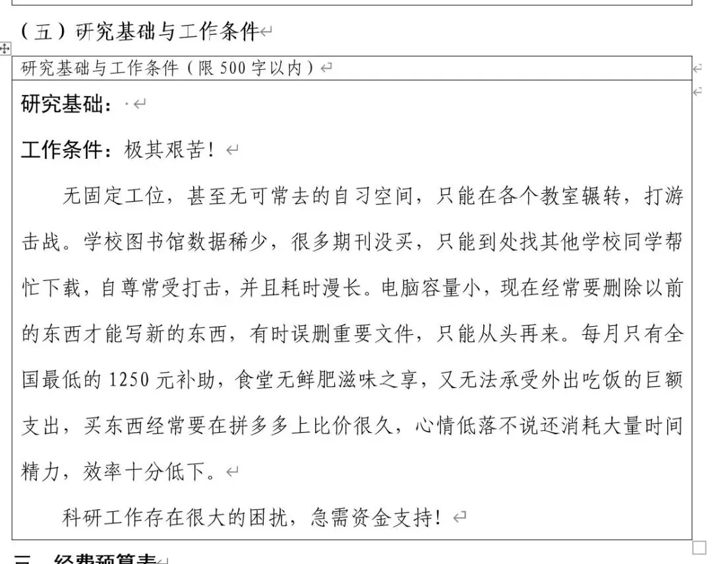

请相关部门及时关注并跟进问题。

## 1 研创计划

“投稿：研创计划原稿。最后在同学劝说下删除，终于理解为什么 所有的文科专业都叫服务业，就tm一万也得舔”

## 2 宵禁

“社论君你好，我想问一下上学期最后学校出台的有关宵禁的规定下学期及以后是否还持续实行？新学期开始了，大家陆续返校，烦请广大师生持续关注此事，谢谢！！！”

## 3 论文评阅

> “投稿： 这个让老师们费了大劲的论文评阅意见表到底是谁在看？如果大家不知道论文为什么是那个分，那么要那个表干什么？难道教务处会认真看那个表？这个东西又不主动发给学生，只是形式上多了一个环节，学生想看还要找教秘去要，多此一举还增加工作量。教务处能不能想个办法形成制度，让这个表真正发挥作用，让大家知道为什么得那个分。 另外，咱们目前的成绩单必修选修杂在一块，可是咱们的推免绩点是按必修课算的。那么理应教务处应该开发一个必修课成绩单，供推免的时候提交使用。这个并不难，而且很是造福学生，不知教务处为什么不办？”
